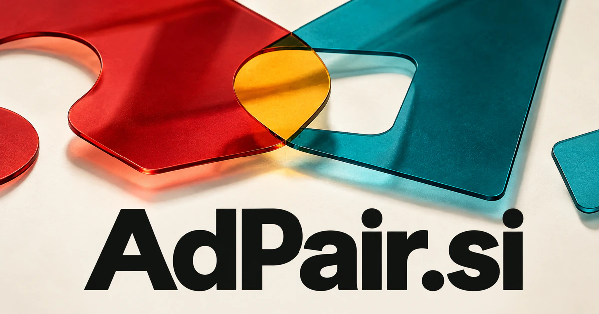

# AdPair.si — Find the right match for every message

AdPair.si joins advertisement with pair, making thoughtful matching its central idea. It could name an AI campaign workspace for agencies and brands: connect customer intent, creative evidence, creators and placements, then explain which combinations deserve a test. The same identity can support sponsorship services, collaboration marketplaces and a specialist advertising studio.

[Enquire about AdPair.si](mailto:hedge.pike02@icloud.com?subject=Domain%20enquiry%3A%20adpair.si)

## Meaning and naming depth

Ad is the familiar short form of advertisement; pair means to join or associate things that belong together. The compound makes matching its central action. An ad can be paired with an audience, a placement, a creator, a product, a landing page, or another creative variation.

That produces more depth than a generic campaign dashboard. The product can focus on fit: what was intended, why a combination was chosen, what evidence was collected, and what should be tried next. Advertising infrastructure has established standards for automated transactions, but a founder can choose a much more focused service without attempting to build an entire ad exchange.

## Business opportunities

### 1. Creative and audience matching

Agency strategists could use an AI research assistant to reconcile customer intent, creative evidence and channel context, then propose audience-message pairings with testable reasons. A workspace could keep creative, placement, and interpretation together. Sell subscriptions to agencies and brands that need clearer campaign learning across projects.

### 2. Creator partnerships

Compare a brief with creator portfolios, coordinate production specialists and prepare a collaboration plan with clear deliverables. Teams could review pitches, approve work, and track milestones. Sell marketplace services, campaign administration, and creator workspaces rather than relying only on a list of social profiles.

### 3. Newsletter and podcast sponsorships

Advertisers could compare suitable opportunities and prepare a shared brief. A publisher’s sponsorship desk could connect audience interests, editorial calendars and advertiser objectives, assembling a sponsorship brief that respects the publication's identity. Revenue could come from booking services, publisher tools, and managed sponsorship programs for a specific media community.

### 4. Landing-page alignment

Conversion teams could combine specialist agents to reason across ad copy, page content and customer questions, turning promise-to-page mismatches into prioritized revisions. The tool could identify missing information and prepare revision tasks. Sell campaign review software, creative services, and specialist optimization projects based on the customer’s actual materials.

### 5. Creative variation workspaces

A coordinated production desk could combine brand rules, past experiment evidence and channel specifications to plan meaningful creative variations instead of cosmetic permutations. Specialist agents could prepare candidate variations while teams choose the final assets. Sell production subscriptions, agency workspaces, and integration services for campaign operations.

### 6. Local advertising partnerships

A service could handle a clear brief, agreed placement, and shared reporting. A local campaign planner could map complementary merchants, neighborhood events and community interests into joint campaigns with practical scheduling and production tasks. Managed campaign fees and provider subscriptions would support a practical local-media business.

### 7. Brand collaboration discovery

A partnership assistant could examine product complements, audience overlap and operational constraints, shaping collaborations that work as businesses as well as creative concepts. The workspace could organize project scope, assets, approvals, and responsibilities. Sell introductions, collaboration tools, and managed production services for partnerships that need more than a contact exchange.

### 8. Advertising asset libraries

Brand librarians could use an AI research assistant to interpret an asset's purpose, usage context and performance history, retrieving reusable material with an explanation of fit. Teams could find an appropriate asset instead of starting again. Sell shared workspaces, catalog preparation, and maintained asset services to brands and agencies with recurring production needs.

### 9. Media planning education

Students could explain why they paired a particular message with a particular context. For marketing educators, an adaptive tutor could generate scenario-specific audiences and placement constraints, question a student's assumptions and adapt the next campaign exercise. Sell courses, workshops, classroom licenses, and professional training programs.

### 10. Specialist advertising studio

An agent-assisted advertising studio could connect research, strategy, copy and design specialists around one brief, delivering a coherent campaign and documented learning agenda. Clients could buy defined campaign packages or ongoing support. The compound provides a clear identity for a studio that may later develop software.

## A Super Intelligence brand

AdPair.si can frame Super Intelligence around contextual matching. A possible platform could analyze an approved brief, identify missing creative requirements, organize suitable production options, and prepare a test plan. The opportunity is coordinated campaign work with an intelligible rationale and a clear record of what the team learns.

## Why the name works

Six letters and two familiar components make the name compact and easy to explain. Pair gives the product an active, repeatable verb and supports a simple visual motif of two pieces coming together. **“Better fits. Stronger creative.”** works for software, services, and a curated marketplace.

## Related names, different directions

- [BuzzBoard.si](buzzboard-si.md) — Track conversations and emerging topics before deciding which message to pair with an audience.
- [CPQ.si](cpq-si.md) — Move from campaign interest to a configured solution and a considered commercial proposal.
- [MyReviews.si](myreviews-si.md) — Explore the customer feedback and reputation side of understanding an audience.

## Acquire AdPair.si

[Buy or make an offer on Dynadot](https://www.dynadot.com/market/user-listings/adpair.si), or email [hedge.pike02@icloud.com](mailto:hedge.pike02@icloud.com?subject=Domain%20enquiry%3A%20adpair.si) to discuss a direct purchase, a possible discount, or a portfolio bundle. The product directions above are ideas for a future owner.

[Purchase options](../guides/how-to-buy.md) · [Browse all domains](../README.md)

## Sources and further reading

- [Merriam-Webster: pair](https://www.merriam-webster.com/dictionary/pair) — The ordinary matching and association senses behind the compound.
- [IAB Tech Lab: OpenRTB](https://iabtechlab.com/standards/openrtb/) — A primary reference for standardized digital advertising transactions.
