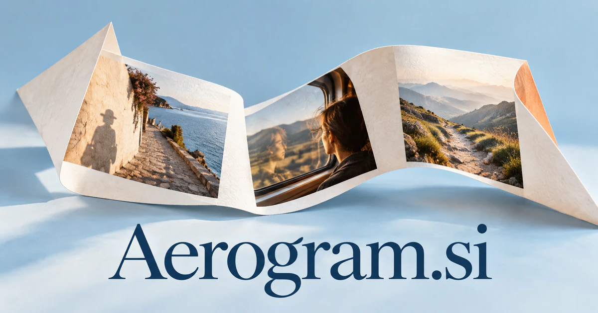

# Aerogram.si — Thoughtful dispatches across distance

Aerogram.si takes its name from a lightweight air-letter, giving communication a tangible story about messages traveling between places. It could suit a travel-journal service that connects a traveler’s memories with local context, or an aerial-reporting workspace for survey teams. Correspondence, destination publishing and guest keepsakes offer distinct ways to develop the same idea.

[Enquire about Aerogram.si](mailto:hedge.pike02@icloud.com?subject=Domain%20enquiry%3A%20aerogram.si)

## What the name opens up

An [aerogram](https://www.merriam-webster.com/dictionary/aerogram) is a lightweight air-letter sheet folded and sealed with the message inside and address outside. The word combines an air association with a written or recorded message. Its history provides a tangible story for modern communication: a considered dispatch sent across distance. A buyer could extend that story into travel journals, personal correspondence, aviation publishing, or information gathered from the air. Those latter directions are brand extensions, while the literal letter remains a useful creative anchor. The eight-letter form has more character than a generic messaging abbreviation.

## Business opportunities

### 1. Personal travel journals

Travelers could use an AI research assistant to connect photos, locations, journal fragments and personal interests, turning a journey into a chronological story with chosen themes. Users could edit the narrative and choose who sees it. Consumer subscriptions or printed keepsakes would give the historical air-letter association a tangible contemporary purpose.

### 2. Guest trip stories

Hospitality teams could offer an AI assistant that combines a guest's chosen highlights, local context and storytelling preferences into a personalized trip narrative. Guests could review personal material before production. Operator subscriptions or per-book fees would extend an existing travel experience through a considered keepsake.

### 3. Destination dispatches

Readers could follow destinations and revisit earlier editions. For destination editors, a research desk could compare local reporting, seasonal changes and reader interests, assembling sourced dispatches that reveal a place beyond generic attractions. Paid newsletters, books, or editorial memberships would make Aerogram a clear identity for thoughtful travel publishing.

### 4. Personal correspondence apps

A correspondence assistant could remember shared history, interpret the writer's intent and suggest a thoughtful letter structure while preserving the sender's voice. Recipients could keep a private archive. Consumer subscriptions or printed letter services would revive the dispatch idea through a modern, personal interface.

### 5. Aviation editorial products

Aviation publishers could use an AI research assistant to connect technical records, route changes and historical context, preparing explainable editorial briefs for different reader groups. Readers could follow subjects over time and collect research notes. Memberships, books, or specialist courses could build a focused content business around the air-related name.

### 6. Aerial survey reporting

Survey teams could combine specialist agents to relate aerial images to maps, site histories and inspection questions, preparing a report that distinguishes observations from interpretation. Project fees or professional subscriptions would use Aerogram as a brand for turning airborne observations into understandable deliverables.

### 7. Remote field dispatches

Field researchers could use an AI research assistant to organize intermittent dispatches, reconcile timestamps and locations, and identify which missing observations require a follow-up visit. Reports could preserve dates, locations, and contributor context. Organization subscriptions or commissioned publishing services would support a distinct professional communication workflow.

### 8. Digital postcard commerce

A personal postcard-design service could combine a traveler's chosen images, recipient interests and printing constraints into a personal design and fulfillment-ready order. Customers could choose a style and edit the message before sending. Product sales and designer collaborations would connect the historical letter association with a tangible service.

### 9. Language exchange letters

Topic prompts and teacher feedback could support sustained exchange. Language learners could practice correspondence through an adaptive dialogue system that understands the relationship, explains tone choices and adapts the next exchange to recurring language difficulties. School licenses or memberships would combine the educational value of language practice with the emotional appeal of receiving a message.

### 10. Hospitality memory services

A memory concierge could help hotels connect guest-approved photos, itinerary milestones and local stories into keepsakes that encourage a continuing relationship. Customers could purchase a digital or printed edition. Business subscriptions or per-keepsake revenue could make Aerogram part of a thoughtful hospitality experience.

## A Super Intelligence product vision

An Aerogram SI storyteller could organize a traveler's selected photographs, voice notes, routes, and observations into several possible narrative editions. The user might choose a private family letter, an illustrated journal, or a concise professional dispatch. Source items would remain available for editing, and the traveler would approve what is shared. Subscription journals, print keepsakes, or tour-operator licenses could fund an initial business. The intelligence opportunity is meaningful composition across distance: helping scattered moments become an understandable story that retains the person's own memories and perspective.

## Related names, different directions

- [FeiYu.si](feiyu-si.md) — Explore a more character-led identity for crossing boundaries between places, tools and ideas.
- [TravelBox.si](travelbox-si.md) — Bring the practical itinerary, travel services and trip organization into the foreground.
- [InWords.si](inwords-si.md) — Concentrate on turning remembered experiences or spoken thoughts into written expression.

## Acquire the domain

Contact [hedge.pike02@icloud.com](mailto:hedge.pike02@icloud.com?subject=Domain%20enquiry%3A%20aerogram.si) to discuss a direct-purchase discount, an offer, or a portfolio package.

[View the sales listing](https://www.dynadot.com/market/user-listings/aerogram.si) · [Purchase options and escrow](../guides/how-to-buy.md) · [Browse all domains](../README.md)

## Sources and further reading

- [Aerogram — Merriam-Webster](https://www.merriam-webster.com/dictionary/aerogram) — Established air-letter object and spelling variants.
