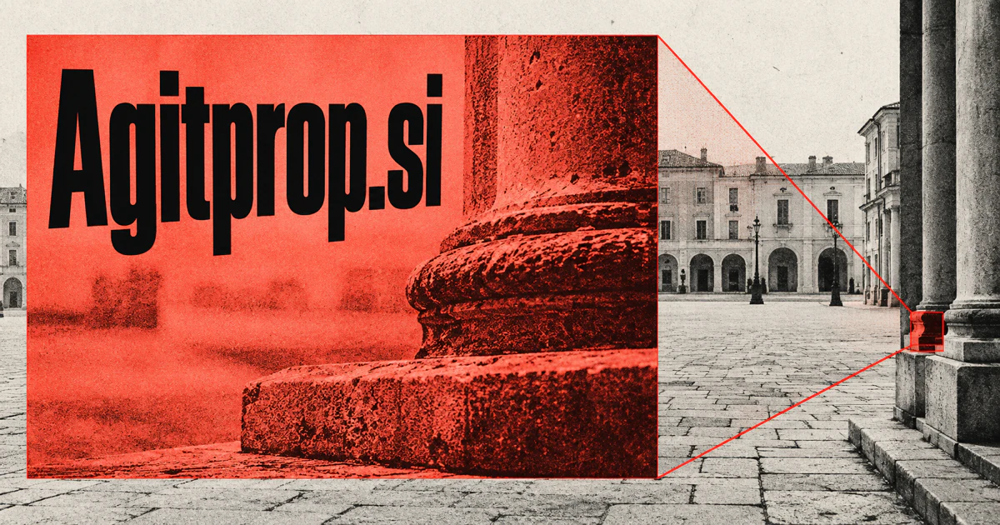

# Agitprop.si — Understand how messages persuade

Agitprop.si draws on a documented political and artistic term combining agitation with propaganda. Its strongest proposed product is an evidence-led workspace for researchers, educators and editors examining how narratives persuade: connect claims, imagery and historical context, then make the underlying techniques inspectable. Publishing, archives and experimental performance give the name an equally credible cultural life.

[Enquire about Agitprop.si](mailto:hedge.pike02@icloud.com?subject=Domain%20enquiry%3A%20agitprop.si)

## Meaning and naming depth

Agitprop combines the ideas of agitation and propaganda and is associated with political messaging expressed through literature, drama, music, and art. Its history gives it a sharper tone than generic words such as media or content. That can be valuable for a publication or creative practice that deliberately examines persuasion, representation, and power.

Its historical and artistic associations provide a clear intellectual center. A founder can choose to analyze persuasive culture, preserve its artifacts, teach media literacy, or make original work with a critical point of view. The same charged identity can support both rigorous research and expressive art.

## Business opportunities

### 1. Media literacy publication

A media literacy assistant could compare a message's claims, emotional devices and source context, helping readers understand how persuasion works rather than merely assigning a label. Readers could compare original examples and editorial analysis. Paid memberships, books, courses, and institutional subscriptions would support a publication whose value is interpretation rather than a constant stream of headlines.

### 2. Narrative research workspace

Research teams could use an AI research assistant to connect recurring metaphors, audience assumptions and publication histories, building evidence-linked accounts of how a narrative develops. Specialist agents could prepare summaries while preserving the original material. Sell newsroom workspaces, specialist research services, and tools for evidence-linked editorial analysis.

### 3. Digital poster and print archive

Designers, educators, and researchers could explore recurring visual forms. An archive research workspace could interpret imagery, slogans and historical metadata together, helping curators connect artifacts through documented themes and provenance. Revenue could come from institutional access, curated publications, and licensed print reproductions.

### 4. Experimental theatre collective

A theatre collective could explore an AI assistant that links archival voices, dramatic structure and production constraints, developing scenes that invite audiences to examine competing interpretations. A production company could sell tickets, touring work, workshops, and commissioned performances. The domain would provide a memorable home for the collective’s artistic point of view.

### 5. Critical design and film studio

Creative directors could use an AI research assistant to connect a cultural question with visual references, script alternatives and production choices, making a coherent critical design brief. Clients could commission cultural projects or explanatory media. The name suits a studio with a recognizable aesthetic, with production fees and original publications providing several revenue paths.

### 6. Classroom tools for rhetoric

Students could examine how the same event is framed in different materials. Rhetoric teachers could employ an AI assistant to adapt arguments to different classroom scenarios, surface hidden premises and guide students through evidence-based counterarguments. Sell course licenses, instructor resources, and workshops to schools, universities, and cultural institutions.

### 7. Information provenance notebook

A provenance workspace could connect a statement's appearances, cited documents and edits, producing an inspectable lineage that separates a source from later repetition. The product could organize verification tasks and source histories. Sell collaboration tools and training to organizations publishing evidence-sensitive material.

### 8. Cultural criticism journal

A cultural journal could use an AI research assistant to bring historical research, artistic form and contemporary context into editorial questions worthy of sustained criticism. A distinct editorial voice could attract readers interested in the relationship between aesthetics and persuasion. Memberships, events, anthologies, and commissioned research would broaden the business beyond display advertising.

### 9. Exhibitions and educational experiences

Museums could commission content or license installations. A museum assistant could coordinate collection research, visitor questions and spatial design, creating exhibition routes that make difficult historical material understandable. The name’s cultural resonance makes it suitable for traveling exhibitions, lectures, and accompanying educational products.

### 10. Creative collaboration platform

A creative collaboration workspace could connect writers, researchers and artists through shared references, clarify disagreements and turn a creative premise into a coordinated production. Specialist agents could help search a project’s references and assemble production notes. Sell studio workspaces, publishing tools, and curated collaborative programs.

## A Super Intelligence brand

Agitprop.si could position Super Intelligence as narrative analysis: connecting language, imagery, historical context, and source provenance to make communication easier to examine. One possible tool would trace recurring claims across a selected archive and show how their framing changes. The distinctive opportunity is interpretive depth, with a human editorial or scholarly perspective shaping the questions being asked.

## Why the name works

The word is vivid, culturally grounded, and difficult to confuse with a bland productivity brand. It suits a bold publication masthead, a film ident, or an exhibition title. **“Look closer at the message.”** connects the name’s edge to an intelligible audience benefit without requiring a narrowly political product.

## Related names, different directions

- [TruthCheck.si](truthcheck-si.md) — Focus on the support for a particular claim rather than the broader techniques of persuasion.
- [Gewiss.si](gewiss-si.md) — Explore an evidence-oriented brand for confidence in research and organizational knowledge.
- [TextArt.si](textart-si.md) — Develop the visual and expressive relationship between language, imagery and creative work.

## Acquire Agitprop.si

[Buy or make an offer on Dynadot](https://www.dynadot.com/market/user-listings/agitprop.si), or email [hedge.pike02@icloud.com](mailto:hedge.pike02@icloud.com?subject=Domain%20enquiry%3A%20agitprop.si) to discuss a direct purchase, a possible discount, or a portfolio bundle. The product directions above are ideas for a future owner.

[Purchase options](../guides/how-to-buy.md) · [Browse all domains](../README.md)

## Sources and further reading

- [Merriam-Webster: agitprop](https://www.merriam-webster.com/dictionary/agitprop) — Established meaning and associations with literary, dramatic, musical, and visual expression.
- [W3C: SKOS Reference](https://www.w3.org/TR/skos-reference/) — A technical foundation for organizing concepts and related archival material.
