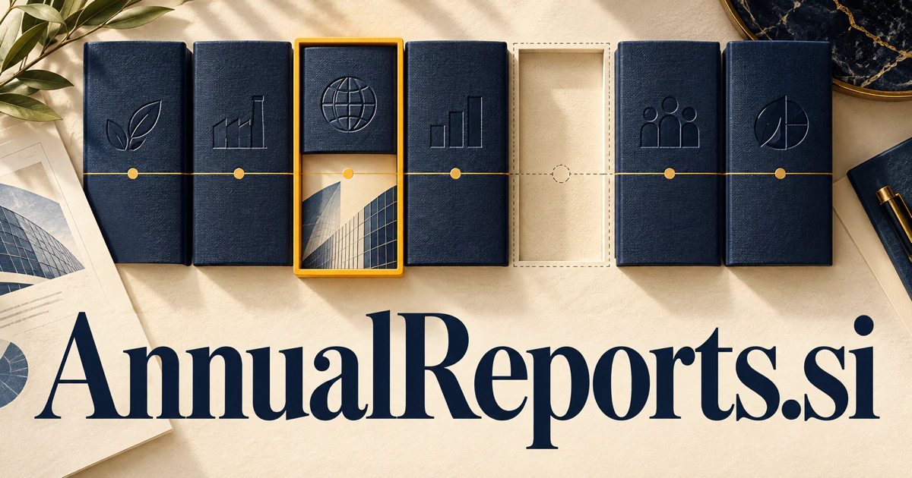

# AnnualReports.si — Read organizations across time

AnnualReports.si directly names a familiar body of organizational evidence: annual reviews of results, strategy, governance and activity. It could become a research workspace where analysts compare years, follow source passages and connect financial details with operating context. Report production, nonprofit impact communication and searchable document collections provide additional buyers and product directions.

[Enquire about AnnualReports.si](mailto:hedge.pike02@icloud.com?subject=Domain%20enquiry%3A%20annualreports.si)

## Meaning and naming depth

An annual report communicates information about an organization over a year. Public-company reporting is one major context, but charities, universities, associations, foundations, and private businesses also publish annual reviews. Different audiences want different things: financial statements, operating results, governance information, impact stories, or a clear explanation of strategy.

That breadth matters for the domain. It can describe the material being researched, the deliverable being produced, or a collection sold to readers. A strong product should preserve distinctions between source documents, extracted data, and interpretation. The name then supports a useful chain from document discovery to careful analysis and finished communication.

## Business opportunities

### 1. Searchable report library

An investor research workspace could connect company identities, reporting periods and document types, retrieving the relevant reports and explaining gaps in a research collection. Researchers could build collections and revisit earlier versions. Sell professional workspaces, institutional subscriptions, and specialist curation rather than merely hosting an undifferentiated pile of PDFs.

### 2. AI-assisted document research

Analysts could use an AI research assistant to reason across financial notes, strategy statements and governance disclosures, answering complex questions with passages that support each conclusion. An analyst could compare how a company described a topic over several years. Sell research subscriptions and team collections with annotation, export, and source-review tools.

### 3. Year-over-year change analysis

The product could prepare a review queue showing meaningful changes and their locations. A longitudinal assistant could reconcile terminology, changed business segments and accounting presentation, showing which year-to-year differences represent substantive operational change. Corporate researchers, consultants, and financial information teams could pay for monitored organizations and retained comparison histories.

### 4. Report preparation for smaller organizations

Small organizations could use an AI research assistant to assemble operational records, interview notes and audience needs into a report outline with clearly assigned evidence requests. Templates could adapt to each organization’s reporting needs. Sell annual software plans, editorial support, and finished-report packages that turn a recurring project into a manageable process.

### 5. Annual-report design studio

Connect a report's factual hierarchy with charts, narrative pacing and accessibility needs, producing a coherent communication system across formats. Clients could commission a full report or a specific production stage. The descriptive domain can support a premium creative practice with related services in data visualization and investor communication.

### 6. Impact and nonprofit storytelling

A team could collect evidence throughout the year instead of reconstructing it at publication time. A nonprofit assistant could link program activity, beneficiary-approved stories and outcome evidence, helping teams explain impact without confusing anecdotes with measured results. Sell reporting workspaces, editorial workshops, and production services tailored to mission-driven organizations.

### 7. Structured data extraction

A contextual extraction service could interpret tables alongside explanatory notes and units, flag ambiguous mappings and prepare reviewable structured records for downstream analysis. Data buyers could inspect extraction rules and review exceptions. Sell APIs, licensed collections, or extraction projects for customers who need repeatable access to specific information.

### 8. Reporting project management

Reporting teams could combine specialist agents to map dependencies among finance, legal, design and leadership, resolve missing inputs and coordinate an achievable publication sequence. A communications lead could see what remains unresolved before release. Team subscriptions and agency workspaces would serve a process distinct from the final report’s design or analysis.

### 9. Education in organizational reporting

Courses could use annotated examples and practical exercises. An adaptive reporting tutor could adapt real reporting examples to a learner's level, explain organizational tradeoffs and test whether a conclusion follows from the evidence. Sell classroom resources, professional training, and specialist learning memberships.

### 10. Monitored intelligence service

A monitoring assistant could connect newly published reports with a customer's research thesis, isolate material changes and prepare a briefing tailored to pending decisions. Each brief could separate reported facts from analytical observations. Sell recurring research services, organization watchlists, and commissioned deep dives to strategy and procurement teams.

## A Super Intelligence brand

AnnualReports.si can frame Super Intelligence around institutional memory: understand a large body of yearly communication, connect comparable evidence, and explain what changed. A potential platform could combine document retrieval, table extraction, time-series comparison, and a sourced writing workspace. The opportunity is a useful research and reporting environment that keeps important questions connected to their evidence.

## Why the name works

The exact plural phrase is clear to both document producers and readers. It suits a library, a specialist service, and a software platform without needing an invented explanation. **“A clearer view of the year.”** offers a broad brand line, while AnnualReports Research, Studio, and Workspace can distinguish different customer journeys.

## Related names, different directions

- [Readouts.si](readouts-si.md) — Explore a shorter identity for the outputs and results produced by analysis or measurement.
- [DataFeeds.si](datafeeds-si.md) — Extend periodic document research into continuously updated external information.
- [Gewiss.si](gewiss-si.md) — Emphasize the evidence and reasoning behind an organizational conclusion.

## Acquire AnnualReports.si

[Buy or make an offer on Dynadot](https://www.dynadot.com/market/user-listings/annualreports.si), or email [hedge.pike02@icloud.com](mailto:hedge.pike02@icloud.com?subject=Domain%20enquiry%3A%20annualreports.si) to discuss a direct purchase, a possible discount, or a portfolio bundle. The product directions above are ideas for a future owner.

[Purchase options](../guides/how-to-buy.md) · [Browse all domains](../README.md)

## Sources and further reading

- [Investor.gov: Annual Report](https://www.investor.gov/introduction-investing/investing-basics/glossary/annual-report) — A primary investor-education explanation of annual corporate reports.
- [SEC: EDGAR APIs](https://www.sec.gov/search-filings/edgar-application-programming-interfaces) — Official access context for company filings and structured public-company data.
