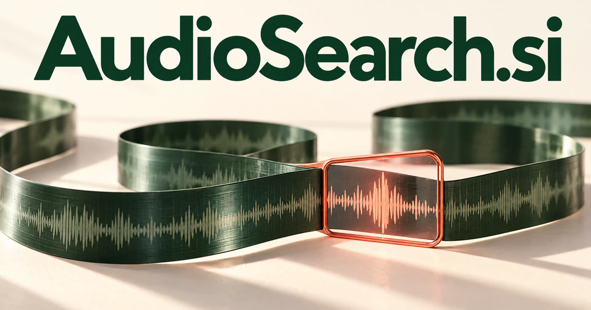

# AudioSearch.si — Find the sound that answers the question

AudioSearch.si is a descriptive compound for AI audio search: finding spoken evidence, recognizing an acoustic quality or discovering material that fits a creative brief. Researchers, editors and technical teams could use it to connect recordings with questions and context. Podcast discovery, sound libraries and maintenance archives each support a focused first product.

[Enquire about AudioSearch.si](mailto:hedge.pike02@icloud.com?subject=Domain%20enquiry%3A%20audiosearch.si)

## Meaning and naming depth

Audio is broader than speech. It includes music, environmental sounds, machine noise, effects, and recorded conversations. Search is broader than exact keyword matching: a person may remember a phrase, describe a topic, imitate a sound, or ask for material that resembles a reference.

These lead to different technical products. Transcript search locates words produced by speech recognition. Semantic transcript search retrieves passages related to a concept. Direct audio-language representations can connect descriptions with audio features without depending entirely on a transcript. The name is valuable because it accommodates all three while keeping the user’s goal immediately understandable.

## Business opportunities

### 1. Podcast moment discovery

Podcast researchers could use an AI research assistant to connect a question with spoken arguments, speaker context and related episodes, returning useful moments with evidence for their relevance. Results could open at a useful timestamp and preserve links to the original recording. Sell creator tools, publisher workspaces, and listener subscriptions for curated or customer-owned collections.

### 2. Meeting and interview archives

Reason across meeting history, interview themes and project documents, finding the conversation that explains a decision and its remaining dependencies. Researchers could find an earlier explanation without replaying an entire interview. Sell team workspaces, searchable storage, and professional transcription-review features.

### 3. Sound-effect discovery

A sound-selection assistant could interpret a scene's emotional purpose, timing and acoustic qualities, finding effects that fit the production rather than matching filenames alone. An editor could ask for a restrained metallic impact that fits a particular scene, then compare candidates with their surrounding audio. Sell library subscriptions, project organization tools, or discovery infrastructure to sound publishers.

### 4. Music catalog exploration

A music discovery service could connect mood, instrumentation, musical structure and a listener's brief, assembling explainable catalog selections for a specific creative use. The product could organize candidate tracks and rights information for review. Revenue could come from professional workspaces, publisher tools, and licensing services appropriate to the catalog.

### 5. Research in oral histories

Historians could use an AI research assistant to connect remembered events, named places and contrasting oral accounts, organizing research trails while preserving the voices and context of participants. Libraries and research institutes could manage collections and permissions. Sell institutional licenses, digitization support, and curated research services built around the recordings themselves.

### 6. Customer-service conversation analysis

Staff could review examples and connect them to training material or process improvements. Service teams could combine specialist agents to relate conversations to product history, customer outcomes and escalation patterns, identifying concrete improvements to support workflows. Sell workspaces by team, supported recording volume, and configured analytical workflows.

### 7. Searchable technical maintenance audio

A maintenance assistant could relate machine recordings to operating conditions, technician notes and prior inspections, helping engineers decide which equipment requires closer investigation. Engineers could compare a new recording with relevant historical examples. Sell specialist data workspaces and analysis tools to maintenance organizations, without assuming sound alone establishes a diagnosis.

### 8. Language learning from real recordings

Connect real speech segments with a learner's interests, comprehension gaps and pronunciation practice, building contextual listening exercises. Teachers could build exercises from approved materials and link explanations to exact moments. Sell learning subscriptions, classroom workspaces, and specialist collections for particular professional or academic subjects.

### 9. Developer audio retrieval API

Developers could choose whether to search transcripts, acoustic features, or both. A retrieval service for developers could combine transcript retrieval, acoustic similarity and task intent behind one interface, returning inspectable results suited to the consuming application's workflow. Usage plans, private deployment, and integration support would serve the infrastructure market.

### 10. Journalistic and documentary research

A documentary assistant could cross-reference interviews, archive clips and research notes, helping editors locate relevant testimony and distinguish corroborated material from unresolved claims. The output could include candidate clips and source references. Sell production workspaces, research services, and archive preparation for long-form storytelling projects.

## A Super Intelligence brand

AudioSearch.si can position Super Intelligence around understanding information that is heard rather than read. A possible system could connect spoken content, acoustic events, speaker context, and relevant documents in one investigation. The user’s question might be “Where did we discuss this?” or “Which recording sounds like this?” The name makes that broad capability accessible through a very concrete verb.

## Why the name works

The compound is immediately descriptive and broad enough for speech, music, effects, and environmental sound. It fits a consumer search interface and a technical API. **“Find what matters in what you hear.”** captures the shared benefit, while AudioSearch Studio, Archive, and API offer natural product divisions.

## Related names, different directions

- [AudioX.si](audiox-si.md) — Move from finding a recording to editing, transforming and producing the resulting audio.
- [SoundX.si](soundx-si.md) — Explore a broader experimental sound identity without committing the brand to retrieval.
- [TextReader.si](textreader-si.md) — Focus on written material becoming a listening or reading experience.

## Acquire AudioSearch.si

[Buy or make an offer on Dynadot](https://www.dynadot.com/market/user-listings/audiosearch.si), or email [hedge.pike02@icloud.com](mailto:hedge.pike02@icloud.com?subject=Domain%20enquiry%3A%20audiosearch.si) to discuss a direct purchase, a possible discount, or a portfolio bundle. The product directions above are ideas for a future owner.

[Purchase options](../guides/how-to-buy.md) · [Browse all domains](../README.md)

## Sources and further reading

- [Speech-to-text time offsets](https://docs.cloud.google.com/speech-to-text/docs/v1/async-time-offsets) — Official guidance for connecting recognized words to recording timestamps.
- [Contrastive Language–Audio Pretraining](https://github.com/LAION-AI/CLAP) — A primary project demonstrating shared audio-language representations.
