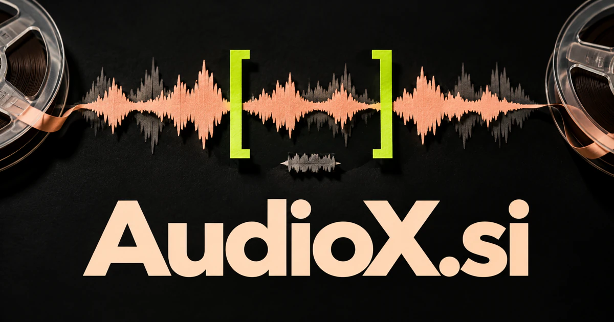

# AudioX.si — A flexible workspace for sound

AudioX.si combines a clear medium with an open-ended brand symbol: X can suggest transformation, exchange or experimentation as a chosen positioning. Its strongest software direction is a production workspace coordinating speech editing, localization and sound processing for creators. Restoration, datasets, equipment guidance and developer interfaces let the same identity expand into specialist audio work.

[Enquire about AudioX.si](mailto:hedge.pike02@icloud.com?subject=Domain%20enquiry%3A%20audiox.si)

## What the name opens up

Audio identifies the medium immediately. X can be a deliberately chosen symbol for experimentation, exchange, transformation, or an unknown sound to discover; each is a proposed brand reading. The compound therefore balances category clarity with room to explore. A buyer could focus on speech production, music, restoration, datasets, spatial experiences, or developer infrastructure. AudioX leaves room for an evolving toolset and several output formats. The [Web Audio API](https://developer.mozilla.org/en-US/docs/Web/API/Web_Audio_API) is one real technical foundation for browser audio processing, separate from any proposed intelligent features.

## Business opportunities

### 1. Spoken audio editing

Podcast editors could use an AI research assistant to connect narrative intent, spoken meaning and production rules, proposing cuts and transitions that preserve the argument and speaker's voice. Producers could listen to the exact change before approval. Creator subscriptions or studio seats would connect everyday audio tasks with a coherent production record.

### 2. Localization production

Coordinate translation, pronunciation, timing and performance specialists, adapting a recording to a new audience while retaining the original message's purpose. A producer could see which edition needs attention after a change. Project workspaces or studio subscriptions would serve the coordination behind maintaining several language versions of the same content.

### 3. Audio processing API

Customers could test sample inputs and inspect outputs. An audio an AI assistant API could interpret the requested outcome, choose suitable processing tools and return an auditable transformation plan alongside the resulting sound. Metered usage or enterprise licenses would position AudioX as a practical service inside larger applications.

### 4. Archive restoration workspaces

An archive workspace could compare damaged passages, recording context and restoration alternatives, helping conservators improve intelligibility without silently inventing historical detail. Project licenses or specialist services could serve spoken archives, performances, and oral histories. The valuable outcome is a usable, documented edition.

### 5. Music stem organization

Reason across stems, arrangement goals and mixing references, organizing tracks and proposing alternatives that serve the musician's intended composition. Teams could track which recording belongs to which version. Workspace subscriptions could reduce production confusion while leaving creative decisions with the people making the music.

### 6. Audio dataset preparation

Project-based processing or enterprise licenses could support a technical business. A dataset workspace could connect recording metadata, speaker coverage and task requirements, detecting gaps and preparing a review plan before material enters a training pipeline. The X can stand for transformation from raw recordings into organized, usable material.

### 7. Voice experience prototypes

A voice interaction studio could coordinate dialogue design, user context and failure recovery, letting teams rehearse complete spoken interactions before committing to a production experience. Clients could review several versions and leave time-specific notes. Team subscriptions or a prototyping studio could connect audio craft with product design.

### 8. Equipment comparison tools

Reconcile room acoustics, recording purpose, existing hardware and user constraints, explaining which microphone or setup best fits the actual job. Each sample could retain its conditions and chain of equipment. Paid professional collections, education licenses, or a specialist commerce business could help buyers understand actual recorded differences.

### 9. Live production preparation

A production workspace could make last-minute changes visible to everyone involved. A live-production planning desk could connect a running order, venue constraints and crew responsibilities, preparing cues and contingencies that keep a performance's sound work coordinated. Per-event licenses or agency subscriptions would attach AudioX to a concrete operational need.

### 10. Personal sound collections

A personal audio curator could connect a user's recordings, places and memories, organizing a meaningful sound collection with contextual discovery rather than another undifferentiated folder. Collections could be tagged, annotated, and turned into small audio stories. A consumer subscription or creator edition would broaden the brand beyond professional editing.

## A Super Intelligence product vision

An AudioX SI studio could follow an audio brief from recorded source to reviewed deliverables. A speech agent might prepare edits, a production agent organize alternate language versions, and a quality agent flag clipping, unexpected silence, or inconsistent exports. Producers would compare the actual audio before approving it. An initial subscription could serve spoken-content teams, with metered processing for heavy jobs. The larger opportunity is coordinated audio production: understanding the purpose of a recording and arranging several tools around it with listening and creative judgment built into the workflow.

## Related names, different directions

- [AudioSearch.si](audiosearch-si.md) — Discover the right passage, recording or acoustic reference before production begins.
- [DrumLoop.si](drumloop-si.md) — Choose a focused musical identity around groove, repetition and rhythm creation.
- [Etudes.si](etudes-si.md) — Emphasize deliberate practice, expressive studies and the development of musical understanding.

## Acquire the domain

Contact [hedge.pike02@icloud.com](mailto:hedge.pike02@icloud.com?subject=Domain%20enquiry%3A%20audiox.si) to discuss a direct-purchase discount, an offer, or a portfolio package.

[View the sales listing](https://www.dynadot.com/market/user-listings/audiox.si) · [Purchase options and escrow](../guides/how-to-buy.md) · [Browse all domains](../README.md)

## Sources and further reading

- [Web Audio API — MDN](https://developer.mozilla.org/en-US/docs/Web/API/Web_Audio_API) — Browser audio-processing background for proposed tools.
