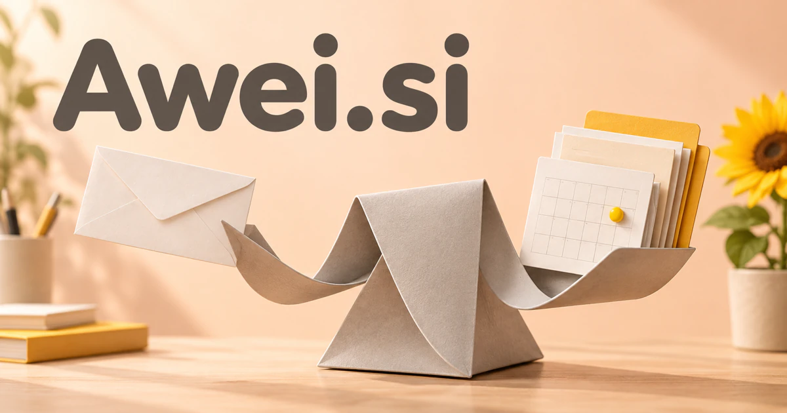

# Awei.si — A capable companion with a familiar voice

Awei.si has the sound of a personal name and several deliberately selectable brand readings. A Mandarin name such as 阿伟 is one possible interpretation; the unmarked spelling does not determine characters or tones. It could become a friendly assistant for personal administration or team coordination, connecting everyday questions with company knowledge, useful tools and practical follow-through.

[Enquire about Awei.si](mailto:hedge.pike02@icloud.com?subject=Domain%20enquiry%3A%20awei.si)

## Meaning and naming depth

Awei offers an open naming canvas with the sound of a personal name. In a Mandarin context, 阿伟 / 阿偉 is one possible name-like spelling; 阿 can prefix familiar personal names, while the characters and tones for the complete name would be chosen deliberately. A visual split into A + We + I could also tell a creative story about individual and collective capability.

The letters also allow explicit creative expansions. **Adaptive Workflow and Enterprise Intelligence** could position a business platform; **Assisted Work, Education, and Ideas** could suit a personal companion. Those are proposed brand stories, not established abbreviations. The useful common thread is an identity that can be friendly at the front end and technically capable underneath.

## Business opportunities

### 1. Everyday administrative companion

An administrative an AI assistant companion could connect messages, documents and personal priorities, identify the next useful action and prepare the information needed to complete it. Awei could feel like the name of the assistant itself. Paid individual plans could expand into shared workspaces for bookkeepers, assistants, and small professional practices.

### 2. Enterprise workflow intelligence

Link task history, business rules and specialist tools, resolve workflow exceptions and coordinate handoffs between departments with a shared explanation. A customer onboarding request might trigger document collection, account preparation, and staff introductions. Software subscriptions could sit alongside configuration services sold by implementation partners familiar with a particular industry.

### 3. Language and communication partner

Different personalities and lesson tracks could serve school learners, travelers, and professionals. A communication assistant could combine relationship context, language needs and the speaker's intent, preparing messages and practice exchanges that fit the actual situation. The human-sounding name fits a product people address directly rather than merely operate.

### 4. Family organization and household coordination

A household assistant could connect family schedules, recurring responsibilities and shared preferences, negotiate practical plans and make the reasoning visible to everyone involved. A voice interface could turn a spoken request into a task for the right person. Family subscriptions could support integrations with calendars, appliances, and home service providers.

### 5. Training guide for new employees

Relate a new employee's role, current assignment and company knowledge, guiding them through real work instead of presenting a fixed orientation sequence. Employers could provide their own materials and assign learning paths. Awei becomes the welcoming guide that explains how the organization works, with licensing priced by team or active learner.

### 6. Character platform for children’s learning

The business could sell educational subscriptions, books, printable activities, and character merchandise. An adaptive learning character could connect a child's questions, story interests and demonstrated understanding, adapting a friendly character's next challenge around meaningful exploration. A flexible name leaves room for multiple ages and subjects without rebranding.

### 7. Customer onboarding for service businesses

A customer onboarding service could interpret a new customer's goals, required documents and service dependencies, preparing a personalized onboarding path and coordinated staff tasks. A branded client portal can make a complex engagement feel conversational. Charge firms by active client workspace, with premium templates for specific service types.

### 8. Connected-device interface

Relate spoken intentions to household context and available capabilities, coordinating compatible devices around a useful outcome rather than isolated commands. Customers could personalize routines, review device events, and ask for contextual help. Device sales and an optional software membership could support the same recognizable identity.

### 9. Knowledge capture for small teams

Small organizations often need something lighter than a large enterprise knowledge system. A team knowledge workspace could connect decisions, practical examples and expert explanations, turning everyday work into a searchable account of how the organization operates. Awei could sell simplicity: shared understanding that new colleagues can actually find.

### 10. Creative tools and stationery brand

A creative assistant could link sketches, written intentions and physical stationery formats, helping customers turn scattered ideas into a tangible project or organized personal practice. Specialist agents could help customers turn rough thoughts into structured projects, while physical products create a tangible brand presence. The name is sufficiently open for a studio, shop, and application to coexist.

## A Super Intelligence brand

Awei.si could make Super Intelligence approachable through an assistant with memory, context, and useful tools. The opportunity is to make sophisticated capability feel like one consistent relationship: the same companion can help prepare a lesson, organize a project, or explain a document. A founder could begin with one carefully designed audience and later add specialist skills without changing the core identity.

## Why the name works

Four letters reduce visual clutter in a logo, a product badge, and a spoken introduction. Awei can extend across chat, coding, learning, and connected services. **“A little help. A wider possibility.”** would support a warm consumer identity, while a more restrained design could suit enterprise software.

## Related names, different directions

- [BYO.si](byo-si.md) — Explore a more explicit promise of customer-controlled assistants and private knowledge.
- [ChatWeb.si](chatweb-si.md) — Focus the companion on conversational access to websites and connected online tasks.
- [Cues.si](cues-si.md) — Build around the timing and context of a helpful intervention rather than a named character.

## Acquire Awei.si

[Buy or make an offer on Dynadot](https://www.dynadot.com/market/user-listings/awei.si), or email [hedge.pike02@icloud.com](mailto:hedge.pike02@icloud.com?subject=Domain%20enquiry%3A%20awei.si) to discuss a direct purchase, a possible discount, or a portfolio bundle. The product directions above are ideas for a future owner.

[Purchase options](../guides/how-to-buy.md) · [Browse all domains](../README.md)

## Sources and further reading

- [OMG: Business Process Model and Notation](https://www.omg.org/spec/BPMN/2.0.2/About-BPMN) — A formal foundation for the workflow concepts explored here.
- [Han Dian: 阿](https://zdic.net/hans/%E9%98%BF) — The character’s use as a prefix with personal names; the full name-like spelling is a proposed naming choice.
