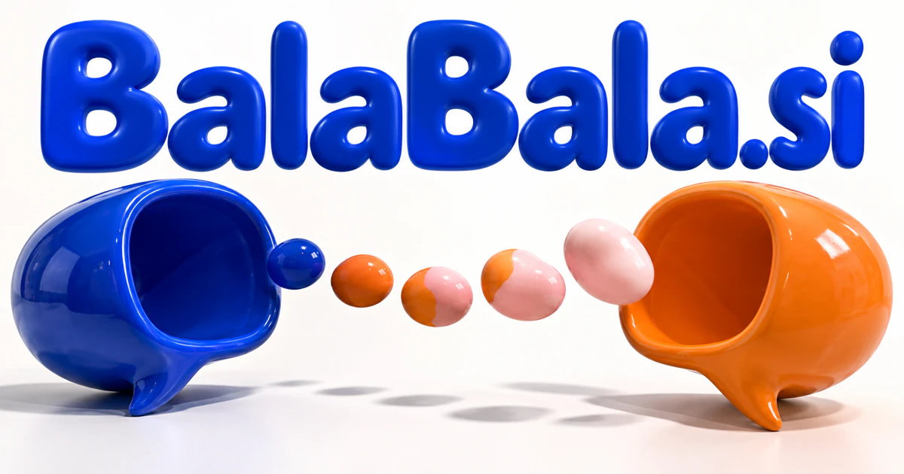

# BalaBala.si — Where conversation becomes understanding

BalaBala.si is a rhythmic repeated-sound brand form, rather than an acronym with one fixed expansion. Its conversational character could suit a language-practice companion that remembers a learner’s interests and adapts the exchange. Meetings, family stories, discussion communities and voice games offer additional products where listening, interpretation and participation matter as much as generating speech.

[Enquire about BalaBala.si](mailto:hedge.pike02@icloud.com?subject=Domain%20enquiry%3A%20balabala.si)

## What the name opens up

Balabala is a repeated-sound brand form. Its rhythm suggests animated speech and an ongoing exchange. Repetition gives it a chant-like quality that can work in conversation, audio, storytelling, and social experiences. A buyer could lean into playful chatter or make it the place where talk becomes understanding. Technical possibilities involving generated speech can draw on real capabilities such as the browser's [speech synthesis interface](https://developer.mozilla.org/en-US/docs/Web/API/SpeechSynthesis).

## Business opportunities

### 1. Conversation practice

A conversation-practice partner could connect a learner's goals, vocabulary gaps and real conversational turns, adapting the dialogue to keep practice challenging and socially meaningful. Tutors could adjust the scenario and review progress. School subscriptions or individual memberships would connect playful conversation with a concrete speaking goal.

### 2. Meeting follow-through

Reconcile competing interpretations, decisions and commitments, turning a discussion into assigned next steps while exposing questions the group has not resolved. Participants could correct the wording beside the original passage. Team subscriptions would support useful follow-through while preserving the conversational context behind an action item.

### 3. Audio journals

Users could choose whether to keep an entry as audio, edit a transcript, or prepare a short written reflection. A journal assistant could connect spoken reflections across time, notice recurring themes and help the writer shape a private narrative or practical follow-up intention. Consumer subscriptions and optional printed journals would support a more expressive personal archive.

### 4. Interactive storytelling

A storytelling assistant could coordinate character memory, plot logic and a participant's choices, sustaining a narrative that responds to what the listener actually contributes. Authors could sell episodic worlds and character collections. A family or creator subscription could support a warm, conversational entertainment brand with a recognizable spoken identity.

### 5. Podcast discussion clubs

Link an episode's arguments with members' questions, prepare informed prompts and help participants compare evidence instead of repeating summaries. Publishers could sell community access or bonus discussions. The product could connect long audio experiences with an ongoing conversation with the people creating the work.

### 6. Children's speaking games

Teachers and families could choose age-appropriate prompts and review progress through actual recordings. A speaking-practice companion could combine imaginative characters, a child's chosen topics and gradual language challenges, making playful conversation a route to clearer self-expression. Sell activity packs or educator subscriptions, with the playful sound supporting a friendly character-led design.

### 7. Brainstorming facilitation

A facilitation assistant could connect different participants' ideas, uncover complementary proposals and test assumptions, helping a group turn animated talk into an actionable concept. Facilitators could preserve minority ideas alongside popular ones. Agency licenses and session packages could turn energetic chatter into a useful creative service.

### 8. Language exchange communities

Match learning goals, interests and communication preferences, then support conversations with contextual explanations and useful reflection after each exchange. Topic cards, session notes, and partner feedback could help strangers sustain a useful exchange. Memberships or school editions could combine social motivation with a clearer reason to return for another conversation.

### 9. Voice-based party games

Hosts could choose a format and invite participants without complicated setup. A party game assistant could interpret a group's preferences, shared references and evolving game state, generating spoken challenges that invite participation across different confidence levels. Paid game packs, venue editions, or consumer subscriptions could give the domain a distinct entertainment business.

### 10. Customer dialogue studies

A customer research workspace could connect dialogue themes with journey stages and product decisions, translating qualitative evidence into specific questions for a business to investigate. Research agencies could subscribe to reusable guides and a source-linked transcript workspace. Balabala could make the conversational research method part of the brand.

## A Super Intelligence product vision

An SI vision for Balabala could turn a conversation into several useful perspectives: what was said, what participants meant, where they disagreed, and what should happen next. A learner could practice a negotiation with character agents, replay a difficult moment, and try another response. A facilitator could use the same interaction model for a workshop. The product would earn its intelligence story through responsive dialogue and understandable feedback, while participants retain control over recordings, generated summaries, and the actions taken outside the session.

## Related names, different directions

- [Charades.si](charades-si.md) — Explore expression and shared play through movement, gesture and acted scenes.
- [HearMe.si](hearme-si.md) — Make being listened to and communicating clearly the central brand promise.
- [TextReader.si](textreader-si.md) — Connect conversation with written material, listening and guided comprehension.

## Acquire the domain

Contact [hedge.pike02@icloud.com](mailto:hedge.pike02@icloud.com?subject=Domain%20enquiry%3A%20balabala.si) to discuss a direct-purchase discount, an offer, or a portfolio package.

[View the sales listing](https://www.dynadot.com/market/user-listings/balabala.si) · [Purchase options and escrow](../guides/how-to-buy.md) · [Browse all domains](../README.md)

## Sources and further reading

- [SpeechSynthesis — MDN](https://developer.mozilla.org/en-US/docs/Web/API/SpeechSynthesis) — Browser speech-output reference for the proposed speaking experiences.
