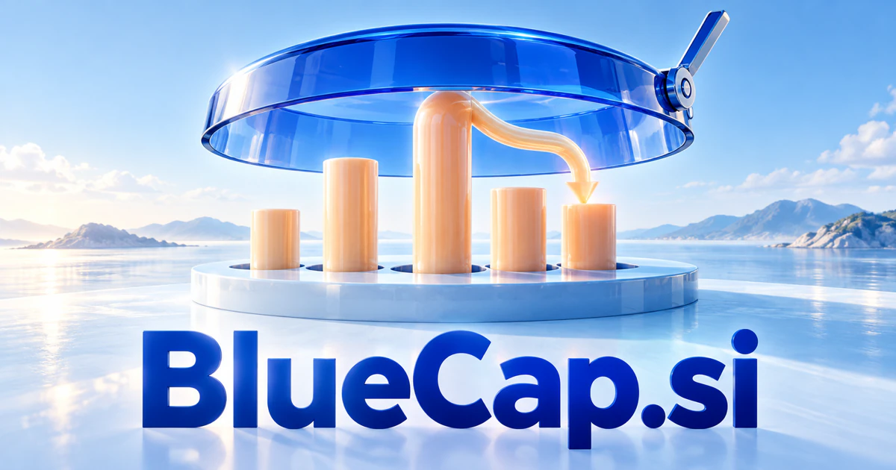

# BlueCap.si — Keep the overview as possibilities expand

BlueCap.si combines an immediately recognizable color with a word that can mean headwear, a cover, a limit or capitalization. Those real meanings support a proposed control workspace for teams managing agents, cloud resources and operating responsibilities. A blue-capped assistant character, nature discovery, water services and physical product design offer different routes beyond enterprise software.

[Enquire about BlueCap.si](mailto:hedge.pike02@icloud.com?subject=Domain%20enquiry%3A%20bluecap.si)

## Meaning and naming depth

**Blue + cap** is a transparent compound of two familiar words. A cap can be headwear, a cover, or an upper limit; in financial language, cap also abbreviates capitalization. Those meanings are documented by [Cambridge](https://dictionary.cambridge.org/us/dictionary/english/cap). Blue supplies an immediate color identity and can be used creatively to evoke sky, water, or an ocean-oriented business.

There is additional lexical depth: [Merriam-Webster's bluecap entry](https://www.merriam-webster.com/dictionary/bluecap) includes headwear, bird, and flower senses. That gives nature and character design a genuine language foundation. The enterprise readings below develop the ordinary meanings of cap into proposed products; they do not depend on claiming that BlueCap is an established technical term.

The most useful brand tension is **expansive possibilities with a clear boundary**. AI can explore, plan, and coordinate, while the cap represents a visible scope, budget, or responsibility. Equally, a consumer brand can use the cap as a simple character cue rather than a technical metaphor.

## Business opportunities

### 1. AI usage and spending oversight

An AI operations analyst could connect model usage, task value and departmental priorities, reasoning about spending boundaries before proposing a more efficient allocation of capability. A workspace could group costs, forecast consumption, and route spending changes for approval. Per-team subscriptions and enterprise deployments would serve organizations that want to connect AI experimentation with clear commercial accountability.

### 2. Control center for autonomous agents

Relate an intended task to permissions, dependencies and execution history, coordinating specialists within an understandable scope of responsibility. Operators could inspect runs, compare outcomes, and amend permissions before another execution. Usage plans or private deployments would place BlueCap at the boundary between powerful tools and accountable operations.

### 3. Cloud budget coordination

Cloud providers already document threshold-triggered budget actions, including approval-based execution; a proposed product could organize that operational process across teams. A cloud planning workspace could reconcile workload needs, architecture and resource commitments, preparing a cost plan that explains service tradeoffs and identifies avoidable operational waste. Subscriptions and implementation services would suit finance and platform engineering users.

### 4. Security investigation assistance

A security assistant could connect alerts, identity events and system context, assemble competing explanations and guide an investigator toward the most informative next check. A recognizable assistant could help analysts navigate evidence and prepare a handover. Enterprise licenses and managed analyst workspaces would sell investigation clarity while retaining the team's authority over consequential actions.

### 5. Digital field supervisor

Combine site observations, work orders and crew capabilities, helping supervisors sequence jobs and react coherently to changing conditions. The cap becomes a character cue for a practical assistant that follows the job. Per-site subscriptions, contractor licenses, and reporting services could connect field information with office coordination.

### 6. Industrial protective-equipment management

An assistant could prepare reminders and summarize gaps for a supervisor. An equipment assistant could relate workplace tasks, inspection records and product specifications, coordinating fit, replenishment and maintenance requirements for protective-equipment programs. Facility subscriptions and distributor partnerships would serve operational buyers, with the cap providing a direct visual connection to equipment and everyday work.

### 7. Ocean and water operations

A water operations assistant could connect sensor trends, maintenance history and geographic context, preparing investigation routes and coordinated responses for utility or marine teams. Teams could combine observations, equipment records, schedules, and local conditions into useful planning briefs. Specialist software licenses and monitoring services could create a focused business under a name with a strong blue identity.

### 8. Nature discovery and biodiversity records

Combine sightings, imagery and habitat context, helping observers explore plausible identifications and organize records for expert review. Photograph collections, location notes, and expert review could help people organize observations. Memberships, educational licensing, and institutional workspaces would suit a carefully curated nature brand.

### 9. Visual personal assistant character

It could organize everyday requests, prepare documents, and coordinate approved tasks. A personal assistant could use a recognizable blue-cap character to connect commitments, preferences and task context, offering a consistent companion across several practical tools. Consumer subscriptions and licensed character experiences offer room to develop both software utility and a recognizable personality.

### 10. Headwear and customizable merchandise

A merchandise assistant could interpret an event's identity, wearer preferences and production constraints, turning customization ideas into coherent headwear collections and fulfillment briefs. Buyers could preview embroidery, compare colorways, and organize group orders. Product margins, customization fees, and a business-ordering platform would turn the literal meaning into a commercially direct opportunity.

### 11. Packaging and closure design

Connect closure requirements, material options and customer handling needs, helping design teams reason through prototypes before preparing supplier specifications. A workspace could compare dimensions, materials, supplier documents, and prototype feedback. Supplier subscriptions or commissioned design services could address packaging teams, with cap referring to a concrete component rather than an abstract brand story.

### 12. Company and portfolio research

Users could compare source documents and create reusable research briefs. A research workspace could connect company disclosures, strategic changes and portfolio questions, producing evidence-linked comparisons that explain how a business fits an investment thesis. Professional subscriptions and institutional licenses could support research workflows without making investment outcomes the brand promise.

## A Super Intelligence product story

BlueCap.si offers a coherent Super Intelligence narrative: **wide capability, understandable oversight**. A business could ask an AI team to investigate rising operating costs. Agents gather authorized records, compare explanations, prepare options, and present proposed actions alongside their budgets and owners. A person can review the reasoning and authorize the next step.

The cap is useful because it makes the product story concrete. It can represent a spending boundary, an agreed task scope, or a supervisor's role. The brand can therefore grow from a single cost tool into an orchestration workspace while keeping a consistent visual and verbal identity.

## Why the name works

BlueCap has seven letters, two clear syllables, and an image a buyer can immediately picture. It accommodates a compact icon, a character, or a restrained enterprise wordmark. BlueCap Control, BlueCap Field, and BlueCap Ocean demonstrate plausible extensions. **“Explore further. Keep the overview.”** connects ambitious intelligence with a useful operational purpose.

## Related names, different directions

- [CloudGateway.si](cloudgateway-si.md) — Focus on how models, tools and cloud services connect and how requests move between them.
- [BotID.si](botid-si.md) — Examine the identity, ownership and credentials of the agents being supervised.
- [DQM.si](dqm-si.md) — Explore the quality of the underlying data and decision process before acting on an overview.

## Acquire BlueCap.si

[Buy or make an offer on Dynadot](https://www.dynadot.com/market/user-listings/bluecap.si), or email [hedge.pike02@icloud.com](mailto:hedge.pike02@icloud.com?subject=Domain%20enquiry%3A%20bluecap.si) to discuss a direct purchase, a possible discount, or a portfolio bundle. The possibilities above describe ideas for a future owner, rather than an included operating business.

[Purchase options and Escrow.com](../guides/how-to-buy.md) · [Browse all domains](../README.md)

## Research references

- [Merriam-Webster: bluecap](https://www.merriam-webster.com/dictionary/bluecap) — Headwear, bird, and flower senses.
- [Cambridge Dictionary: cap](https://dictionary.cambridge.org/us/dictionary/english/cap) — Headwear, covering, limit, and capitalization meanings.
- [AWS documentation: configuring budget actions](https://docs.aws.amazon.com/cost-management/latest/userguide/budgets-controls.html) — Thresholds and approval-based actions relevant to the cloud oversight direction.
