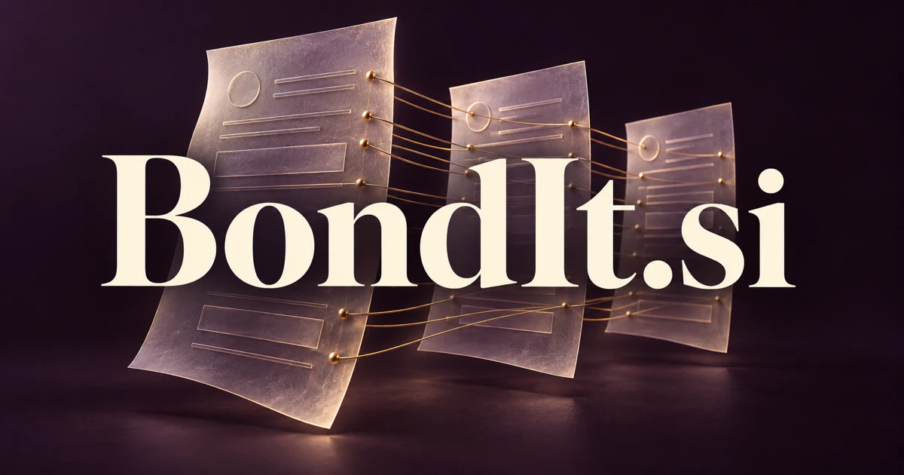

# BondIt.si — Connect fixed-income evidence to a clearer decision

BondIt.si combines **bond** with the active invitation **it**. Its strongest financial direction is a research terminal that connects instrument terms, issuer information, portfolio exposures and a client's questions. Analysts could move from scattered documents to comparisons they can inspect and explain. The word also carries real relationship and adhesion meanings, leaving room for distinct collaboration or materials products under the same memorable name.

[Enquire about BondIt.si](mailto:hedge.pike02@icloud.com?subject=Domain%20enquiry%3A%20bondit.si)

## Meaning and naming depth

**Bond** has several established senses. It can describe a debt instrument, a close connection between people, or the act of joining materials; [Cambridge's entry](https://dictionary.cambridge.org/us/dictionary/english/bond) records those different readings. **BondIt** turns the word into a compact instruction: connect it, bring it together, or work with the bond. That last step is a creative brand construction, rather than a separate financial term.

The financial reading has a particularly concrete vocabulary: issuer, principal, interest, maturity and contractual provisions. [Investor.gov explains corporate bonds](https://www.investor.gov/introduction-investing/investing-basics/investment-products/bonds-or-fixed-income-products) as debt obligations and distinguishes them from equity. A useful BondIt product would connect those terms to source documents and the user's specific research question, preserving distinctions between contractual facts, market observations and modeled scenarios.

## Business opportunities

### 1. An intelligent bond research terminal

Fixed-income analysts could gather instrument descriptions, offering documents, issuer filings and research notes in one workspace. Specialist agents would extract terms, compare conflicting records and assemble a sourced answer to a question about an instrument. Professional subscriptions and enterprise data integrations could support a terminal whose primary value is understandable evidence rather than an unexplained recommendation.

### 2. Portfolio exposure maps

Investment teams could group holdings by issuer, maturity, currency and user-defined categories, then investigate how apparent diversification relates to underlying exposures. The system would explain each grouping and identify missing information before preparing a review. Team licenses and reporting integrations would suit firms that need a consistent research record across accounts and analysts.

### 3. Interest-rate scenario workspaces

Analysts could inspect how selected instruments behave under explicit changes to model assumptions. Calculation tools would remain separate from narrative agents, allowing reviewers to trace an explanation back to inputs and formulas. Subscription workspaces or embedded analytics modules could serve professional research teams that want to compare scenarios without confusing a modeled outcome with an observed fact.

### 4. Coupon and maturity coordination

Operations teams could reconcile expected interest and principal dates with instrument records and portfolio positions. An assistant would flag incomplete calendars, explain discrepancies and organize the questions needing confirmation. Account-based subscriptions and operational integrations would give BondIt a dependable administrative product alongside more sophisticated research tools.

### 5. Bond-ladder planning tools

Advisers could explore hypothetical maturity schedules against a client's stated cash needs and planning horizon. The workspace would compare alternative structures, show gaps and preserve the assumptions used in each illustration for professional review. Adviser subscriptions and client-reporting modules could support a business built around explainable planning rather than promises about future returns.

### 6. Offering-document extraction

Research and legal teams could turn long offering documents into linked fields for covenants, dates, definitions and unusual conditions. An extraction agent would show the precise passage behind each field, while a second reviewer checks consistency across documents. Document-volume pricing and private deployments could serve firms whose research begins with difficult, heterogeneous source material.

### 7. Callable-instrument comparisons

Analysts could compare call schedules, relevant contractual language and chosen scenario assumptions across a shortlist. The product would explain how differences in provisions affect the comparison and keep ambiguous wording in a review queue. Specialist analytics subscriptions would suit users who need to understand the structure of an instrument before comparing headline figures.

### 8. Issuer monitoring and research updates

An issuer workspace could connect newly published filings, announcements and analyst notes with existing research questions. Agents would distinguish a genuinely changed fact from a repeated statement and draft a source-linked update for review. Per-issuer monitoring plans or enterprise licenses could help research teams keep their own understanding current without generating indiscriminate alerts.

### 9. Client reporting and investment committees

Advisers and research departments could transform approved analyses into clear client explanations, committee briefs and documented follow-up questions. A reviewer would check whether each statement is supported by the selected data and research. Reporting subscriptions and white-label workspaces could commercialize the communication layer while preserving professional ownership of the final message.

### 10. Fixed-income learning studios

Educators could build interactive lessons around fictional instruments, payment schedules and changes to assumptions. A tutor would connect a learner's question to the relevant definition, calculation and example, adapting the explanation while retaining the source material. Course licenses and individual memberships could make BondIt an approachable entry point into a specialist subject.

### 11. Relationship and partnership workspaces

A separate BondIt product could help partnership teams connect shared objectives, commitments and contact histories across organizations. An assistant would prepare meeting briefs, find unresolved promises and coordinate introductions with the participants' approval. Team subscriptions and managed partnership services would make the interpersonal meaning of bond central, rather than presenting relationships as financial instruments.

### 12. Adhesive and materials selection

Manufacturers and repair specialists could compare substrates, application conditions, supplier documentation and recorded test results. A materials assistant would propose candidate approaches and a test plan, explaining which requirements remain unresolved. Supplier tools, laboratory workspaces and engineering subscriptions could build on the physical meaning of bonding as a distinct industrial business.

## A Super Intelligence product story

For a fixed-income product, BondIt.si can express Super Intelligence through **coordinated research that keeps contractual detail, quantitative analysis and human intent connected**. One agent reads the instrument documents, another checks calculation inputs, and a third reviews how the resulting explanation addresses an analyst's question. Conflicts stay visible instead of disappearing inside a fluent summary.

The name also supports a broader brand principle: connections should carry useful context. A relationship workspace would connect commitments and people; a materials tool would connect requirements and test evidence. These are alternative product directions, each deserving its own audience, data model and launch story.

## Why the name works

Six letters create a short, energetic instruction. **Bond** gives the identity a substantive financial anchor, while **It** makes the name feel active enough for a product demonstration. BondIt Research, BondIt Monitor and BondIt Reports could introduce a coherent suite. **“Bring the evidence together.”** can connect the financial positioning with the broader idea of meaningful bonds.

## Related names, different directions

- [FinMap.si](finmap-si.md) — Organize operating cash flow, commitments and business scenarios rather than individual debt instruments.
- [AnnualReports.si](annualreports-si.md) — Make published company reporting the primary research surface.
- [VDR.si](vdr-si.md) — Center the product on controlled document review and diligence workflows.
- [CPQ.si](cpq-si.md) — Explore specification-led configuration and quoting, a useful adjacent identity for the materials direction.

## Acquire BondIt.si

[Buy or make an offer on Dynadot](https://www.dynadot.com/market/user-listings/bondit.si), or email [hedge.pike02@icloud.com](mailto:hedge.pike02@icloud.com?subject=Domain%20enquiry%3A%20bondit.si) to discuss a direct purchase, a possible discount, or a portfolio bundle. These product directions are proposals for a future owner to develop.

[Purchase options and Escrow.com](../guides/how-to-buy.md) · [Browse all domains](../README.md)

## Research references

- [Cambridge Dictionary: bond](https://dictionary.cambridge.org/us/dictionary/english/bond) — Financial, interpersonal and adhesion meanings used in the naming analysis.
- [Investor.gov: corporate bonds](https://www.investor.gov/introduction-investing/investing-basics/investment-products/bonds-or-fixed-income-products) — Debt obligations, principal, interest and the distinction from equity.
