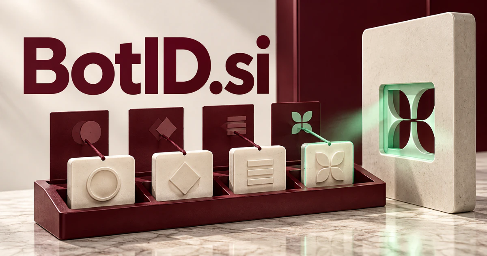

# BotID.si — Know which agent is acting, and why

BotID.si brings together automated software and identification in a compact, direct name. It could serve organizations deploying many agents by connecting each machine identity with an owner, intended capabilities, delegated permissions and action history. An inventory, an authentication layer and a capability registry solve different problems; the name can support one focused product or a coordinated identity platform.

[Enquire about BotID.si](mailto:hedge.pike02@icloud.com?subject=Domain%20enquiry%3A%20botid.si)

## Meaning and naming depth

The name combines **bot**, a familiar term for automated software, with **ID**, the everyday abbreviation for identification or an identifier. The combination can describe several different objects: the identity of the bot, the person or organization responsible for it, a credential it presents, or a record associated with a particular execution.

Those distinctions create product depth. An inventory says what exists; authentication establishes which principal is making a request; authorization decides what that principal can do. A strong BotID product could connect those layers rather than treating a recognizable label as proof of trust. OAuth token exchange provides established delegation concepts that make this an engineering territory as well as a branding idea.

## Business opportunities

### 1. Identity registry for AI agents

An agent identity assistant could connect owners, intended capabilities and credential records, helping organizations understand which automated specialists exist and why each receives access. Enterprise customers could organize agents by team and environment. Sell managed registry access, private deployments, or developer plans measured by active identities.

### 2. Bot authentication for applications

Reason about request context, delegated authority and a bot's task, preparing an authentication decision with inspectable evidence for security operators. A software vendor could distinguish a customer’s integration from an unidentified script. Paid SDKs, usage plans, and enterprise support would create a product with a precise integration point.

### 3. Non-human identity inventory

The workspace could connect each identity to an accountable owner and renewal date. An identity discovery workspace could reconcile automation tools, service accounts and infrastructure records, identifying duplicate or orphaned machine identities and assigning responsible owners. This broadens the market beyond conversational agents to existing automation estates.

### 4. Agent action histories and investigation

An investigation workspace could connect an agent's actions, authorization changes and business context, reconstructing how an automated task unfolded and which uncertainty needs investigation. Operations teams could investigate a failed update without reconstructing disconnected logs. Charge by retained events, workspaces, or managed reporting features.

### 5. Approved-bot directory

Match a customer's task with documented bot capabilities, operating boundaries and evidence, producing a shortlist with meaningful reasons for suitability. Customers could discover an assistant suitable for a particular workflow. The business could sell listing enhancements, integration certification services, or a private directory for enterprises.

### 6. Machine-to-machine access reviews

Managed IT providers could use the software across client organizations and sell recurring cleanup services. An access review assistant could compare machine permissions with current workloads and owner intent, preparing targeted review requests instead of treating every credential identically. The buyer’s practical deliverable is a maintained register of what automated access is still necessary.

### 7. Robotic process automation accountability

An RPA assistant could connect a business process, robot identity and execution outcomes, making ownership and exception handling understandable across technical and operational teams. A BotID agent card could travel with each deployment. Licensing could follow installed robots, client accounts, or workflow libraries.

### 8. Bot labeling for communities and games

Relate bot behavior, declared role and moderator context, helping members understand which automated participants assist, simulate characters or require review. Game worlds could use persistent identifiers for non-player characters and simulation actors. Consumer-friendly badges and administration tools could support both hosted communities and developer integrations.

### 9. Workload credentials for connected devices

An operator could register a device-side bot, rotate its credentials, and trace uploads to a known source. A device identity assistant could combine workload identity, device context and expected communication patterns, helping operators coordinate credentials throughout a connected system's lifecycle. Sell fleet administration, enrollment tools, and integration services to device manufacturers.

### 10. Agent reputation and capability records

An agent reputation assistant could compare task-specific evidence, execution history and capability claims, helping buyers distinguish a relevant specialist from a merely recognizable name. A marketplace could help buyers compare agents using documented evaluations rather than slogans. Revenue could come from paid evaluation workspaces, marketplace services, and capability-report subscriptions.

## A Super Intelligence brand

BotID.si can become a foundational Super Intelligence brand: as capabilities expand, identities and responsibilities need to remain understandable. A possible product stack would include BotID Registry, BotID Access, and BotID Trails. An agent could request narrowly scoped permissions for one task, carry its identity between tools, and leave an intelligible activity record. That story works for today’s automation and for more capable future agent ecosystems.

## Why the name works

The name tells technical buyers the category before a sales presentation begins. “Bot” gives it a machine actor; “ID” gives it a job. **“Know every agent. Understand every action.”** is an immediate positioning line. The compact spelling also works naturally in an API, a developer console, and a visible identity badge.

## Related names, different directions

- [KeyID.si](keyid-si.md) — Explore a broader identity and credential name that can include people as well as machines.
- [CloudGateway.si](cloudgateway-si.md) — Concentrate on the controlled routes through which an identified agent reaches tools and services.
- [PeerBot.si](peerbot-si.md) — Focus on collaboration and capability matching between multiple agents.

## Acquire BotID.si

[Buy or make an offer on Dynadot](https://www.dynadot.com/market/user-listings/botid.si), or email [hedge.pike02@icloud.com](mailto:hedge.pike02@icloud.com?subject=Domain%20enquiry%3A%20botid.si) to discuss a direct purchase, a possible discount, or a portfolio bundle. The product directions above are ideas for a future owner.

[Purchase options](../guides/how-to-buy.md) · [Browse all domains](../README.md)

## Sources and further reading

- [IETF: OAuth 2.0 Token Exchange](https://www.rfc-editor.org/rfc/rfc8693) — Delegation and token exchange concepts relevant to agent identities.
- [IETF: JSON Web Key](https://www.rfc-editor.org/rfc/rfc7517) — Standard representation and identifiers for cryptographic keys.
