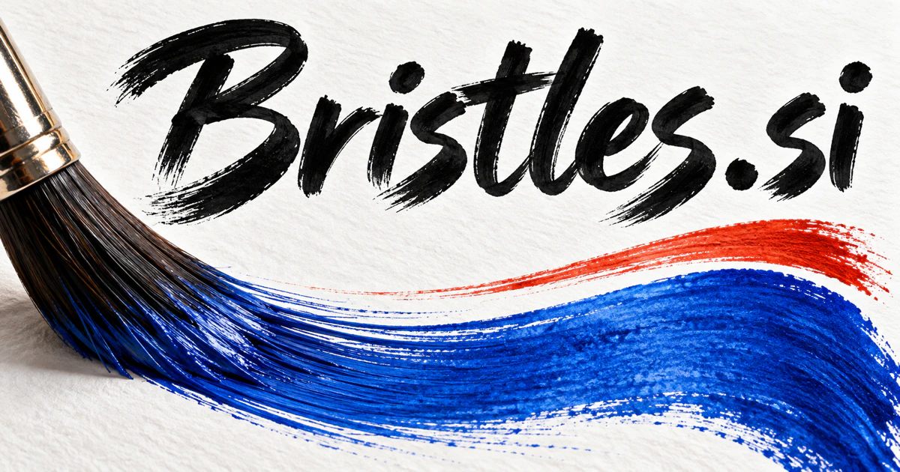

# Bristles.si — Bring a sense of craft to intelligent tools

Bristles.si names the stiff hairs or filaments associated with brushes, giving digital creativity an unusually tactile identity. It could become an artist’s workspace connecting intended marks, references, materials and controllable tools. Physical brush commerce, surface simulation, grooming and cleaning offer other buyers whose decisions depend on understanding how a tool meets a real surface.

[Enquire about Bristles.si](mailto:hedge.pike02@icloud.com?subject=Domain%20enquiry%3A%20bristles.si)

## What the name opens up

[Bristles](https://www.merriam-webster.com/dictionary/bristle) can be short, stiff hairs or filaments, including those on a brush. The verb also suggests standing up or being full of something. The brush connection makes the name unusually tangible for digital painting: mark, texture, pressure, and material can all become part of the brand language. Its scope also reaches real art supplies, grooming, cleaning, and material simulation. A buyer could use a bristling-with-ideas metaphor for creativity, while retaining the stronger literal link to tools that make, clean, or shape a surface.

## Business opportunities

### 1. Digital brush studio

An artist’s brush-design workspace could connect an artist's intended mark, reference material and brush behavior, proposing controllable tools that make the visual idea easier to realize. Creators could develop collections suited to a medium or project. Software subscriptions or brush-pack sales would connect digital marks with a tangible sense of craft.

### 2. Studio asset library

Interpret a project's visual language, locate suitable assets and explain reuse choices, connecting previous craft decisions with the next production brief. Contributors could see how to reproduce the intended visual language. Studio licenses would support consistency while giving artists clear resources to adapt within a project.

### 3. Creative learning business

Learners could compare attempts and ask questions. An art-practice coach could relate a student's marks, chosen medium and expressive goal, designing focused practice and feedback around what the student is trying to communicate. Courses, memberships, and individual resource sales would support independent makers and educators with a recognizable creative identity.

### 4. Physical brush commerce

A brush-selection service could connect a buyer's technique, surface and material preferences, explaining suitable tool combinations and preparing a practical kit for the intended project. Demonstration marks and care guidance could make selection more useful. Direct product sales, curated kits, or subscriptions could connect an informative digital experience with tangible art tools.

### 5. 3D surface simulation

Reason across geometry, visual references and simulation constraints, helping 3D teams construct bristled or fibrous surfaces with convincing behavior. Tools could expose editable parameters and rendering examples. Asset sales or studio licenses would use the literal filament meaning for a technical creative business.

### 6. Cosmetic brush planning

Retailers could sell coordinated kits alongside educational content. A beauty assistant could connect desired finish, product texture and application technique, guiding brush selection and personalized routines through explicit user preferences. A commerce business or professional training subscription could use the same tactile identity in a distinct consumer category.

### 7. Pet grooming workspaces

A grooming assistant could combine coat characteristics, service history and owner priorities, helping groomers prepare a tailored appointment and clear follow-up care instructions. Owners could receive a clear aftercare summary. Per-salon subscriptions or a grooming product line would give Bristles a practical service and physical-product route beyond art software.

### 8. Cleaning equipment selection

Reconcile surface material, access constraints and equipment behavior, helping facility teams choose appropriate brushes and coordinate an efficient maintenance sequence. A catalog could document material, dimensions, compatibility information, and maintenance. Supplier subscriptions or specialist sales could build a useful industrial commerce business around the literal object.

### 9. Creative texture marketplaces

Buyers could inspect use examples and licensing before purchase. A marketplace service could translate a designer's visual brief into texture requirements, matching creators' assets with a project's material and licensing needs. Marketplace commissions or contributor memberships would suit a brand whose tangible imagery connects many distinct visual styles.

### 10. Art practice communities

A community assistant could connect members' works, practice goals and complementary techniques, organizing critique groups and challenges that help artists develop a recognizable craft. Members could build a portfolio of experiments across tools and materials. Courses, memberships, or workshop tickets could turn the domain into a creative learning destination.

## A Super Intelligence product vision

A Bristles SI studio could study a creator's own sample marks and propose editable digital brushes that reproduce selected characteristics. Artists would control pressure response, texture, scatter, and color behavior through editable settings. A team edition could preserve a project's approved visual language and explain which resources were used. A brush library subscription could be the initial business, followed by software licenses and education. The intelligent opportunity is understanding an intended mark and giving a creator useful, controllable means to make it.

## Related names, different directions

- [TextArt.si](textart-si.md) — Explore expressive creation where words and imagery become the primary medium.
- [Drap.si](drap-si.md) — Focus the material story on textiles, interiors, fabric behavior and clothing.
- [Etudes.si](etudes-si.md) — Make deliberate studies and the development of creative technique the central promise.

## Acquire the domain

Contact [hedge.pike02@icloud.com](mailto:hedge.pike02@icloud.com?subject=Domain%20enquiry%3A%20bristles.si) to discuss a direct-purchase discount, an offer, or a portfolio package.

[View the sales listing](https://www.dynadot.com/market/user-listings/bristles.si) · [Purchase options and escrow](../guides/how-to-buy.md) · [Browse all domains](../README.md)

## Sources and further reading

- [Bristle — Merriam-Webster](https://www.merriam-webster.com/dictionary/bristle) — Literal hair, filament, brush, and related verb senses.
