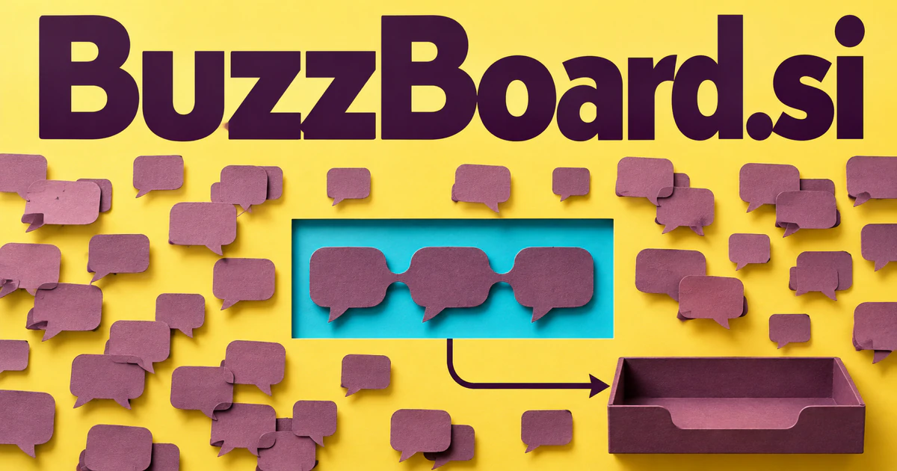

# BuzzBoard.si — Make collective signals worth acting on

BuzzBoard.si combines excitement or activity with a place where information becomes visible. It could name a listening and planning desk for marketers, community managers and product teams: connect conversations with their context, identify recurring questions and decide what deserves a response. Live events, employee ideas and editorial planning extend the name beyond a conventional monitoring dashboard.

[Enquire about BuzzBoard.si](mailto:hedge.pike02@icloud.com?subject=Domain%20enquiry%3A%20buzzboard.si)

## Meaning and naming depth

Buzz can mean a humming sound, a flurry of activity, or excited attention around a product or event. Board can mean a surface for notices, a working display, or an organized group. Together they create a natural story about making activity visible.

The compound has several distinct product readings. A marketing team may want a listening dashboard; a community needs a place to gather questions; an event organizer needs a live participation surface. The deeper commercial idea is not collecting the most noise. It is deciding which conversations deserve attention and giving people a useful way to respond.

## Business opportunities

### 1. Brand listening and briefing

A brand assistant could connect customer conversations, campaign context and product changes, separating meaningful shifts in perception from routine bursts of attention. Staff could compare topics over time and assign follow-ups. Sell agency workspaces, organization subscriptions, and managed research services tailored to a customer’s actual channels.

### 2. Community topic boards

Organize recurring questions, complementary member expertise and unresolved discussions, turning a topic board into a useful collective knowledge resource. The board could connect each topic to related material and an owner. Sell community software, facilitation services, and templates for different membership models.

### 3. Live event participation

Organizers could turn useful contributions into a post-event summary. An event planner could relate audience questions, session context and speaker expertise, preparing timely prompts and follow-ups that deepen participation rather than merely count reactions. Sell event licenses, production support, and reusable interaction tools for hosts running recurring programs.

### 4. Trend research workspaces

A trend assistant could compare weak signals across communities, publications and customer behavior, helping researchers develop hypotheses about which emerging patterns deserve investigation. A board could retain the source evidence behind a trend hypothesis. Sell analytical subscriptions, curated reports, and specialist projects to product, retail, and strategy teams.

### 5. Employee ideas and suggestions

Connect employee suggestions with operational constraints and related projects, shaping promising ideas into proposals that teams can evaluate and own. Managers could group related ideas and show what happened after review. Sell team subscriptions and facilitated programs that make employee participation visible beyond an occasional survey.

### 6. Creator and publisher planning desk

A creator could identify what to explain next and coordinate collaborators. An editorial workspace could relate audience questions, topical evidence and production capacity, coordinating a publisher's next useful piece rather than chasing undifferentiated buzz. Sell individual plans, publication workspaces, and content production services.

### 7. Local happenings and culture

A local discovery companion could connect neighborhood events, resident interests and venue context, helping communities discover relevant activities and organize complementary local participation. A recognizable editorial voice could separate useful discovery from a generic listings page. Revenue could come from memberships, relevant sponsorships, events, and commissioned guides.

### 8. Product feedback synthesis

Connect feedback themes, customer segments and usage evidence, preparing reasoned priorities and research questions for the next development cycle. A team could distinguish a widely repeated request from a smaller issue that blocks a critical workflow, then ask affected users better follow-up questions. The board could show evidence rather than only vote totals. Sell organization workspaces and integrations into existing product development tools.

### 9. Classroom discussion tool

Students could connect related ideas and revisit the discussion afterward. A classroom assistant could connect students' contributions with lesson goals, expose differing interpretations and prepare discussion prompts that strengthen reasoning across the group. Sell classroom licenses, curated activity packs, and training for institutions introducing more participatory learning.

### 10. Creative campaign studio

A campaign assistant could combine cultural signals, brand intent and production expertise, turning a live trend into an original creative direction with a concrete execution brief. Clients could see research, concepts, and production in one shared board. Project fees, retainers, and original media products would support a service-led interpretation of the name.

## A Super Intelligence brand

BuzzBoard.si can position Super Intelligence around collective signals: understand what people are discussing, connect related evidence, and help a team choose the next useful action. A possible product would combine listening, research, and collaborative planning in one visual workspace. The board makes the intelligence inspectable rather than hiding every conclusion in a generated summary.

## Why the name works

The repeated initial sound makes the compound easy to remember, and both components offer visual possibilities. It can feel energetic without losing a clear functional meaning. **“See the conversation. Shape the next step.”** gives the brand a useful bridge between information gathering and action.

## Related names, different directions

- [AdPair.si](adpair-si.md) — Turn an identified audience or trend into a specific creative and placement strategy.
- [MyReviews.si](myreviews-si.md) — Concentrate on reviews, customer experience and reputation rather than the full conversation landscape.
- [DataFeeds.si](datafeeds-si.md) — Explore the timely information inputs and update streams behind a listening product.

## Acquire BuzzBoard.si

[Buy or make an offer on Dynadot](https://www.dynadot.com/market/user-listings/buzzboard.si), or email [hedge.pike02@icloud.com](mailto:hedge.pike02@icloud.com?subject=Domain%20enquiry%3A%20buzzboard.si) to discuss a direct purchase, a possible discount, or a portfolio bundle. The product directions above are ideas for a future owner.

[Purchase options](../guides/how-to-buy.md) · [Browse all domains](../README.md)

## Sources and further reading

- [Merriam-Webster: buzz](https://www.merriam-webster.com/dictionary/buzz) — Sound, activity, and attention senses behind the naming analysis.
- [Merriam-Webster: board](https://www.merriam-webster.com/dictionary/board) — Notice surfaces, organized displays, and group meanings that support the compound.
