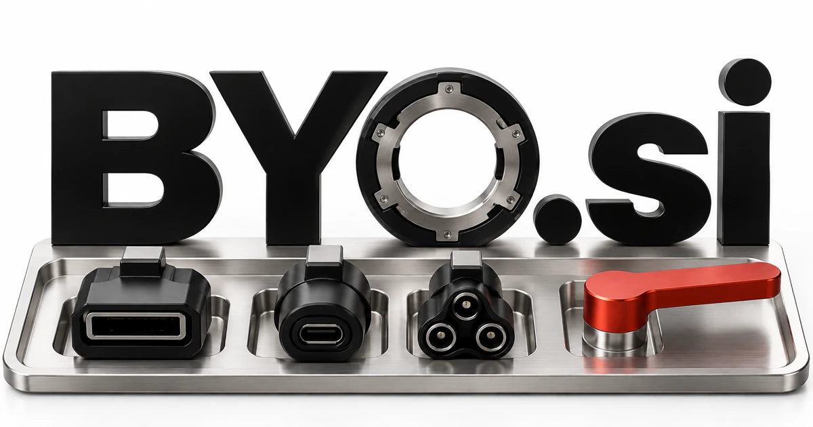

# BYO.si — Bring, build or be your own

BYO.si offers a short grammatical frame with several useful readings. Bring Your Own is familiar; Build Your Own and Be Your Own are natural brand interpretations for customization and independence. A model-independent workspace could let customers choose their data, tools and specialist agents, while private research, creator services and practical learning offer focused paths under the same ownership-centered identity.

[Enquire about BYO.si](mailto:hedge.pike02@icloud.com?subject=Domain%20enquiry%3A%20byo.si)

## Meaning and naming depth

The familiar BYO construction is associated with **Bring Your Own**, and technical buyers already encounter combinations such as bring your own device or bring your own key. The final object is deliberately open. That creates a useful product naming system: bring your own model, data, cloud, workflow, identity, or audience.

**Build Your Own** is another natural reading for customization; **Be Your Own** can introduce an aspirational message such as “be your own analyst.” These are contextual brand interpretations, not a claim that every expansion is an established technical acronym. The naming strength comes from a short, reusable grammatical frame that puts ownership with the customer.

## Business opportunities

### 1. Model-independent AI workspace

A provider-independent workspace could connect a customer's task, chosen models and evaluation preferences, orchestrating specialists while keeping provider choices under the customer's control. Developers and advanced individual users could pay for the workspace while keeping provider billing separate. BYO makes provider choice part of the product’s identity.

### 2. Private enterprise assistant deployment

Reason across internal knowledge, deployment boundaries and role-specific needs, coordinating useful assistance within the organization's chosen environment. An IT team could configure a departmental assistant without adopting a single mandatory hosting arrangement. Implementation services, update subscriptions, and support plans provide a credible enterprise business.

### 3. Visual build-your-own agent platform

Templates might cover customer onboarding, research collection, or project administration. An agent builder assistant could translate a customer's desired outcome into modular tools, specialist roles and test scenarios, helping them construct an intelligible personal workflow. Sell builder subscriptions and a marketplace where experienced creators distribute reusable workflow components.

### 4. Developer-controlled encryption and credentials

A credential-design assistant could connect customer-managed keys, identity context and permitted tasks, helping developers design credential boundaries around how their agents actually operate. Customers could connect existing key-management systems, inspect access events, and rotate secrets. The BYO philosophy naturally supports a technical story about explicit ownership and deployment choice.

### 5. Creator’s branded assistant toolkit

Combine a creator's chosen knowledge, voice and audience needs, helping them build an assistant that extends a recognizable service or teaching practice. They bring the expertise, brand, and audience; the platform supplies hosting and product tools. Revenue could combine creator subscriptions, usage plans, and optional commerce services.

### 6. Modular hardware and robotics kits

A robotics assistant could connect available components, sensor observations and a builder's goals, guiding the assembly and testing of a useful modular physical assistant. Guided lessons and interchangeable modules would support a shop, educational subscriptions, and workshops. “Build your own” gives the brand a tangible, hands-on expression.

### 7. Personal knowledge and research systems

A private research workspace could connect the user's chosen sources, notes and questions, developing a private line of investigation that they can inspect and extend. Rather than prescribing one filing system, the product could expose customizable schemas and saved investigations. Consultants could sell setup packages for lawyers, researchers, and independent analysts.

### 8. Community and events identity

Connect members' own skills, resources and intentions, assembling collaborative events where participants bring complementary contributions to a shared experience. A repair evening, for example, could match participants bringing tools with those bringing skills or objects to fix, making contribution more important than passive attendance. A booking platform, membership club, and physical venue could share the same invitation-led brand and grow around participation.

### 9. Customizable retail bundles

Customers choose components according to a goal, then reorder what they actually use. A retail assistant could reconcile a shopper's use case, compatible components and preferences, building a coherent bundle that feels personally assembled rather than preselected. The short brand can bridge digital configuration software and a direct-to-consumer range of modular physical products.

### 10. Independence-focused learning

A learning companion could help someone be their own analyst or maker by connecting concepts, practical experiments and feedback in a progressively more independent workflow. An AI tutor could guide projects while the learner makes decisions. Sell specialist learning tracks, project templates, and live cohorts that turn the ownership theme into an educational outcome.

## A Super Intelligence brand

BYO.si could position Super Intelligence as something customers shape rather than passively receive. “Bring your own intelligence” might describe a workspace that combines a person’s knowledge with chosen models, private information, and specialist tools. A founder could start with an agent builder and expand into a broader ecosystem of interchangeable skills, execution environments, and community-created components.

## Why the name works

Three letters make the address unusually compact, while the open-ended phrase gives campaigns a repeatable structure: BYO Models, BYO Studio, BYO Teams, BYO Skills. **“Your tools. Your intelligence. Your way.”** captures a clear product philosophy. The name is broad enough for a platform and specific enough to organize its feature story.

## Related names, different directions

- [Atua.si](atua-si.md) — Emphasize the assistant’s ability to carry out an intention rather than how its owner assembles it.
- [CloudGateway.si](cloudgateway-si.md) — Explore the infrastructure that connects customer-selected models, services and tools.
- [Equipage.si](equipage-si.md) — Build a team-and-equipment story around assembling the capabilities needed for a task.

## Acquire BYO.si

[Buy or make an offer on Dynadot](https://www.dynadot.com/market/user-listings/byo.si), or email [hedge.pike02@icloud.com](mailto:hedge.pike02@icloud.com?subject=Domain%20enquiry%3A%20byo.si) to discuss a direct purchase, a possible discount, or a portfolio bundle. The product directions above are ideas for a future owner.

[Purchase options](../guides/how-to-buy.md) · [Browse all domains](../README.md)

## Sources and further reading

- [NIST: Bring Your Own Device](https://csrc.nist.gov/glossary/term/bring_your_own_device) — An established technical example of the BYO construction.
- [OMG: Business Process Model and Notation](https://www.omg.org/spec/BPMN/2.0.2/About-BPMN) — A reference for structured workflow concepts used in agent building.
