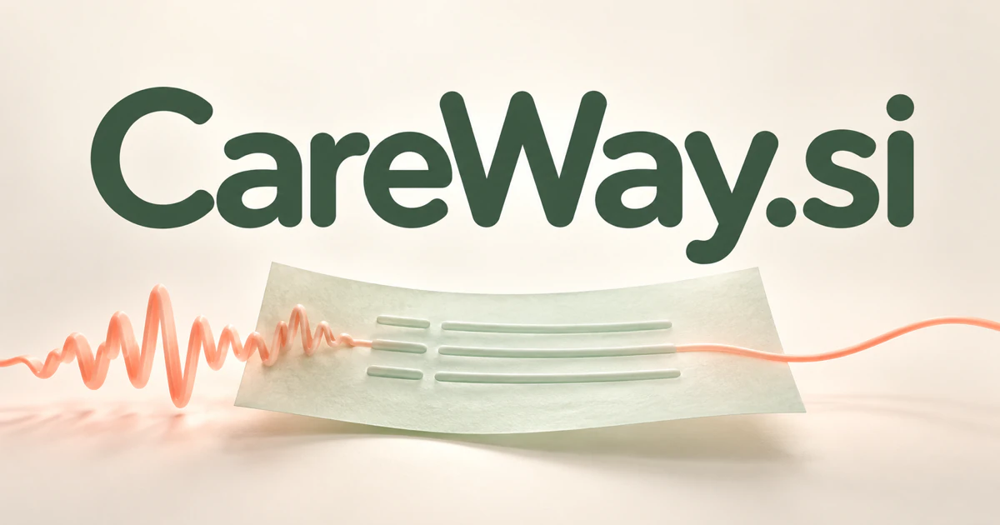

# CareWay.si — Carry the conversation into the next step of care

CareWay.si joins two familiar words into a practical promise: attentive support with a path forward. Its strongest product direction is a clinical-documentation workspace that helps professionals turn an authorized consultation into a reviewed record, an understandable follow-up and a clear handover. A care organization could introduce one useful documentation tool, then connect the information that patients, families and professionals need between encounters.

[Enquire about CareWay.si](mailto:hedge.pike02@icloud.com?subject=Domain%20enquiry%3A%20careway.si)

## Meaning and naming depth

**Care** brings attention, support and responsibility to the name; **way** adds a method, route or next step. Together they suggest continuity rather than an isolated administrative transaction. The seven-letter compound can work for a professional workspace, a navigation service or a family organizer, with a warmer identity than a technical abbreviation.

The documentation opportunity has a concrete technical context. [NHS guidance on ambient scribing](https://www.england.nhs.uk/publication/guidance-on-the-use-of-ai-enabled-ambient-scribing-products/) describes products that turn speech into structured documentation, including notes and letters. It also emphasizes review and approval of outputs. CareWay could make that review part of the product's central experience: show the relevant source, expose uncertain wording and let the responsible professional decide what enters the record.

## Business opportunities

### 1. Ambient clinical scribing

Practices could capture an authorized consultation and receive a draft organized around their own note template. The workspace would distinguish observations, reported history and documented decisions, then present the draft for correction. Clinician subscriptions, practice licenses and record-system integrations could support a focused first service whose value is a more usable documentation process.

### 2. Structured records and case continuity

Clinical teams could connect approved notes, dates, observations and unresolved questions across an authorized record. An assistant would prepare a concise timeline with links back to the underlying material, allowing the next professional to inspect the context. Organization subscriptions could serve practices that need useful continuity across repeated visits and different contributors.

### 3. Referral preparation

Referring professionals could assemble the relevant chronology, selected reports and the specific question they want a specialist to address. An agent would organize the packet, identify missing administrative information and prepare a letter for approval. Referral-network licenses and integration services could make CareWay a reliable place to prepare and track a handover.

### 4. Pre-visit preparation

Patients could submit concerns, existing documents and practical questions before a scheduled encounter. The system would organize those inputs into an editable agenda and distinguish the patient's account from information already confirmed in the record. Practice subscriptions and patient portals could help the consultation begin with an understandable account of what needs attention.

### 5. Reviewed follow-up communication

A professional's approved plan could become a draft patient letter, a set of practical reminders and a queue of administrative tasks. Each output would remain connected to the approved source so the team can check wording and responsibilities. Per-practice plans could extend the documentation product into the work that follows an appointment.

### 6. Team handovers

Care teams could summarize recent changes, assigned responsibilities and outstanding questions for the person taking over. A handover agent would organize information by time and relevance, showing where a statement came from rather than presenting an unexplained conclusion. Department licenses and private deployments could serve services with frequent changes of shift or responsible team.

### 7. Home-care coordination

Home-support providers could connect visit notes, agreed tasks, availability and observations in one authorized workspace. An assistant would highlight unfinished practical work and prepare the next visit's briefing. Provider subscriptions and family access plans could give CareWay a distinct service identity around coordinated support in everyday life.

### 8. Allied-health session workflows

Therapists could prepare reviewed session notes, relate activities to agreed goals and organize communication between appointments. The product would retain the professional's decisions while reducing the fragmentation of forms, messages and follow-up lists. Practitioner subscriptions and clinic licenses could introduce a focused edition for a specific discipline before expanding to adjacent services.

### 9. Shared care-plan workspaces

Teams could connect agreed goals, contributors, activities and review dates in a structured plan. The [HL7 FHIR CarePlan resource](https://hl7.org/fhir/R4B/careplan.html) provides a useful interoperability context for representing intended care for a patient or group. CareWay could offer plan-authoring tools, reviewed updates and integration services that keep participants aligned around the same record.

### 10. Family-care organizers

Families could organize appointments, transport, documents and practical responsibilities for an approved circle of participants. A coordination assistant would explain what remains to be arranged and prepare a shared weekly view. Household subscriptions or employer-sponsored support could create a consumer route built around organization and communication rather than clinical decision making.

### 11. Accessible communication preparation

Care organizations could turn approved content into draft plain-language explanations, translated messages or alternative formats for review. The workspace would preserve the source material and route language-sensitive questions to an appropriate person. Organization plans and managed communication services could make the name useful wherever care information needs to reach different audiences clearly.

### 12. Documentation quality review

Quality teams could compare a draft record with its authorized inputs, looking for inconsistent dates, missing required fields and statements that lack a supporting source. Reviewers would see an explanation and decide whether a correction is needed. Team licenses and integration modules could position CareWay as a useful review layer across several documentation systems.

## A Super Intelligence product story

CareWay.si can express Super Intelligence through **continuity across listening, documentation, planning and communication**. One agent organizes the encounter, another connects relevant history, and a third prepares follow-up drafts. The responsible professional reviews the material and approves the next action.

The strongest product story begins with a concrete workflow and grows through connected context. A reviewed consultation note could support a referral, a handover and a patient explanation without losing the evidence behind them. The intelligence lies in coordinating those tasks and making their relationships understandable. Practice subscriptions, organization licenses, integrations and household plans provide separate routes for an owner to develop.

## Why the name works

CareWay is easy to divide into meaningful words and broad enough to support a product family. CareWay Notes, CareWay Plans and CareWay Home could introduce distinct audiences while retaining the same identity. **“A clearer next step in care.”** connects the name's human tone with its practical coordination role.

## Related names, different directions

- [FitMate.si](fitmate-si.md) — Center the product on fitness habits, training and a supportive personal companion.
- [PawCare.si](pawcare-si.md) — Focus on the relationship between pet owners, everyday routines and animal care.
- [SmartVet.si](smartvet-si.md) — Build a professional veterinary documentation and workflow workspace.
- [HomeGuide.si](homeguide-si.md) — Organize the wider decisions and practical projects around a home.

## Acquire CareWay.si

[Buy or make an offer on Dynadot](https://www.dynadot.com/market/user-listings/careway.si), or email [hedge.pike02@icloud.com](mailto:hedge.pike02@icloud.com?subject=Domain%20enquiry%3A%20careway.si) to discuss a direct purchase, a possible discount, or a portfolio bundle. These product directions are proposals for a future owner to develop.

[Purchase options and Escrow.com](../guides/how-to-buy.md) · [Browse all domains](../README.md)

## Research references

- [NHS guidance on AI-enabled ambient scribing products](https://www.england.nhs.uk/publication/guidance-on-the-use-of-ai-enabled-ambient-scribing-products/) — Documentation capabilities and the importance of reviewing generated outputs.
- [HL7 FHIR R4B: CarePlan](https://hl7.org/fhir/R4B/careplan.html) — A primary specification for representing intended care, participants, goals and activities.
