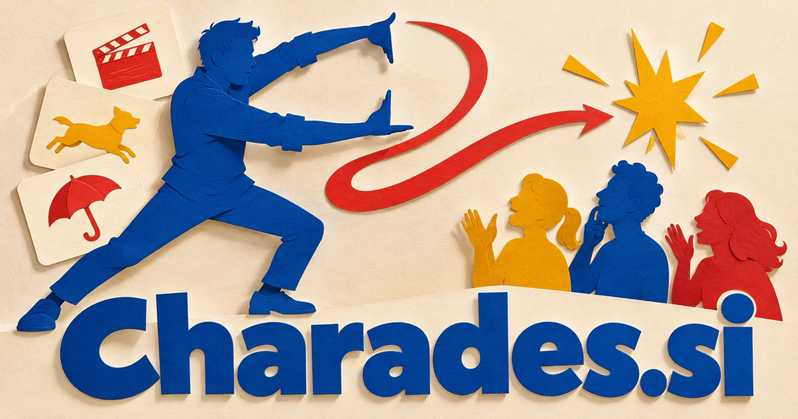

# Charades.si — Understand each other through expression and play

Charades.si names the familiar game of communicating an answer through acting rather than saying it directly. That foundation could support an adaptive party game, a classroom vocabulary service or a tool for performance practice. A deeper product might connect gesture, narrative context and participant responses, exploring how people and intelligent characters convey meaning beyond words.

[Enquire about Charades.si](mailto:hedge.pike02@icloud.com?subject=Domain%20enquiry%3A%20charades.si)

## Business opportunities

The strongest route depends on the buyer’s audience and the problem they want to solve. These directions develop different meanings of the name into practical product and service concepts.

### 1. Multiplayer party game

A game assistant could connect players' interests, previous clues and group dynamics, creating acting challenges whose difficulty adapts to the people sharing the room. Paid collections or a subscription could support repeat play, with hosts choosing age-appropriate themes and the level of improvisation that suits the group.

### 2. Classroom vocabulary activities

Relate vocabulary goals, a student's understanding and expressive choices, turning enacted clues into memorable language practice and useful teacher feedback. Classroom licenses could include printable materials, reusable prompt sets, and quick ways to adapt the same activity for different learners and lesson goals.

### 3. Remote team social sessions

A team activity facilitator could combine participants' comfort levels, cultural references and meeting format, coordinating inclusive activities that help colleagues understand one another. Business plans could package short activities that are easy to explain and run without turning workplace participation into an evaluation of employees.

### 4. Acting and improvisation practice

A performance assistant could interpret a scene's intention, character relationships and an actor's chosen approach, proposing improvisation exercises that develop expressive range. Course purchases and professional memberships could combine guided prompts with student recordings and instructor feedback on specific performance choices.

### 5. Gesture-based creative tools

Connect observed movement, creative intent and scene context, helping designers turn physical expression into animations, interactions or visual storyboards. Creator subscriptions could help artists map gestures to expressions or scenes, preserving editable animation results rather than promising perfect interpretation of every physical movement.

### 6. Language learning through scenes

A language learning companion could coordinate a scenario, contextual vocabulary and the learner's performance, making the meaning of an expression clear through an enacted situation. Education subscriptions could connect gestures with vocabulary, example phrases, and listening exercises, giving learners several ways to understand and remember a concept.

### 7. Family activity publishing

A family assistant could connect children's interests, available time and different generations' abilities, preparing activity sequences that encourage shared imagination and participation. Direct retail and subscriptions could make a recognizable entertainment brand spanning digital play, physical cards, and facilitated events.

### 8. Interactive characters and stories

Relate gestures, narrative memory and a participant's choices, sustaining interactive stories in which meaning emerges through action as well as words. Game purchases or episodic memberships could support an original cast whose reactions make communication and collaboration part of the entertainment.

### 9. Nonverbal communication training

A communication assistant could connect a person's intentions, situational context and expressive strategies, helping coaches design practical exercises for clearer nonverbal interaction. Professional packages could support reflection and practice without presenting a game score as a psychological or clinical assessment.

### 10. Human-agent communication research

A research workspace could compare human interpretations, gesture annotations and task outcomes, helping investigators study how context shapes communication between people and intelligent agents. Research licenses could include replayable sessions, explicit consent tools, and documented evaluation methods, creating a useful experimental setting for multimodal interaction.

## A Super Intelligence product story

Charades.si could connect Super Intelligence with the challenge of understanding more than literal words. A game agent might generate appropriate prompts, interpret an approved video input within a defined task, and explain uncertain guesses. The product remains a playful, inspectable interaction rather than claiming unrestricted understanding of human intention.

## Why this name can carry a business

The existing game concept makes the brand easy to explain, while performance and interpretation create room for education and technical research. Its social character supports recurring use, themed content, live events, and physical products under the same recognizable identity.

## Related names, different directions

- [BalaBala.si](balabala-si.md) — Choose a conversational identity when spoken exchanges and storytelling are the main experience.
- [TruthOrDare.si](truthordare-si.md) — Build another familiar participatory game with different prompts, choices and social dynamics.
- [Etudes.si](etudes-si.md) — Focus on structured performance studies and deliberate expressive practice.

## Acquire Charades.si

The product directions above are ideas for a buyer to develop; software, customer accounts, content libraries, and an operating business are not included.

[Buy or make an offer on Dynadot](https://www.dynadot.com/market/user-listings/charades.si), or email [hedge.pike02@icloud.com](mailto:hedge.pike02@icloud.com?subject=Domain%20enquiry%3A%20charades.si) to discuss a direct purchase, a possible discount, or a portfolio package. Marketplace availability and checkout terms can vary. See [purchase options](../guides/how-to-buy.md) for the available marketplaces and an Escrow.com transaction route.

## Research references

- [Cambridge Dictionary: charades](https://dictionary.cambridge.org/dictionary/english/charades)

[Browse all domains](../README.md)
