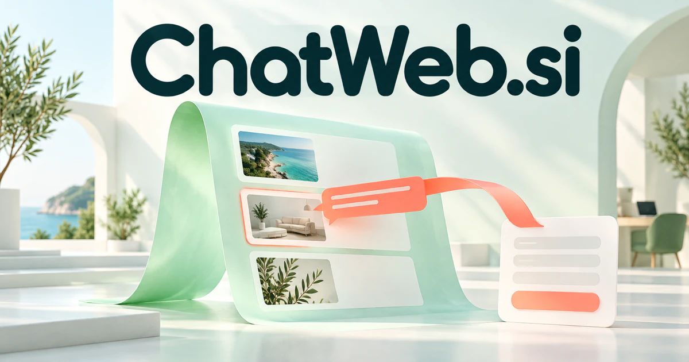

# ChatWeb.si — A web you can work with through conversation

ChatWeb.si can mean conversation on a website, conversation with a website, or a connected web of discussions. Its strongest proposed product is a conversational interface that helps visitors or researchers understand information and complete online tasks. Agency assistants, shopping guidance, documentation, community knowledge and multilingual access can each become a distinct business without stretching the name.

[Enquire about ChatWeb.si](mailto:hedge.pike02@icloud.com?subject=Domain%20enquiry%3A%20chatweb.si)

## Meaning and naming depth

Chat is informal conversation, while web evokes both connected websites and a network of relationships. Together they form a transparent compound rather than an obscure acronym. The name can describe chatting *on* the web, chatting *with* a website, or a connected web of conversations.

That flexibility matters. A customer support widget is one product; a conversational browser, research interface, collaborative room, or voice-enabled website is another. All remain coherent under the same name. The deeper brand idea is an interface shift: the website becomes something a person can interact with through language, while pages, links, forms, and structured actions continue to do the underlying work.

## Business opportunities

### 1. Website assistants for agencies

An agency assistant could connect each client's site content, service rules and visitor questions, turning a website assistant into an informed guide with useful handoffs. It could answer from approved pages, show relevant links, and collect an enquiry when the visitor needs staff help. Agency workspaces, installation services, and recurring maintenance packages offer a clear route to revenue.

### 2. Conversational shopping

Reconcile a visitor's needs, catalog attributes and practical constraints, explaining alternatives and coordinating the steps from discovery to a suitable purchase. A shopper could explain a room or use case instead of guessing category filters. Merchant subscriptions could expand into catalog enrichment, merchandising experiments, and assisted purchasing workflows.

### 3. Research across multiple websites

It could retain quotations, compare conflicting information, and collect a linked evidence notebook. A web research workspace could connect evidence across sites, compare conflicting claims and follow a user's evolving question, producing an inspectable research trail rather than disconnected links. Analysts, students, and consulting teams could pay for shared collections and export tools.

### 4. Interactive documentation

A documentation assistant could relate a developer's goal, installed version and examples, guiding them through a working implementation while identifying missing context. A developer could describe an error, inspect a relevant example, and jump to the exact documentation section. Usage subscriptions, internal deployments, and documentation maintenance services create different customer tiers.

### 5. Lead qualification and appointment preparation

Interpret a prospect's problem, service requirements and staff expertise, preparing a useful appointment brief instead of merely collecting contact details. Agencies, clinics, repair firms, and professional practices could subscribe. The product’s output is a more useful appointment, not merely another chat transcript.

### 6. Community rooms and live discussion

Threads, live chat, shared resources, and searchable summaries could belong to one web destination. A community assistant could connect discussions, member expertise and recurring questions, helping participants build shared understanding across a web of conversations. Sell membership software to organizers or operate a focused paid community under the ChatWeb name.

### 7. Conversational browser interface

A browser assistant could reason across open pages, forms and the user's intended outcome, coordinating approved web actions while keeping the task's context available. Professionals could pay for a productivity application that connects reading, comparison, note taking, and task execution within one familiar environment.

### 8. Multilingual visitor access

Connect a visitor's language, cultural expectations and the underlying service information, adapting explanations while preserving the practical meaning of the offer. The assistant could preserve links to source pages and guide users through relevant forms. Sell localization workspaces, editorial review tools, and site subscriptions rather than treating translation as a one-time project.

### 9. Voice-first web experiences

Visitors could ask follow-up questions while looking at maps or illustrations. A conversational web interface could coordinate spoken intent, page structure and task state, making complete website journeys available through a natural conversation. Voice minutes, publisher plans, and specialist accessibility-focused implementation services offer distinct commercial options.

### 10. Web conversation intelligence

A conversation analysis workspace could connect visitor questions, unsuccessful journeys and content gaps, preparing actionable improvements for the people maintaining the website. The software could suggest pages to improve and topics to explain. Sell reporting to content teams, product marketers, and agencies responsible for keeping websites useful over time.

## A Super Intelligence brand

ChatWeb.si can frame Super Intelligence as a web-wide interaction layer: understand the visitor’s intent, locate relevant knowledge, and coordinate useful tools. A possible product would move from “Which service fits me?” to a comparison, a prepared enquiry, and an appointment request. The name can therefore grow from conversation software into a broader platform for intelligent online experiences.

## Why the name works

Two familiar words make the product category easy to remember and demonstrate. The compound offers natural extensions such as ChatWeb Search, ChatWeb Commerce, and ChatWeb Rooms. **“Ask the web. Find your next step.”** connects the conversational interface to a practical outcome instead of making intelligence an abstract claim.

## Related names, different directions

- [OpenSupport.si](opensupport-si.md) — Focus the conversation on resolving customer questions and coordinating service work.
- [EasySearch.si](easysearch-si.md) — Make finding and comparing information the dominant promise, with or without a chat interface.
- [KeyID.si](keyid-si.md) — Explore the identity and access context behind personalized online assistance.

## Acquire ChatWeb.si

[Buy or make an offer on Dynadot](https://www.dynadot.com/market/user-listings/chatweb.si), or email [hedge.pike02@icloud.com](mailto:hedge.pike02@icloud.com?subject=Domain%20enquiry%3A%20chatweb.si) to discuss a direct purchase, a possible discount, or a portfolio bundle. The product directions above are ideas for a future owner.

[Purchase options](../guides/how-to-buy.md) · [Browse all domains](../README.md)

## Sources and further reading

- [WHATWG: HTML Living Standard](https://html.spec.whatwg.org/multipage/) — The underlying structure and interaction primitives of web pages.
- [W3C: Forms Tutorial](https://www.w3.org/WAI/tutorials/forms/) — Clear forms and instructions remain useful in conversational web journeys.
