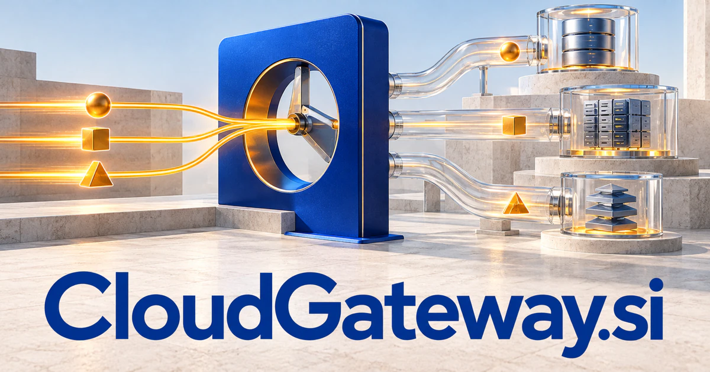

# CloudGateway.si — Connect the capabilities a business actually needs

CloudGateway.si names an understandable infrastructure role: an entry point that connects or routes access to hosted services. It could become a platform for choosing models, connecting agent tools and applying shared policy across a business. Integration, migration, partner access and device connectivity offer separate practical starting points for teams that need their systems to work together.

[Enquire about CloudGateway.si](mailto:hedge.pike02@icloud.com?subject=Domain%20enquiry%3A%20cloudgateway.si)

## Meaning and naming depth

Cloud places the name in hosted computing and connected services; gateway identifies an entry point that mediates access or routes traffic. In software architecture, gateway routing can expose several services through a shared endpoint. The metaphor is broader than networking: a gateway can also help customers enter an unfamiliar technical environment.

A buyer could emphasize infrastructure, integration, security policy, cost visibility, or onboarding. These are related but distinct commercial territories. The descriptive name is useful when the buyer already knows the problem and needs confidence that the company understands how systems connect. It leaves implementation choices open rather than tying the business to one cloud or model provider.

## Business opportunities

### 1. Unified API gateway

An API routing layer could connect request intent, service capabilities and operating policies, reasoning about the most suitable route through a complex application environment. Customers could expose selected services without teaching every client about internal topology. Subscription pricing could follow request volume, environments, or enterprise deployment requirements.

### 2. AI model access and routing

Reconcile task difficulty, latency requirements and evaluation evidence, coordinating specialist models around an outcome rather than a fixed provider preference. Application teams could assign budgets by customer or workload. A developer plan could grow into enterprise contracts for dedicated deployments, support, and organization-wide access policies.

### 3. Cloud integration for smaller businesses

A CloudGateway service could configure connectors and monitor failures. A small-business integration adviser could map existing applications, duplicated information and staff workflows, preparing cloud connections that solve the organization's actual operational bottlenecks. Monthly managed packages would make recurring integration operations accessible to firms without an internal platform engineering team.

### 4. Agent tool gateway

A tool gateway assistant could connect an agent's objective, available functions and permission boundaries, preparing the right tool context for each approved stage of a task. Administrators could set scopes, inspect requests, and publish internal capabilities. Sell the gateway to agent builders, enterprise automation teams, and software vendors adding tools to their products.

### 5. Edge and device connectivity

Combine device observations, local constraints and cloud capabilities, coordinating where analysis occurs and which information must reach the central system. Operators could enroll devices, translate supported protocols, and monitor delivery status. Hardware bundles, fleet subscriptions, and installation services create a bridge between infrastructure software and physical deployments.

### 6. Cloud migration and onboarding

A guided portal could keep evidence and responsibilities organized. A migration planner could connect application dependencies, organizational priorities and operational risks, preparing staged moves with concrete validation and ownership at each step. Sell assessment projects, migration work, and an ongoing operations subscription after the move.

### 7. Multi-cloud cost and traffic visibility

A multi cloud assistant could relate traffic patterns, service commitments and business value, explaining infrastructure tradeoffs and identifying avoidable fragmentation across providers. A gateway can connect traffic records with budgets, making reports useful for conversations about service design. Charge for dashboards, retained history, and advisory packages based on actual customer usage.

### 8. Secure partner access portals

Connect contractual roles, shared resources and intended workflows, assembling an appropriate portal experience and reviewable access plan. Customers could manage credentials, documentation, and connection support in one portal. This direction suits B2B software companies whose integrations are part of the product they sell.

### 9. Cloud marketplace and procurement service

The business could combine a searchable catalog with implementation expertise and consolidated project records. A procurement assistant could compare business needs, service characteristics and integration work, helping buyers choose cloud capabilities that fit together as a coherent operating environment. Revenue might come from procurement support, specialist consulting, and paid customer workspaces.

### 10. Technical learning gateway

A practical cloud tutor could relate a learner's current system, conceptual gaps and practical goal, creating guided experiments that explain how cloud services connect. Learners could deploy a small gateway and observe traffic patterns. Course licenses, team training, and hands-on workshops would give the descriptive name an educational expression.

## A Super Intelligence brand

CloudGateway.si could position Super Intelligence around access to useful capabilities. A reasoning system becomes more valuable when it can reach appropriate data, models, and tools through a consistent interface. The flagship opportunity is a gateway that translates an agent’s intended operation into a documented request, selects a suitable service, and returns an intelligible result with cost and execution context.

## Why the name works

The name contains the category and the role in plain language. It fits an infrastructure dashboard, a managed service firm, and a developer documentation site without requiring a new explanation each time. **“Connect capability. Control the journey.”** gives a broad platform a practical promise while leaving room for a suite of specialized gateways.

## Related names, different directions

- [FluxAPI.si](fluxapi-si.md) — Focus on the developer-facing interfaces and flowing information behind connected capabilities.
- [OneNode.si](onenode-si.md) — Explore a compact identity for a unified node, deployment point or compute resource.
- [BotID.si](botid-si.md) — Connect gateway access with the identity, authority and capabilities of each requesting agent.

## Acquire CloudGateway.si

[Buy or make an offer on Dynadot](https://www.dynadot.com/market/user-listings/cloudgateway.si), or email [hedge.pike02@icloud.com](mailto:hedge.pike02@icloud.com?subject=Domain%20enquiry%3A%20cloudgateway.si) to discuss a direct purchase, a possible discount, or a portfolio bundle. The product directions above are ideas for a future owner.

[Purchase options](../guides/how-to-buy.md) · [Browse all domains](../README.md)

## Sources and further reading

- [Gateway Routing pattern](https://learn.microsoft.com/en-us/azure/architecture/patterns/gateway-routing) — Official architecture guidance on routing services through a shared endpoint.
- [OpenAPI Specification](https://spec.openapis.org/oas/latest.html) — A standard format for describing HTTP API capabilities.
