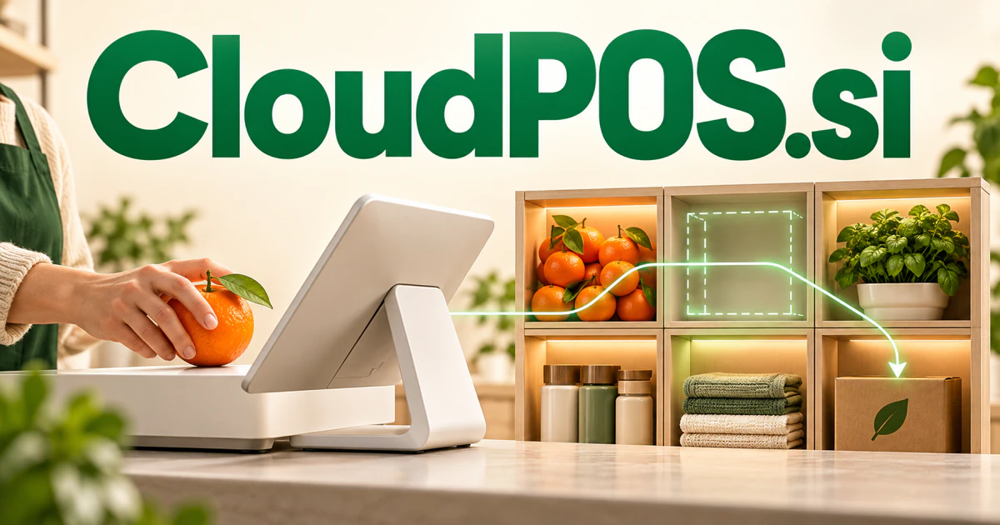

# CloudPOS.si — Connect the decisions behind every sale

CloudPOS.si combines cloud computing with the established point-of-sale abbreviation. It could name a connected operating workspace for retailers or restaurants, relating checkout activity to stock, staffing, customer questions and practical plans. The opportunity reaches beyond a payment screen into the decisions that keep commerce coherent across locations, channels and changing daily conditions.

[Enquire about CloudPOS.si](mailto:hedge.pike02@icloud.com?subject=Domain%20enquiry%3A%20cloudpos.si)

## Meaning and naming depth

POS is the established abbreviation for **point of sale**. Cloud places the product in a connected, centrally accessible software context. The combined phrase therefore gives a merchant a practical idea of the category before a demonstration begins.

A point-of-sale system sits where several business processes meet. A transaction can affect inventory, customer records, returns, staff responsibilities, and later reporting. This makes the name broader than a payment terminal. A future owner could choose a focused merchant type, then expand around its operating needs. The technical and commercial challenge is to make connected information useful in the pace of real storefront work.

## Business opportunities

### 1. Retail checkout and inventory

A retail assistant could relate transactions, inventory movement and local demand, helping staff coordinate replenishment, customer questions and checkout exceptions in one operational picture. Staff could see availability across supported locations and prepare replenishment tasks. Sell subscriptions by store or device, with onboarding services and integrations into the merchant’s chosen payment infrastructure.

### 2. Restaurant and cafe operations

Connect orders, kitchen capacity and ingredient availability, helping managers coordinate menus, preparation and service when circumstances change. A cafe owner could update items and review what needs preparation. Sell location-based plans, setup services, and optional hardware packages designed for a specific hospitality workflow.

### 3. Service-counter software

A customer’s service request could remain attached to its related transactions. A service-desk assistant could interpret a customer's request alongside job history, available staff and scheduling constraints, preparing an appropriate service and completion plan. Sell vertical software, migration assistance, and operating templates rather than a generic checkout screen.

### 4. Multi-location merchant oversight

A multi location assistant could compare store context, inventory imbalances and staffing patterns, explaining which local differences need intervention rather than applying one rule everywhere. Managers could compare relevant information without repeatedly requesting spreadsheets. Sell organization licenses, integration work, and continuing support to small chains and franchise networks.

### 5. Commerce data and planning

Connect sales history, product relationships and upcoming events, helping merchants reason about assortment and operating plans with visible assumptions. The workspace could show the records behind each observation. Sell analytical subscriptions and specialist advisory services alongside an existing point-of-sale integration.

### 6. Online and offline catalog connections

A shared product change could be reviewed before publication across channels. A catalog workspace could reconcile product identity, store availability and online presentation, coordinating updates that keep a customer's shopping journey consistent across channels. Revenue could come from connector subscriptions, catalog preparation, and managed synchronization for businesses selling in several places.

### 7. Pop-up and event retail

An event retail planner could combine expected attendance, venue constraints and sales signals, helping pop-up teams adapt stock, staffing and service during a short trading window. Customers could prepare a catalog, organize staff, and review the event afterward. Sell event plans, equipment rentals, and setup services suited to short-lived selling environments.

### 8. Merchant support and onboarding

Connect a business's workflow, catalog structure and team roles, preparing a usable configuration and focused training for actual daily tasks. A reseller could support several customers from one console. Sell onboarding packages, training subscriptions, and managed operations services to merchants and software partners.

### 9. Loyalty and service follow-up

Staff could understand the customer’s prior interactions without searching several tools. A customer relationship assistant could relate purchase context, service history and preferences, preparing relevant follow-up and loyalty experiences rather than repetitive promotional messages. Sell merchant workspaces and implementation services focused on repeat service rather than generic promotional messaging.

### 10. Integration and commerce consultancy

A commerce advisory workspace could connect merchant problems with specialist integrations, process changes and training, coordinating improvements around a measurable operational objective. Projects could begin with a practical operational bottleneck and end with maintained connections. The descriptive domain can support professional services before or alongside a proprietary merchant software product.

## A Super Intelligence brand

CloudPOS.si can frame Super Intelligence around commerce operations that understand context. A potential assistant could explain an unusual stock movement, prepare a reorder draft, or gather information for a service estimate. The valuable story connects the transaction to the surrounding work, making intelligence useful to staff and owners in the moments they actually need it.

## Why the name works

The name describes a known product category in plain language. It fits a merchant dashboard, a partner program, and a technical integration site. **“Connect the counter to the whole business.”** expresses a broader opportunity than checkout alone, while CloudPOS Retail, Service, and Events offer natural specialization.

## Related names, different directions

- [CPQ.si](cpq-si.md) — Explore the earlier configuration and proposal work needed for more complex commercial purchases.
- [DataFeeds.si](datafeeds-si.md) — Keep supplier catalogs and other changing commerce information connected to operating systems.
- [MyReviews.si](myreviews-si.md) — Develop the customer feedback and reputation relationship that continues after a transaction.

## Acquire CloudPOS.si

[Buy or make an offer on Dynadot](https://www.dynadot.com/market/user-listings/cloudpos.si), or email [hedge.pike02@icloud.com](mailto:hedge.pike02@icloud.com?subject=Domain%20enquiry%3A%20cloudpos.si) to discuss a direct purchase, a possible discount, or a portfolio bundle. The product directions above are ideas for a future owner.

[Purchase options](../guides/how-to-buy.md) · [Browse all domains](../README.md)

## Sources and further reading

- [PCI Security Standards Council: Standards](https://www.pcisecuritystandards.org/standards/) — Primary payment-data and software standards relevant to commerce implementation.
- [CloudEvents](https://cloudevents.io/) — A reference for describing events shared between connected business systems.
