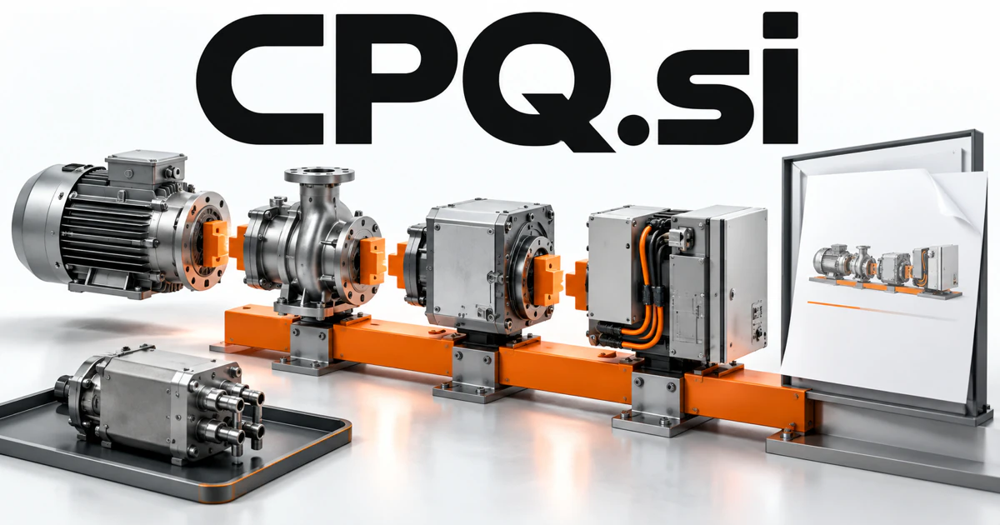

# CPQ.si — Turn complex requirements into a coherent proposal

CPQ.si uses the established configure-price-quote abbreviation, giving a business buyer a clear category signal. A proposed platform could connect requirements, compatibility rules, specialist knowledge and delivery constraints before preparing a commercial offer. Industrial equipment, professional services, installation work and subscription packaging require different implementations, but share the need to explain why a configuration fits.

[Enquire about CPQ.si](mailto:hedge.pike02@icloud.com?subject=Domain%20enquiry%3A%20cpq.si)

## Meaning and naming depth

CPQ stands for **configure, price, quote**. Configuration determines a suitable combination of products or services; pricing applies the relevant commercial rules; quoting turns the result into a proposal. The workflow becomes valuable when choices depend on one another or when pricing cannot be reduced to a single list price.

That creates a deeper product territory than document generation. A CPQ system may need compatibility rules, assumptions, service scope, approval steps, and a clean handoff to delivery. A founder can choose a narrow vertical and expand from there. Creative expansions are possible, but this name already carries a strong, useful meaning for its most natural audience.

## Business opportunities

### 1. Equipment and industrial configuration

An industrial assistant could connect operating requirements, engineering compatibility and delivery constraints, coordinating a feasible equipment configuration with an explanation of each component choice. A sales representative could explain why certain options belong together. Sell software licenses, rule-modeling services, and catalog maintenance for customers with complex equipment ranges.

### 2. Professional service proposals

Reason across client goals, specialist effort and project dependencies, shaping a proposal whose scope and delivery plan reinforce one another. A discovery brief could become a reviewable statement of work. Sell team subscriptions and tailored implementation services rather than treating every engagement as a blank document.

### 3. Subscription and usage packaging

Sales teams could understand what changes when a customer expands. A packaging assistant could relate customer usage patterns, service entitlements and operational economics, preparing understandable subscription configurations that fit distinct needs. Sell revenue-operations tooling, integration projects, and configured workspaces for businesses with varied commercial models.

### 4. Self-service customer configurators

A guided product configurator could ask for missing requirements, explain compatibility tradeoffs and guide a buyer toward a solution that meets their real operating context. A storefront could explain tradeoffs and prepare an enquiry or quote request. Sell embeddable components, configuration APIs, and design services to merchants or manufacturers wanting a clearer buying journey.

### 5. Construction and installation estimates

Connect site observations, component specifications and installation dependencies, preparing a coherent work scope and surfacing questions that require an expert visit. Contractors could revise a proposal without rebuilding a spreadsheet. Sell vertical software, onboarding support, and template libraries for defined types of installation work.

### 6. Channel and distributor quoting

Manufacturers could maintain shared product logic while partners manage their customer relationships. A channel assistant could reconcile distributor context, manufacturer rules and a customer's project, coordinating a quote that different commercial partners can understand and fulfill. Enterprise subscriptions and partner onboarding services would support a distinct channel-focused business.

### 7. Deal review and approval coordination

A deal review assistant could connect exceptional terms, delivery obligations and approval responsibilities, preparing a focused decision record for the right commercial specialists. A sales team could see what remains unresolved before issuing an offer. Sell team workspaces and integrations into existing customer-management and document systems.

### 8. Product and pricing data preparation

Reconcile product attributes, configuration rules and legacy data, preparing a reliable foundation that prevents contradictions in customer-facing proposals. This can be a service business in its own right. Sell assessment projects, migration work, and maintained data services to companies preparing to adopt configuration software.

### 9. Quote analytics and learning

The product could connect observations to specific quote components. A quote learning companion could connect offered configurations, customer feedback and eventual outcomes, helping teams improve how they interpret requirements and present alternatives. Sell analytical workspaces and advisory services based on the customer’s own records.

### 10. CPQ education and implementation

An implementation assistant could map a company's selling process, rule complexity and team knowledge, designing practical CPQ workflows and training around actual customer scenarios. A consultancy could combine courses with customer implementation work. Training subscriptions, workshops, and specialist support would give the exact category name a credible services and publishing dimension.

## A Super Intelligence brand

CPQ.si can position Super Intelligence around commercial reasoning with explicit structure. A possible assistant could interpret a requirement, ask for missing information, apply configuration rules, and prepare an explained proposal. The calculation and business rules remain inspectable, while language understanding helps the customer and sales team move through complexity more naturally.

## Why the name works

Three letters contain the category’s entire established abbreviation. The name is especially suited to technical documentation, buyer education, and specialist software positioning. **“Complex offers, made clear.”** expresses the benefit, while CPQ Studio, CPQ API, and CPQ Academy can serve different stages of the same customer journey.

## Related names, different directions

- [CloudPOS.si](cloudpos-si.md) — Focus on operating the transaction and merchant relationship once a product or service is selected.
- [AdPair.si](adpair-si.md) — Explore matching in creative campaigns and partnerships rather than technical configuration.
- [Equipage.si](equipage-si.md) — Build around the actual crew, equipment and preparation that fulfill the configured solution.

## Acquire CPQ.si

[Buy or make an offer on Dynadot](https://www.dynadot.com/market/user-listings/cpq.si), or email [hedge.pike02@icloud.com](mailto:hedge.pike02@icloud.com?subject=Domain%20enquiry%3A%20cpq.si) to discuss a direct purchase, a possible discount, or a portfolio bundle. The product directions above are ideas for a future owner.

[Purchase options](../guides/how-to-buy.md) · [Browse all domains](../README.md)

## Sources and further reading

- [Configure, price, quote overview](https://www.sap.com/resources/what-is-cpq) — Official practitioner description of the established CPQ workflow and software category.
- [OMG: Business Process Model and Notation](https://www.omg.org/spec/BPMN/2.0.2/About-BPMN) — A primary reference for modeling workflow stages, dependencies, and approvals.
