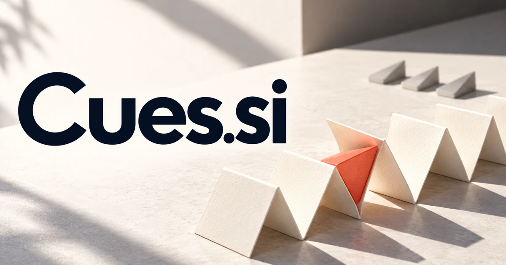

# Cues.si — Offer the right help at the right moment

Cues.si names the signals or prompts that help someone notice, remember or act. It could suit an assistant that understands a person’s current task and offers a relevant next question or action, making timing central to the experience. Coaching, learning, live production, visual understanding and personal habits each give that contextual promise a different practical audience.

[Enquire about Cues.si](mailto:hedge.pike02@icloud.com?subject=Domain%20enquiry%3A%20cues.si)

## Meaning and naming depth

A cue can tell a performer when to begin, give a person a hint about what to do, or provide a feature from which something is perceived. The plural suggests a collection of useful signals rather than one command. A separate concrete sense is a billiards cue, giving the name a direct sporting and retail interpretation.

The more abstract senses share a useful idea: timing and context matter. The same advice can be helpful in one moment and distracting in another. A strong Cues product could understand the situation and present a small amount of relevant guidance. The name is broad enough for perception, learning, performance, and personal assistance without requiring a technical explanation.

## Business opportunities

### 1. Contextual work assistance

A contextual work assistant could connect current activity, project intent and pending dependencies, offering a timely next-step cue with an understandable reason for its relevance. An assistant could prepare useful prompts from approved business materials. Sell organization workspaces, specialist integrations, and configuration services for teams doing repetitive but context-sensitive work.

### 2. Sales and service coaching

Connect a customer conversation, service history and the representative's objective, surfacing the next useful question rather than a generic script. Managers could review which examples need improvement. Sell team subscriptions, training programs, and industry-specific playbooks supported by a practical coaching interface.

### 3. Stage and live-production coordination

Production teams could rehearse and revise one shared running order. A production planner could reason across the running order, performer state and technical dependencies, coordinating cues that keep an unfolding live event coherent. Sell event licenses, studio plans, and production services to organizations managing conferences, performances, and live broadcasts.

### 4. Learning prompts and revision

A learning companion could connect a student's retrieval history, conceptual misunderstandings and upcoming use, preparing prompts that develop understanding at the moment it is needed. Teachers could sequence prompts according to the material and the learner’s response. Sell educational subscriptions, course licenses, and curated activity libraries rather than a general answer generator.

### 5. Habit and attention design

Relate a person's intentions, real environment and previous attempts, suggesting context-sensitive cues that make a chosen behavior easier to begin. Users could experiment with what helps them follow through. Sell subscriptions, planning products, and optional guided programs built around deliberate support rather than constant notification volume.

### 6. Visual understanding tools

A team could compare uncertain cases and record interpretations. A visual assistant could connect scene details, the viewer's task and external knowledge, drawing attention to relevant evidence instead of merely labeling objects. Sell dataset review software, evaluation workspaces, and specialist services for defined perception tasks.

### 7. Music and media cue management

A media assistant could relate narrative pace, emotional intent and timing constraints, organizing musical cues and alternatives around what a production is trying to convey. A project could retain which asset belongs to which moment. Sell professional workspaces, production templates, and workflow services for media teams.

### 8. Communication practice

Connect an upcoming conversation's purpose, relationship history and likely questions, preparing rehearsal cues that support more confident participation. The rehearsal could change when a simulated interviewer challenges an assumption, helping the user practice adapting an explanation rather than reciting one. Roleplay could support presentations, interviews, and customer conversations. Sell professional training, individual practice tools, and facilitated workshops focused on communication skills.

### 9. Billiards equipment and coaching

A retailer could combine a curated shop with product explanations and practice programs. A billiards assistant could relate table geometry, a player's intent and practice history, preparing reasoned exercises and equipment choices around specific skill development. Commerce, memberships, and events would create a non-AI business with an exact word association.

### 10. Design and behavioral research studio

A behavioral research workspace could connect observed behaviors, environmental cues and design hypotheses, helping teams test when an intervention improves a person's experience. Projects could involve wayfinding, onboarding, information design, or service experiences. Sell research, design commissions, workshops, and original tools under a compact word that captures the studio’s central subject.

## A Super Intelligence brand

Cues.si can frame Super Intelligence through contextual understanding: notice relevant signals, interpret them in relation to a goal, and offer useful guidance. A possible product could connect perception, memory, and tool access while presenting only the cue a person needs next. The brand supports sophisticated capability expressed through a calm, minimal interaction.

## Why the name works

Four letters, a familiar pronunciation, and several concrete meanings give the name unusual flexibility. It can feel technical, creative, educational, or premium without losing its core idea. **“The right signal, at the right moment.”** works for software, coaching, and live production, while Cues Studio, Learn, and Work can organize a suite.

## Related names, different directions

- [EduSpark.si](eduspark-si.md) — Develop learning journeys where a well-timed prompt becomes practice and deeper understanding.
- [Jiff.si](jiff-si.md) — Emphasize quick, useful completion when a small task matters more than ongoing guidance.
- [TimeCard.si](timecard-si.md) — Connect helpful interventions with a concrete record of work, time and activity.

## Acquire Cues.si

[Buy or make an offer on Dynadot](https://www.dynadot.com/market/user-listings/cues.si), or email [hedge.pike02@icloud.com](mailto:hedge.pike02@icloud.com?subject=Domain%20enquiry%3A%20cues.si) to discuss a direct purchase, a possible discount, or a portfolio bundle. The product directions above are ideas for a future owner.

[Purchase options](../guides/how-to-buy.md) · [Browse all domains](../README.md)

## Sources and further reading

- [Merriam-Webster: cue](https://www.merriam-webster.com/dictionary/cue) — Performance signals, hints, perceptual features, and the separate billiards sense.
- [W3C: Forms Tutorial](https://www.w3.org/WAI/tutorials/forms/) — Primary guidance on useful instructions and feedback in digital interactions.
