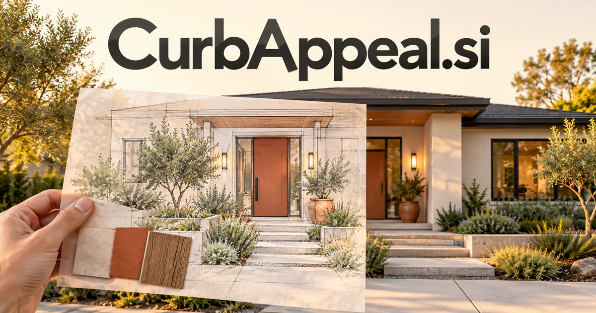

# CurbAppeal.si — Make the first view tell a better story

CurbAppeal.si names the visual impression a property creates from outside. It could become a planning service for homeowners, property teams and local businesses, connecting imagery, condition, practical constraints and design alternatives. Listing preparation, landscape projects, maintenance and welcoming entrances let the name serve both visual decisions and the coordinated work that brings them to life.

[Enquire about CurbAppeal.si](mailto:hedge.pike02@icloud.com?subject=Domain%20enquiry%3A%20curbappeal.si)

## What the name opens up

[Curb appeal](https://www.merriam-webster.com/dictionary/curb%20appeal) describes a house's visual attractiveness from the street. The phrase is already an outcome people understand, connecting facade, entryway, landscaping, lighting, and upkeep. Its broader branding promise is a considered first impression. A buyer could serve homeowners, real-estate professionals, contractors, retailers, or hospitality operators, with a distinct workflow for each. The strongest opportunities connect visual ideas to actual materials, scopes, and service delivery. Attractive previews can start the conversation; informed project decisions and completed work give a business lasting usefulness.

## Business opportunities

### 1. Exterior project previews

An exterior design assistant could connect site imagery, architectural context and homeowner preferences, preparing alternative improvements with clear relationships between appearance and practical work. Concepts could be compared before a site visit. Planning fees or contractor subscriptions would connect visual exploration with a properly scoped project discussion.

### 2. Listing preparation plans

Relate property condition, likely buyer questions and available preparation time, sequencing presentation tasks that make the home's strengths easier to understand. Owners could see priorities and mark work finished. Professional subscriptions or preparation services would make the property's first impression an organized project with visible next steps.

### 3. Portfolio maintenance

Managers could distinguish recurring care from a proposed improvement. A property care workspace could connect inspection observations, seasonal requirements and contractor capacity, coordinating exterior care across sites with different operating needs. Per-property subscriptions would connect appearance with a useful ongoing maintenance record and clearer vendor coordination.

### 4. Landscape project design

A landscape planner could reconcile local conditions, desired use and upkeep preferences, helping a customer develop an outdoor plan that fits the property's real context. A plan could include questions for a site visit and supplier quotes. Design fees or professional subscriptions would connect the visual promise with a specific outdoor project.

### 5. Storefront improvement services

Connect foot traffic, brand identity and accessibility observations, shaping entrance, signage and display changes around a more useful customer journey. Clients could compare proposals before ordering materials. Agency services or merchant subscriptions would extend the first-impression idea into commercial property.

### 6. Exterior product discovery

Product specifications and supplier information could remain attached. A product selection assistant could relate exterior materials, architectural style and installation requirements, explaining which options work together before a customer requests specialist advice. Retail margins, disclosed referrals, or manufacturer tools could support a practical commerce business.

### 7. Neighborhood project coordination

A neighborhood assistant could connect shared-space concerns, property plans and contractor schedules, helping residents coordinate improvements that depend on one another. A shared timeline could make dependencies clear. Group subscriptions or a managed coordination service could serve projects where several owners need to act together.

### 8. Hospitality entrance design

Relate guest expectations, arrival conditions and property identity, designing an entrance experience that connects visual appeal with practical welcome. Teams could connect design ideas with operational needs. Consulting projects or property subscriptions would turn the phrase into a specific guest-experience business.

### 9. Property photography preparation

Owners could understand what needs attention before a shoot. A photography assistant could connect a property's distinctive features, light conditions and preparation tasks, producing a shoot plan that communicates the actual arrival experience. Project fees or professional subscriptions could support a focused coordination tool around a property's first published impression.

### 10. Exterior care education

A care education companion could connect a homeowner's materials, climate context and skill level, preparing a practical exterior-care learning path and timely project guidance. Specialists could teach particular tasks and explain when professional help is useful. Memberships, workshops, or curated product kits could build a recurring consumer education business.

## A Super Intelligence product vision

A CurbAppeal SI planner could review owner-supplied photographs, ask about constraints and budget, and prepare several exterior project directions. It would connect each concept with a proposed scope, material questions, and information a contractor needs to price the work. A human specialist would inspect feasibility before commitments are made. Contractor subscriptions, project planning fees, or a managed service marketplace could support the first business. The intelligence vision is a practical bridge from visual intention to coordinated work, with owners able to understand why a change is proposed and what remains to be confirmed.

## Related names, different directions

- [HomeGuide.si](homeguide-si.md) — Explore the wider sequence of household projects, services and everyday property decisions.
- [Drap.si](drap-si.md) — Carry the design conversation indoors through textiles, materials and room visualization.
- [Cobbles.si](cobbles-si.md) — Expand from one property’s appearance to neighborhood streets, stories and local discovery.

## Acquire the domain

Contact [hedge.pike02@icloud.com](mailto:hedge.pike02@icloud.com?subject=Domain%20enquiry%3A%20curbappeal.si) to discuss a direct-purchase discount, an offer, or a portfolio package.

[View the sales listing](https://www.dynadot.com/market/user-listings/curbappeal.si) · [Purchase options and escrow](../guides/how-to-buy.md) · [Browse all domains](../README.md)

## Sources and further reading

- [Curb appeal — Merriam-Webster](https://www.merriam-webster.com/dictionary/curb%20appeal) — Established visual-property meaning grounding the proposed extensions.
