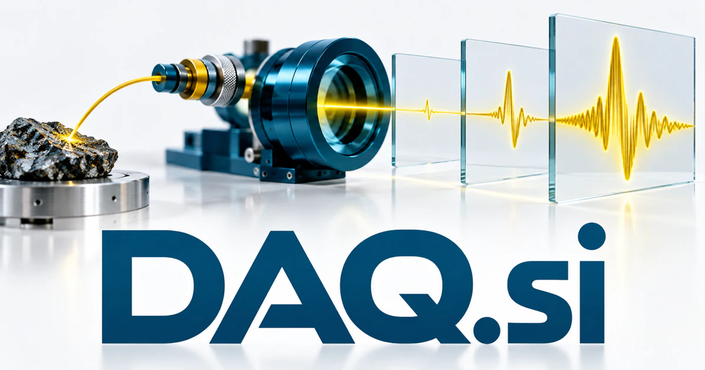

# DAQ.si — Make measurements answer better questions

DAQ.si uses a familiar abbreviation for data acquisition, giving engineers and researchers a direct connection to measurement. A proposed workspace could relate an experiment’s question to instruments, collection settings and interpretation, helping teams understand what their readings mean. Industrial monitoring, field measurements, calibration and research preparation offer different routes from raw signals to useful evidence.

[Enquire about DAQ.si](mailto:hedge.pike02@icloud.com?subject=Domain%20enquiry%3A%20daq.si)

## Business opportunities

The strongest route depends on the buyer’s audience and the problem they want to solve. These directions develop different meanings of the name into practical product and service concepts.

### 1. Laboratory acquisition software

A laboratory assistant could connect an experiment's question, instrument capabilities and acquisition settings, preparing a measurement workflow whose assumptions a researcher can inspect. Per-laboratory subscriptions could make settings and instrument identities traceable when a colleague repeats a measurement or reviews an unexpected result.

### 2. Industrial equipment monitoring

Relate sensor streams, operating states and maintenance history, helping engineers decide which changes justify a closer physical inspection. A review screen could align an unusual signal with machine state, recent servicing and comparable runs so an engineer can test a specific explanation. Site subscriptions could help customers investigate changes in vibration, pressure, or temperature while keeping actual control decisions with qualified operators.

### 3. Environmental field measurement

An environmental assistant could connect location, weather context and measurement coverage, adapting field collection plans to answer a specific ecological or operational question. Organization plans could package collection workflows and client reports, with missing data and handling decisions visible rather than silently hidden in a chart.

### 4. Acoustic and vibration analysis

An acoustic assistant could relate sound patterns, operating conditions and engineering hypotheses, directing analysts toward the measurements that distinguish competing explanations. Engineering subscriptions could serve product development and inspection teams that need the context behind a pattern as well as an attractive visualization.

### 5. Calibration record platform

Connect instruments, procedures and usage context, helping laboratory teams coordinate review work and understand which measurements depend on each record. Professional plans could help laboratories and service companies prepare records and investigations without claiming that software alone establishes measurement traceability or accreditation.

### 6. Data quality review

A measurement quality workspace could compare expected behavior, acquisition metadata and anomalous readings, preparing targeted checks before an analysis relies on questionable inputs. Team subscriptions could route questionable records to an owner before they enter an analysis, business report, or AI workflow.

### 7. Connected-device developer tools

A device development assistant could connect sensor specifications, interface behavior and a developer's intended experiment, helping assemble and debug an intelligible measurement pipeline. Per-team plans could connect a device change with observed measurement behavior during prototyping, rather than relying on disconnected screenshots and message threads.

### 8. Engineering teaching benches

Relate classroom concepts to real signals and instrument settings, adapting experiments to reveal why a measurement behaves as it does. Classroom licenses could combine saved configurations, student reports, and instructor review, making it easier to explain how a physical signal becomes a digital record.

### 9. Research data preparation for agents

A research data preparation service could connect raw observations, metadata and experimental intent, preparing contextualized datasets that downstream specialist agents can interpret responsibly. Professional services and software plans could help researchers ask useful questions while preserving a route back to the original observations.

### 10. Measurement service marketplaces

A measurement marketplace service could map a client's question to suitable instruments, methods and service expertise, preparing a project brief that providers can evaluate clearly. Provider subscriptions or transaction fees could organize a fragmented service journey without overstating the suitability of a particular testing method.

## A Super Intelligence product story

DAQ.si could express Super Intelligence grounded in observation. An agent reads approved measurement metadata, proposes checks, identifies unusual intervals, and drafts questions for an engineer. Statistical tools perform the relevant calculations; the engineer reviews interpretations and decides whether further measurement or action is required.

## Why this name can carry a business

Three letters match the established engineering abbreviation and remain compact in documentation, dashboards, and device labels. The name can support hardware, software, services, and data-quality tools while retaining a consistent promise: better organized evidence from the world outside the application.

## Related names, different directions

- [SCPI.si](scpi-si.md) — Focus specifically on the command-and-control layer used with programmable instruments.
- [Readouts.si](readouts-si.md) — Build around the results and understandable outputs produced from measurements.
- [DataFeeds.si](datafeeds-si.md) — Distribute measurements as timely streams alongside other external information sources.

## Acquire DAQ.si

The product directions above are ideas for a buyer to develop; software, customer accounts, content libraries, and an operating business are not included.

[Buy or make an offer on Dynadot](https://www.dynadot.com/market/user-listings/daq.si), or email [hedge.pike02@icloud.com](mailto:hedge.pike02@icloud.com?subject=Domain%20enquiry%3A%20daq.si) to discuss a direct purchase, a possible discount, or a portfolio package. Marketplace availability and checkout terms can vary. See [purchase options](../guides/how-to-buy.md) for the available marketplaces and an Escrow.com transaction route.

## Research references

- [NI: data acquisition explained](https://www.ni.com/en/shop/data-acquisition.html)

[Browse all domains](../README.md)
