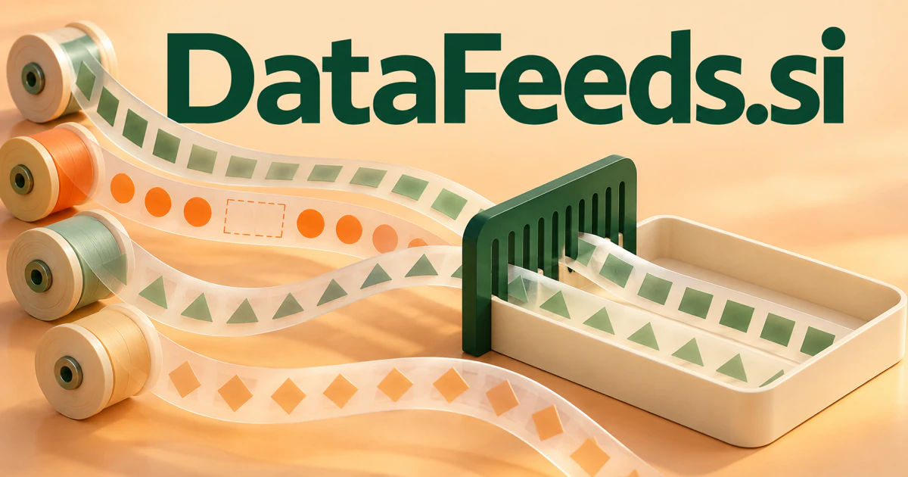

# DataFeeds.si — Give changing information the context it needs

DataFeeds.si directly describes streams of updated information. It could become a service that helps research and operating teams choose sources, reconcile meanings and understand which changes affect their decisions. Financial information, commerce catalogs, sensor readings and knowledge updates are distinct products; freshness and context matter differently in each, leaving room for focused specialist businesses.

[Enquire about DataFeeds.si](mailto:hedge.pike02@icloud.com?subject=Domain%20enquiry%3A%20datafeeds.si)

## Meaning and naming depth

A feed is a continuing supply. In computing and publishing, a data feed can deliver records, updates, events, or published items to another application. RSS is one established web syndication format; other feeds use APIs, files, event streams, or customer-specific delivery arrangements.

The name does not restrict the business to financial prices. Product catalogs, public announcements, weather observations, scientific readings, and operational events can all form feeds. The deeper product question is what a customer needs to know, how often it changes, and what makes delivery reliable and usable. A good feed business can sell curation, consistency, timeliness, and context as well as raw records.

## Business opportunities

### 1. Specialist data marketplace

A marketplace service could connect a customer's question, coverage requirements and provider documentation, identifying data feeds whose limitations match the intended use. Publishers could present their collections in a consistent format. Revenue could come from paid provider tools, customer workspaces, and transaction services for appropriate licensed datasets.

### 2. Financial and economic information delivery

Reconcile timestamps, instrument identities and economic context, helping analysts distinguish a fresh signal from a misleading comparison. Application developers could integrate a consistent interface rather than maintain several separate adapters. Sell API subscriptions, data packages, and integration support without presenting a feed as investment advice.

### 3. Commerce catalog synchronization

Merchants could review changed records before updating their stores. A commerce service could connect supplier updates, product identity and channel rules, coordinating catalog changes that preserve consistency across a merchant's business. Sell subscriptions by supplier connection, catalog size, or managed data services for businesses coordinating many sources.

### 4. AI retrieval and knowledge updates

A knowledge assistant could relate new source material to existing evidence and active questions, updating retrieval collections while explaining which conclusions may need reconsideration. A customer could see which material changed and which downstream index was updated. Sell ingestion workspaces, maintained connectors, and enterprise deployment services.

### 5. Industry announcement monitoring

Connect industry announcements, customer priorities and existing research, preparing relevant implications rather than another undifferentiated news stream. A researcher could ask which new announcements change an existing supplier assessment and receive a brief that separates new evidence from repeated publicity. The product could preserve source links and distinguish original announcements from commentary. Sell curated subscriptions, organization watchlists, and commissioned intelligence services.

### 6. Sensor and equipment streams

Integrators could normalize records before passing them to dashboards or business systems. An equipment assistant could relate incoming measurements to asset history and operating conditions, coordinating investigation when a changing stream affects a practical decision. Revenue could follow connected devices, delivered events, and managed deployments for distributed operations.

### 7. Feed quality and freshness monitoring

A feed quality workspace could compare expected cadence, schema meaning and downstream dependency, identifying stale or inconsistent inputs before they distort a workflow. Data customers could route exceptions to the responsible source owner. Sell monitoring workspaces and reporting services to organizations that depend on external information for their applications.

### 8. Feed publishing toolkit

Connect source structures, intended consumers and update requirements, helping organizations distribute understandable feeds with usable documentation and examples. A specialist researcher could turn maintained information into a subscription product. Sell publisher plans, hosted endpoints, and setup services tailored to different data formats.

### 9. Research and open-data distribution

Users could subscribe to changes in a selected dataset. A research publishing service could reconcile dataset descriptions, methodological context and subscriber questions, making open information easier to discover, compare and apply. Sell institutional hosting, publication support, and collaborative tools that make maintained data easier to use.

### 10. Operational event routing

An event routing planner could connect an incoming business event, workflow state and specialist responsibilities, delivering the right context to the team able to act. Developers could inspect delivery history and replay supported events. Usage-based software and integration consulting would support an infrastructure interpretation of the name.

## A Super Intelligence brand

DataFeeds.si can frame Super Intelligence around a simple dependency: intelligent systems need useful inputs that remain current. A possible platform would combine source selection, ingestion, quality checks, and contextual delivery to agents. Its value would be showing what the system knows, where the information came from, and when it changed, rather than treating a large data volume as intelligence by itself.

## Why the name works

Two ordinary words explain the category, and the plural leaves room for a marketplace or product suite. The name suits documentation, a catalog, and a customer dashboard. **“Fresh inputs. Wider understanding.”** links the delivery function with a future-facing AI proposition while remaining useful for conventional data customers.

## Related names, different directions

- [DAQ.si](daq-si.md) — Explore the instruments and collection workflows that produce a stream of observations.
- [DQM.si](dqm-si.md) — Concentrate on whether incoming information meets the quality needs of its intended task.
- [FluxAPI.si](fluxapi-si.md) — Develop the interfaces, transformations and event flows used to deliver changing information.

## Acquire DataFeeds.si

[Buy or make an offer on Dynadot](https://www.dynadot.com/market/user-listings/datafeeds.si), or email [hedge.pike02@icloud.com](mailto:hedge.pike02@icloud.com?subject=Domain%20enquiry%3A%20datafeeds.si) to discuss a direct purchase, a possible discount, or a portfolio bundle. The product directions above are ideas for a future owner.

[Purchase options](../guides/how-to-buy.md) · [Browse all domains](../README.md)

## Sources and further reading

- [RSS 2.0 Specification](https://www.rssboard.org/rss-specification) — An established standard for web content syndication.
- [CloudEvents](https://cloudevents.io/) — A common way to describe event data across services and platforms.
