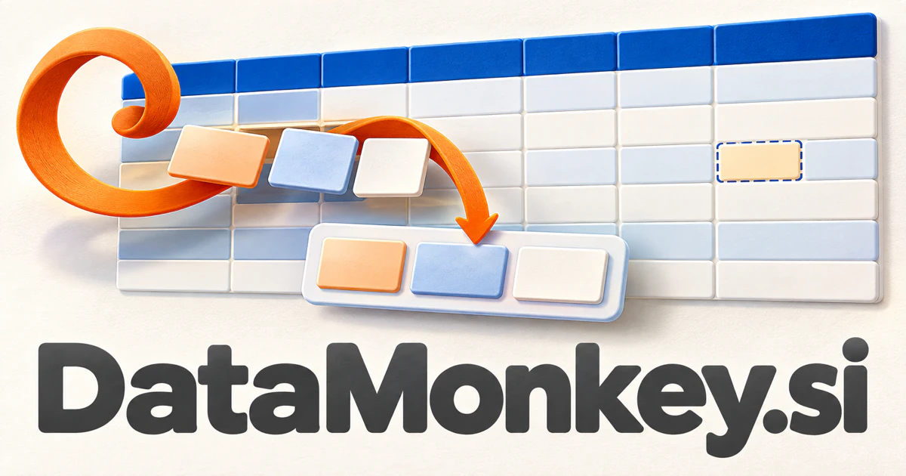

# DataMonkey.si — Make the hard work behind data feel manageable

DataMonkey.si is a playful compound with a serious practical territory: the preparation and investigation behind useful data. It could name an analytical companion for teams reconciling spreadsheets, investigating business questions or preparing a migration. Education, catalog enrichment, test datasets and reporting broaden the audience while keeping hands-on problem solving at the center.

[Enquire about DataMonkey.si](mailto:hedge.pike02@icloud.com?subject=Domain%20enquiry%3A%20datamonkey.si)

## Meaning and naming depth

Data is the precise category word; monkey introduces a lively character and a sense of curiosity, dexterity, and hands-on activity. The compound is a brand construction, not a formal analytical discipline. It can suggest the person who gets the data work done, or an assistant that handles tedious preparation so the customer can focus on interpretation.

That personality is useful because data products often become abstract very quickly. A mascot-led interface could make rows, columns, joins, and missing values feel less intimidating. The business can remain technically serious while presenting its work through an accessible identity. The strongest opportunities connect that friendly surface to a concrete, repeatable job.

## Business opportunities

### 1. Spreadsheet cleanup

A spreadsheet assistant could connect column meanings, business rules and ambiguous entries, preparing reviewable corrections instead of treating every unusual value as a mistake. A preview could explain every proposed transformation before it is applied. Sell individual subscriptions, team plans, and paid cleanup services to operations staff and independent professionals.

### 2. Approachable analytical assistant

Connect a customer's business question, available data and methodological choices, developing an understandable path from raw records to a supported answer. The product could produce a working notebook rather than only a conversational answer. Sell workspaces to small firms that need recurring analysis without a large internal analytics team.

### 3. Data migration preparation

Customers could see examples of what will change. A migration planner could compare source concepts, target requirements and relationship dependencies, preparing mappings and exception queues that preserve the meaning of transferred information. Sell project tools, migration services, and reusable templates for common customer-management or commerce workflows.

### 4. Data collection service

A collection assistant could relate research questions, published sources and extraction constraints, coordinating a consistent dataset with documented origins and unresolved gaps. Researchers and businesses could commission a specific collection instead of receiving a generic dataset. Project fees and recurring maintenance would support a service-led DataMonkey business.

### 5. Practical data education

Adapt a real data problem to a learner's skills, explain analytical decisions and build practical exercises around the mistakes they encounter. A monkey character could guide exercises without making the learning shallow. Sell courses, classroom licenses, workshops, and project kits for people beginning analytical work.

### 6. Synthetic test data tools

Teams could generate repeatable datasets with explicit field relationships. A testing assistant could connect application rules, edge cases and coverage gaps, creating synthetic data scenarios that reveal meaningful failure modes during development. Sell developer plans, organization templates, and specialist test-data services, keeping generated examples distinct from real customer information.

### 7. Catalog enrichment for commerce

A catalog workspace could connect product imagery, supplier text and category conventions, proposing useful attributes that improve comparison and customer understanding. The workspace could flag missing dimensions or inconsistent units. Sell by catalog volume, supported channels, and managed enrichment services to retailers and supplier networks.

### 8. AI dataset preparation

Reconcile task objectives, representation needs and source context, helping research teams curate evidence suited to a particular learning or evaluation question. Researchers could keep decisions attached to the relevant examples. Sell team workspaces and data operations services to organizations that need more than a folder of unexamined training files.

### 9. Data visualization and reporting services

A small studio could combine software templates with human interpretation. A reporting workspace could connect analytical findings, stakeholder decisions and visual explanation, producing a narrative that makes the evidence and its practical implications clear. Retainers, reporting packages, and visualization workshops would create revenue beyond a pure self-service application.

### 10. Playful developer toolkit

A developer assistant could coordinate parsing, profiling and transformation tools around a stated data task, making tedious preparation work reproducible and easier to inspect. Developers could save common transformations and share them with colleagues. A lightweight paid toolkit could provide an entry product before the brand grows into a broader data workbench.

## A Super Intelligence brand

DataMonkey.si can make Super Intelligence practical through data work people recognize. A possible assistant could inspect an unfamiliar dataset, ask clarifying questions, propose transformations, and produce an understandable analysis record. The personality invites customers in; the deeper product value is the combination of curiosity, repeatable tools, and explainable preparation.

## Why the name works

The category word makes the business legible, while the character word creates strong visual and storytelling possibilities. A mascot could appear in tutorials, loading states, and educational products. **“Messy data. Useful answers.”** gives the name a practical promise, and DataMonkey Clean, Learn, and Studio could serve different audiences.

## Related names, different directions

- [DQM.si](dqm-si.md) — Choose a more formal data-quality identity for continuous stewardship and organizational governance.
- [EasySearch.si](easysearch-si.md) — Focus on discovering relevant information rather than preparing and analyzing the underlying data.
- [Readouts.si](readouts-si.md) — Emphasize the clear outputs and interpreted results delivered after the preparation work.

## Acquire DataMonkey.si

[Buy or make an offer on Dynadot](https://www.dynadot.com/market/user-listings/datamonkey.si), or email [hedge.pike02@icloud.com](mailto:hedge.pike02@icloud.com?subject=Domain%20enquiry%3A%20datamonkey.si) to discuss a direct purchase, a possible discount, or a portfolio bundle. The product directions above are ideas for a future owner.

[Purchase options](../guides/how-to-buy.md) · [Browse all domains](../README.md)

## Sources and further reading

- [pandas: introductory user guide](https://pandas.pydata.org/docs/user_guide/10min.html) — Official examples of tabular data structures and practical transformations.
- [Government Data Quality Framework](https://www.gov.uk/government/publications/the-government-data-quality-framework/the-government-data-quality-framework) — A primary reference for assessing data quality in context.
