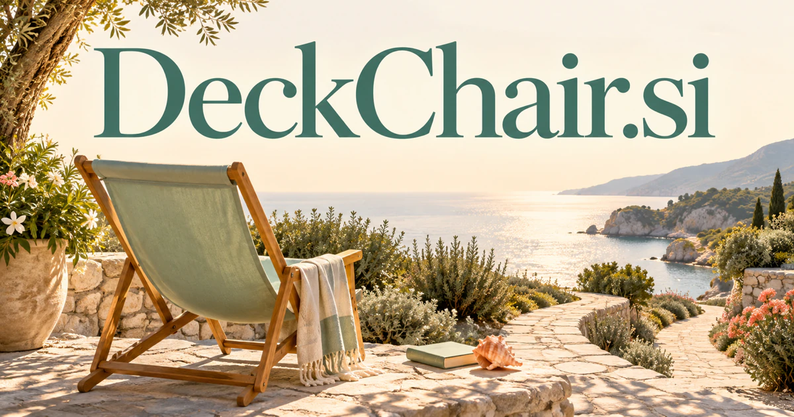

# DeckChair.si — Make room for a more considered kind of leisure

DeckChair.si names a familiar object of outdoor rest, giving a leisure or hospitality brand an immediate image. A proposed concierge could connect a person’s interests, pace and practical needs with suitable outings or guest services. Furniture selection, slow travel, equipment rentals and quiet cultural experiences let the name connect useful planning with the feeling of having time to enjoy it.

[Enquire about DeckChair.si](mailto:hedge.pike02@icloud.com?subject=Domain%20enquiry%3A%20deckchair.si)

## Business opportunities

The strongest route depends on the buyer’s audience and the problem they want to solve. These directions develop different meanings of the name into practical product and service concepts.

### 1. Personal leisure concierge

A leisure assistant could connect a person's interests, available time and practical constraints, assembling an outing that fits their desired pace rather than maximizing an itinerary. A subscription could cover ongoing suggestions, while optional bookings create another commercial route for local experience operators.

### 2. Resort guest services

Combine guest preferences, activity availability and changing conditions, coordinating a stay across dining, recreation and moments of quiet. A guest could describe an unhurried afternoon with a child, then review a practical sequence that accounts for location, available services and booking dependencies. Charge properties for the software, with staff able to approve exceptions and keep inventory synchronized.

### 3. Outdoor furniture commerce

A furniture assistant could relate outdoor dimensions, material behavior and personal comfort preferences, guiding customers toward a coherent space and suitable maintenance choices. A guided configurator could compare dimensions and materials, assemble coordinated sets, and offer design consultations for households choosing their first outdoor arrangement.

### 4. Slow travel itineraries

A slow travel planner could connect local knowledge, mobility needs and a traveler's curiosity, designing flexible routes that leave room for an unhurried experience. Independent advisors could provide editable itineraries, local introductions, and paid planning sessions for customers who value an unhurried experience.

### 5. Poolside operations software

Relate guest demand, equipment availability and staffing context, helping teams coordinate service and resolve competing practical needs. The workspace could connect a request for shaded seating with equipment status and staff handovers, giving the team one coherent service record. Venue subscriptions could fund the system, while managers gain a clear record of occupancy and handovers.

### 6. Retirement lifestyle planning

A lifestyle assistant could connect a person's chosen ambitions, routines and local opportunities, turning newly available time into meaningful activities and relationships. Memberships could include planning sessions and local activity collections, with recommendations driven by individual preferences rather than assumptions about age.

### 7. Calm reading and audio club

A reading and listening curator could connect mood, interests and the time available, curating a restorative listening or reading session with thoughtful discussion afterward. Editorial memberships, themed collections, and author events could make the name a recognizable home for pleasant, undemanding discovery.

### 8. Workday break coordination

Relate meeting patterns, individual preferences and shared responsibilities, coordinating breaks that support recovery without fragmenting necessary collaboration. A team could compare several quiet windows, arrange coverage for necessary enquiries and receive a concise return briefing without making a break another assignment. A workplace subscription could support the service without turning rest into a performance score or collecting unnecessary personal wellbeing information.

### 9. Leisure equipment rentals

A rental service could connect a planned outing, equipment suitability and local availability, preparing a complete leisure kit and practical collection sequence. A customer preparing a picnic or beach afternoon could see why particular items fit the group, what is included and which arrangements remain to confirm. Software fees or rental commissions could connect a simple physical product with a repeatable local service.

### 10. Accessible outing discovery

An outing discovery service could reconcile access information, transport needs and participant preferences, explaining which experiences fit a particular group and what needs confirmation. Paid trip planning and venue subscriptions could support a useful discovery service for travelers whose comfort depends on those details.

## A Super Intelligence product story

DeckChair.si could express “Super Intelligence for time well spent.” A planning agent would translate “a restful Saturday near the sea” into several bookable options, explain travel and accessibility tradeoffs, and request approval before spending. Hospitality, weather, transport, and availability tools could work together behind a calm, approachable interface.

## Why this name can carry a business

The compound is visual and concrete, with an immediately imaginable icon and a relaxed tone. It can move between a tangible seating product and the broader promise of reducing leisure-related effort. That gives a buyer room to launch narrowly, then expand across hospitality, experiences, and everyday assistance.

## Related names, different directions

- [TravelBox.si](travelbox-si.md) — Choose a more practical travel identity when organizing the whole trip is the primary task.
- [Doze.si](doze-si.md) — Concentrate on rest, quiet routines and the transition away from activity.
- [CurbAppeal.si](curbappeal-si.md) — Explore the exterior setting and arrival experience around a leisure or hospitality property.

## Acquire DeckChair.si

The product directions above are ideas for a buyer to develop; software, customer accounts, content libraries, and an operating business are not included.

[Buy or make an offer on Dynadot](https://www.dynadot.com/market/user-listings/deckchair.si), or email [hedge.pike02@icloud.com](mailto:hedge.pike02@icloud.com?subject=Domain%20enquiry%3A%20deckchair.si) to discuss a direct purchase, a possible discount, or a portfolio package. Marketplace availability and checkout terms can vary. See [purchase options](../guides/how-to-buy.md) for the available marketplaces and an Escrow.com transaction route.

## Research references

- [Cambridge Dictionary: deckchair](https://dictionary.cambridge.org/us/dictionary/english/deckchair)

[Browse all domains](../README.md)
