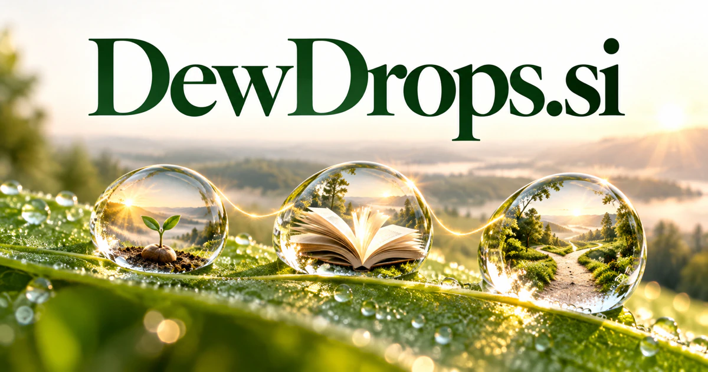

# DewDrops.si — Small discoveries that can grow into something more

DewDrops.si takes its image from individual drops of dew: small, fresh observations that can form a larger whole. It could suit a learning companion or personal-knowledge tool that connects brief insights with a person’s developing questions. Garden journals, environmental observations, family discovery and gentle creative routines give the same idea useful physical and educational contexts.

[Enquire about DewDrops.si](mailto:hedge.pike02@icloud.com?subject=Domain%20enquiry%3A%20dewdrops.si)

## What the name opens up

Dewdrops is the plural of [dewdrop](https://www.merriam-webster.com/dictionary/dewdrop), a drop of dew. Its literal imagery suggests freshness, morning light, delicate surfaces, and many small elements forming something larger. Those associations open possibilities beyond daily lessons: garden observations, sensory design, skincare presentation, environmental sensing, and carefully portioned information. The plural is useful for a collection-based business. Each lesson, note, product, or observation can be a dewdrop within a coherent whole. The name offers an emotional atmosphere without dictating one narrow software function.

## Business opportunities

### 1. Morning learning

A morning learning companion could connect a learner's curiosity, prior understanding and current context, delivering a small insight that opens a deeper path of exploration. Subscribers could collect the editions into subject notebooks. Paid newsletters or learning memberships would make the morning-freshness metaphor part of a repeatable, useful educational experience.

### 2. Workplace microlearning

Relate real assignments, skill gaps and examples from the team, preparing short practice that transfers directly into the next task. Managers could review recurring questions before planning a workshop. Organization subscriptions would serve ongoing skill development in portions that fit the working day.

### 3. Family discovery

Parents could save photographs and responses in a shared collection. A family discovery service could connect children's questions, household activities and available materials, turning ordinary moments into shared investigations and meaningful conversation. Activity packs, printed cards, or memberships would bring the natural discovery identity into daily family life.

### 4. Garden observation journals

A gardening assistant could relate observations, plant histories and changing conditions, guiding the grower toward useful questions and a practical next observation. Seasonal summaries could reveal useful patterns and prompt a useful next observation. Consumer subscriptions, seed-shop partnerships, or printed journals could connect a gentle software experience with physical gardening.

### 5. Mindful creative prompts

Connect a person's mood, selected memories and artistic interests, offering a small exercise that develops into a more sustained creative practice. Users could collect their responses in a personal archive. Paid prompt collections, journals, and facilitator editions would suit a calm brand built around attention and creative practice.

### 6. Environmental sensor dashboards

Observations could be compared with human notes. An environmental assistant could combine sensor readings, location context and past conditions, helping residents or researchers understand which local changes merit attention. Hardware bundles or monitoring subscriptions could turn the natural name into a practical environmental technology identity.

### 7. Skincare discovery tools

A skincare discovery service could reconcile a person's stated preferences, product information and routine complexity, helping them organize choices and questions for appropriate professional advice. Retailers could offer educational consultations and curated starter sets. The name's fresh imagery suits presentation, while product selection would remain grounded in the buyer's stated needs and published information.

### 8. Personal knowledge fragments

Connect brief notes, sources and emerging questions, turning scattered fragments into a useful explanation or a new line of research. Related fragments could gradually form project collections. A consumer subscription could make the plural metaphor tangible through a growing, searchable personal knowledge garden.

### 9. Children's nature collections

Teachers could build classroom collections from pupils' photographs and notes. A field-learning companion could connect a child's sightings, seasonal patterns and follow-up questions, building a personal collection that encourages careful observation rather than passive recognition. Sell thematic packs, school licenses, or a family membership that connects screens with actual outdoor exploration.

### 10. Gentle home collections

A home-curation adviser could relate daily routines, sensory preferences and material choices, assembling small changes that make a living space feel more coherent and comfortable. A design-led shop could pair products with personalization tools and curated room stories. The domain would support a physical brand whose visual identity already has a coherent starting point.

## A Super Intelligence product vision

A Dewdrops Super Intelligence companion could produce one concise daily insight from a user's selected subjects and saved material. It would connect that insight to an original source, a small practical exercise, and the user's previous questions. Over time, the system could organize these fragments into a richer learning map. The opportunity is a thoughtful subscription that makes understanding accumulate without overwhelming the reader. The same brand could eventually offer family editions, workplace collections, or printed learning cards, each retaining the central idea of small discoveries that add up.

## Related names, different directions

- [EduSpark.si](eduspark-si.md) — Turn an initial discovery into a structured lesson, practical project or teaching program.
- [Doze.si](doze-si.md) — Explore a quieter routine and rest-oriented interpretation of gentle everyday technology.
- [HomeGuide.si](homeguide-si.md) — Connect small observations with practical household and garden decisions.

## Acquire the domain

Contact [hedge.pike02@icloud.com](mailto:hedge.pike02@icloud.com?subject=Domain%20enquiry%3A%20dewdrops.si) to discuss a direct-purchase discount, an offer, or a portfolio package.

[View the sales listing](https://www.dynadot.com/market/user-listings/dewdrops.si) · [Purchase options and escrow](../guides/how-to-buy.md) · [Browse all domains](../README.md)

## Sources and further reading

- [Dewdrop — Merriam-Webster](https://www.merriam-webster.com/dictionary/dewdrop) — Literal meaning grounding the natural imagery.
