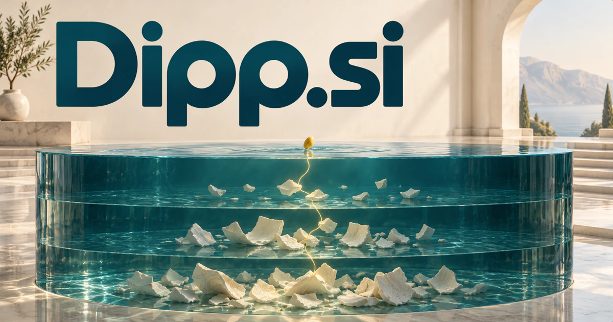

# Dipp.si — Start small, then follow a better question deeper

Dipp.si is a four-letter brand spelling inspired by dip, rather than the standard English word itself. Its strongest proposed product is an approachable research companion: begin with a small question, connect useful evidence and specialist analyses, then let the user choose where to go deeper. Creative experiments, product sampling, learning and discovery offer other interpretations of that inviting first step.

[Enquire about Dipp.si](mailto:hedge.pike02@icloud.com?subject=Domain%20enquiry%3A%20dipp.si)

## Meaning and naming depth

**Dipp is a brand spelling inspired by “dip,” with a doubled final p.** It retains the familiar word's compact shape while giving a designer a distinctive repeated-letter ending. “Dip” has several established senses: briefly entering liquid, a short swim, a downward movement, a sauce, and a brief exploration of a subject. [Cambridge's entry](https://dictionary.cambridge.org/us/dictionary/english/dip) supports those meanings; the product interpretations below develop them into possible businesses.

Three naming territories are especially productive. **Immersion** suggests entering a topic or experience. **Sampling** suggests trying a small portion before committing. **Movement beneath the surface** suggests finding information that a quick glance misses. The doubled p can become two droplets, two connected nodes, or a mirrored mark. A brand can establish “dip” as its spoken form and consistently retain the four-letter written identity.

## Business opportunities

### 1. AI research that starts small and goes deep

A research workspace could connect a small initial question with specialist analyses and source evidence, expanding the investigation only where a deeper answer becomes useful. A question could open a source map, competing explanations, and suggested follow-up investigations. Paid personal workspaces and team research libraries would monetize a progression from a quick introduction to a carefully assembled evidence brief.

### 2. Discovery feed with adjustable depth

Relate a person's interests, unfamiliar topics and previous questions, offering a quick introduction with an intelligible path toward greater depth. Each card could unfold into a summary, original source, context, and saved learning trail. Memberships or publisher partnerships could support topic collections for curious readers and professional learners.

### 3. Visual experimentation for creative teams

A workspace could generate alternatives, collect feedback, and organize approved directions into a reusable library. A creative assistant could connect a brief, visual references and production constraints, coordinating controlled experiments that help designers understand which direction deserves development. Studio subscriptions and project credits could serve agencies, independent creators, and in-house brand teams.

### 4. Image restoration and enhancement

An image restoration assistant could relate a damaged image, available context and alternative reconstruction methods, preparing an inspectable enhancement workflow for a creator or archivist. The [Deep Image Prior research project](https://dmitryulyanov.github.io/deep_image_prior) provides a relevant technical connection through denoising, inpainting, and super-resolution. A business could sell processing credits, batch tools, and specialist restoration services with editable outputs.

### 5. Product sampling and trial experiences

Connect a customer's preferences, past trials and product characteristics, organizing experiments that reveal meaningful fit before a broader commitment. Preference interviews could shape each sample box and subsequent recommendations. Revenue could come from curated kits, retailer services, or recurring discovery memberships, with Dipp expressing the act of trying something new.

### 6. Sauce and flavor discovery brand

Home cooks and small food businesses could explore sauces through a flavor companion that connects ingredients, dietary preferences and the intended meal. It could organize tasting sequences, explain why a pairing fits and adapt quantities into a practical shopping list. Preference notes would make the next experiment more useful. The brand could begin digitally and expand into curated products, recipe licensing or restaurant collaborations.

### 7. Brief lessons and practical learning sessions

A learning companion could connect a person's practical question, existing knowledge and immediate task, delivering a brief lesson followed by a useful opportunity to apply it. Each session could end in a small practical task and a choice of deeper pathways. Individual memberships, cohort programs, and employer learning licenses offer different ways to package the same approachable identity.

### 8. Business performance investigation

Relate a performance change to operating context and competing explanations, coordinating specialist checks to identify what a team should investigate next. A tool could compare affected segments, identify missing evidence, and prepare questions for relevant teams. Analytics subscriptions could appeal to operators who need to understand a change before choosing an intervention.

### 9. Water experiences and local discovery

Venue information, conditions, equipment requirements, and instructor availability could form one searchable collection. A local water-activity planner could connect local conditions, participant preferences and operator knowledge, helping customers compare suitable experiences and prepare questions before booking. Booking commissions, club software, and curated memberships provide distinct commercial routes.

### 10. Personal knowledge capture

A personal knowledge workspace could connect a captured thought with relevant sources, previous notes and unfinished questions, turning a quick dip into an enduring research thread. Specialist agents could suggest useful connections and retrieve a small answer from a growing private collection. A subscription application could attract researchers, writers, and people who want their saved material to become useful again.

### 11. Dataset inspection and curation

Compare task objectives, representative samples and metadata, helping researchers decide where quality review or additional collection will be most informative. Specialist agents could propose clusters and surface unusual examples for review. Team subscriptions or private deployments would serve data practitioners who need more understanding than a spreadsheet preview provides.

### 12. Immersive previews and interactive storytelling

Visitors might explore a scene, speak with a fictional guide, or examine an object before entering a longer experience. An immersive assistant could connect a participant's curiosity, a world's narrative logic and real-time choices, creating previews that reveal more as the user explores. Licensing and commissioned installations could complement consumer story subscriptions.

## A Super Intelligence product story

Dipp.si can frame Super Intelligence as **depth on demand**. A user starts with a small question; an AI workspace proposes an outline, finds material, opens useful tools, and lets the user decide where to explore further. A marketing team investigating a campaign could move from a performance dip to evidence, creative alternatives, and an approved next experiment. The intelligence ambition feels accessible because the brand promises a manageable first step.

## Why the name works

The attraction is the combination of a four-letter identity, a natural action, and room to expand. It can be playful for a consumer app or crisp for a research tool. Dipp Explore, Dipp Studio, and Dipp Insights are coherent potential extensions. **“Start with a dip. Discover the depth.”** gives the brand an invitation that can connect discovery, learning, and creative experimentation.

## Related names, different directions

- [EasySearch.si](easysearch-si.md) — Make straightforward discovery and retrieval the dominant promise instead of adjustable depth.
- [TextArt.si](textart-si.md) — Develop the visual experimentation and expressive creation side of the name.
- [DataMonkey.si](datamonkey-si.md) — Concentrate on the detailed data preparation and investigation behind a deeper research workflow.

## Acquire Dipp.si

[Buy or make an offer on Dynadot](https://www.dynadot.com/market/user-listings/dipp.si), or email [hedge.pike02@icloud.com](mailto:hedge.pike02@icloud.com?subject=Domain%20enquiry%3A%20dipp.si) to discuss a direct purchase, a possible discount, or a portfolio bundle. The proposed businesses above are ideas for a future owner.

[Purchase options and Escrow.com](../guides/how-to-buy.md) · [Browse all domains](../README.md)

## Research references

- [Cambridge Dictionary: dip](https://dictionary.cambridge.org/us/dictionary/english/dip) — The underlying action, exploration, food, water, and downward-movement senses.
- [Deep Image Prior: researchers' project page](https://dmitryulyanov.github.io/deep_image_prior) — A technical reference for the image-restoration direction.
