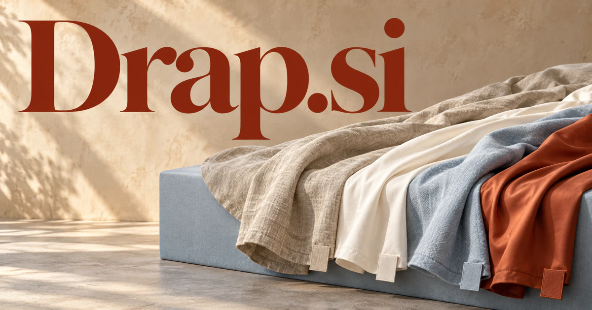

# Drap.si — Connect the feel of fabric with better design choices

Drap.si is a compact French word for a bed sheet or certain cloth, giving a textile or design business a real linguistic foundation. It could name a workspace connecting materials, visual intentions and practical constraints for designers or hospitality teams. Bedding, fabric discovery, garment fit and digital simulation offer distinct products under a coherent material-centered brand.

[Enquire about Drap.si](mailto:hedge.pike02@icloud.com?subject=Domain%20enquiry%3A%20drap.si)

## Business opportunities

The strongest route depends on the buyer’s audience and the problem they want to solve. These directions develop different meanings of the name into practical product and service concepts.

### 1. Design-led bedding brand

A bedding assistant could connect a customer's material preferences, room character and care requirements, assembling a coherent collection instead of recommending isolated products. Customers could save their bed dimensions and preferences, allowing replenishment reminders and seasonal launches to feel useful rather than generic.

### 2. Hospitality linen management

Relate room turnover, inventory movement and service standards, helping hospitality teams coordinate supply, washing and replacement across changing demand. A property manager could follow an unexpected linen shortage from a housekeeping observation to stock allocation, laundry schedules and the next purchasing review. Property subscriptions could connect housekeeping observations with purchasing decisions and make missing or worn textiles easier to investigate.

### 3. AI interior textile visualization

An interior assistant could reason across room imagery, light conditions and textile behavior, preparing visual alternatives that connect a desired feeling to practical material choices. Retail licensing or paid design sessions could turn inspiration into a reviewed shopping list with sample requests, measurements, and installer questions attached.

### 4. Digital fabric library

A fabric library assistant could connect swatch properties, visual references and project requirements, helping designers locate comparable materials and document why a selection fits. Memberships could serve fashion studios and visualization teams that need consistent material references across multiple projects and collaborators.

### 5. Virtual clothing fitting

Relate garment construction, a customer's chosen measurements and intended use, explaining fit alternatives and the information needed for a useful preview. A shopper could compare how the same style is intended to sit in different sizes, with missing construction details surfaced as questions rather than disguised as certainty. Usage-based merchant plans could integrate garment imagery, size information, and customer-controlled photographs.

### 6. Hotel sleep experience collections

A guest experience assistant could combine room environment, bedding choices and visitor preferences, coordinating a considered sleep setting without treating every guest as identical. Wholesale margins, room consultations, and optional guest storefronts could connect a hospitality experience with an identifiable consumer brand.

### 7. Textile sourcing and sample approvals

A sourcing assistant could connect design intent, material specifications and supplier samples, guiding teams through approvals and surfacing the tradeoffs behind each textile choice. A team subscription could preserve the relationship between an approved swatch, its specification, and the eventual manufacturing order.

### 8. Cloth simulation and 3D assets

Reconcile fabric references, geometric constraints and visual goals, helping artists select and tune digital materials for a particular scene. Artists could explore how a selected material behaves in a scene, retain the settings behind a chosen look and reuse the result across a production. Purchasable collections and team licenses could support a specialized creative business with reusable assets.

### 9. Circular textile services

A textile reuse planner could connect material condition, repair options and future use, coordinating pathways that keep cloth valuable through reuse, remaking or recovery. Transaction fees or supplier memberships could support listings with condition photographs, batch quantities, material descriptions, and practical collection arrangements.

### 10. Personal style and sewing education

A sewing education companion could relate a learner's design ambition, fabric behavior and current skills, creating a practical sequence of experiments that builds independent judgment. Paid courses, pattern bundles, and guided kits could give beginners a tangible result while building a long-term learning relationship.

## A Super Intelligence product story

Drap.si could become a Super Intelligence design studio that connects a room photograph, a preferred mood, existing furniture, and a budget with actual textile options. Separate agents could compare materials, prepare sample orders, check measurements, and assemble proposals for human approval. The physical meaning keeps the ambition anchored in a visible result.

## Why this name can carry a business

Four letters make a restrained wordmark possible, while the real textile meaning supplies a specific commercial foundation. Drap can feel elegant without requiring a luxury-only positioning. Its range extends naturally from a single sheet collection to an entire operating platform for material selection, design, and textile services.

## Related names, different directions

- [Bristles.si](bristles-si.md) — Explore another tactile identity centered on tools, marks and the way a surface is worked.
- [HomeGuide.si](homeguide-si.md) — Place textile decisions within a broader sequence of household projects and practical choices.
- [CurbAppeal.si](curbappeal-si.md) — Extend visual planning from interior materials to a property’s exterior presentation.

## Acquire Drap.si

The product directions above are ideas for a buyer to develop; software, customer accounts, content libraries, and an operating business are not included.

[Buy or make an offer on Dynadot](https://www.dynadot.com/market/user-listings/drap.si), or email [hedge.pike02@icloud.com](mailto:hedge.pike02@icloud.com?subject=Domain%20enquiry%3A%20drap.si) to discuss a direct purchase, a possible discount, or a portfolio package. Marketplace availability and checkout terms can vary. See [purchase options](../guides/how-to-buy.md) for the available marketplaces and an Escrow.com transaction route.

## Research references

- [Larousse: drap](https://www.larousse.fr/dictionnaires/francais/drap/26749)

[Browse all domains](../README.md)
