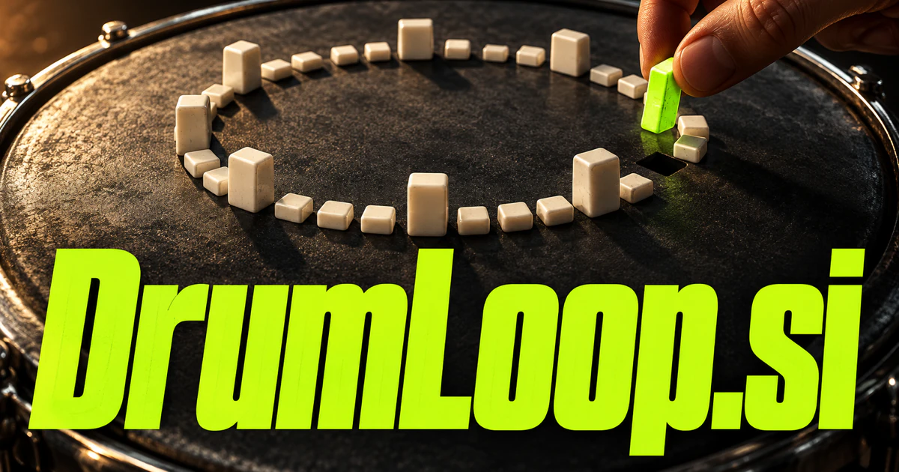

# DrumLoop.si — Find the rhythm a piece actually needs

DrumLoop.si names a repeated rhythmic passage, giving a musical product both category clarity and an idea of iteration. It could become a producer’s workspace that connects intended feel, arrangement context and editable patterns, or a teaching service that adapts practice to a musician’s playing. Sample discovery, collaboration, interactive games and live preparation offer related but distinct businesses.

[Enquire about DrumLoop.si](mailto:hedge.pike02@icloud.com?subject=Domain%20enquiry%3A%20drumloop.si)

## What the name opens up

Drum Loop combines an instrument category with repetition: a rhythmic passage returns and becomes the foundation for something larger. A loop can be an audio recording, an editable sequence, or a practice structure; those are different product forms with shared musical intent. Drum makes the territory clear, while loop creates a connection to iteration, variation, and collaboration. A buyer could serve producers, teachers, performers, game developers, or audio creators. [AudioBufferSourceNode](https://developer.mozilla.org/en-US/docs/Web/API/AudioBufferSourceNode) documents an actual browser source node with looping support, a technical building block for the proposed product.

## Business opportunities

### 1. Loop creation

A composition assistant could connect a musician's intended feel, tempo and arrangement context, proposing editable rhythmic patterns with meaningful alternatives rather than random variations. Users could audition a groove inside their own work. Subscriptions or software licenses would sell control over rhythm as well as quick access to ideas.

### 2. Sample catalog

Interpret a production brief, groove characteristics and available recordings, locating loops that support the musical role the producer needs. Producers could compare candidates in a project collection before buying. Pack sales or memberships would support a specialist label serving working musicians and content makers.

### 3. Rhythm teaching

Learners could compare what they played with the intended structure. A rhythm teaching companion could connect a learner's timing patterns, musical interests and practice history, designing focused exercises that explain the next useful improvement. Teaching-studio licenses or course subscriptions would connect the loop concept with sustained musical practice.

### 4. Live practice accompaniments

A practice companion could coordinate accompaniment with a performer's goals and current playing, adapting a session around the musical skill being developed. Teachers could attach exercises and students could save sessions. Subscriptions or instrument-specific lesson packs could serve players who need a reliable rhythm partner between rehearsals.

### 5. Game rhythm systems

Relate player state, scene tension and rhythmic structure, planning transitions that make interactive music serve the changing experience. Deliverables could include stems, metadata, and implementation notes. Asset licenses or studio subscriptions would connect musical loops with evolving scenes and interactive production workflows.

### 6. Drummer collaboration rooms

Collaborators could preserve who contributed each part. A collaboration assistant could connect musicians' parts, intentions and feedback, helping a remote group resolve rhythmic differences and develop a shared arrangement. Paid project workspaces or creator memberships could support a community whose work begins with a shared rhythmic foundation.

### 7. Fitness class music tools

A class music planner could connect exercise structure, instructor cues and musical energy, preparing rhythm sequences that support the intended session flow. A workspace could organize routines and rehearsal notes. Studio subscriptions or production services could serve a different customer group with a genuine need for structured rhythm.

### 8. Percussion transcription studies

Relate an audio passage, instrument possibilities and rhythmic context, preparing candidate interpretations for musicians to inspect and refine. Students could compare the proposed pattern with the source and correct it. Course subscriptions or teacher editions would focus on understanding rhythm through practical listening and notation.

### 9. Analog rhythm collections

Customers could buy packs with both audio and documented settings. An archive workspace could connect analog recordings, session notes and musical characteristics, helping producers discover useful patterns and preserve context around a collection. A specialist label or product business could give the brand a distinctive material character.

### 10. Rhythm challenges and learning games

An adaptive rhythm game could connect a player's rhythmic understanding, response patterns and chosen music, adapting challenges that turn repeated play into musical progress. Players could progress through instructor-designed levels or share original patterns. Consumer subscriptions, classroom licenses, or event editions would extend the name naturally into musical play.

## A Super Intelligence product vision

A DrumLoop SI assistant could take a user's tapped pattern, reference recording, or written description and propose several editable rhythmic variations. It could retain tempo, instrument roles, swing choices, and structural notes so the producer sees how the result was constructed. The user would audition changes in the actual track. A subscription could begin with a pattern editor and expand into sample organization, practice tools, and collaboration. The intelligence story is responsive musical development, with the creator controlling the beat and deciding what belongs in the finished work.

## Related names, different directions

- [AudioX.si](audiox-si.md) — Broaden the production workspace beyond rhythm into speech, restoration and other audio tasks.
- [Etudes.si](etudes-si.md) — Make deliberate musical studies and the development of technique the central experience.
- [Solfa.si](solfa-si.md) — Explore a music-learning identity grounded in singing, pitch relationships and musical understanding.

## Acquire the domain

Contact [hedge.pike02@icloud.com](mailto:hedge.pike02@icloud.com?subject=Domain%20enquiry%3A%20drumloop.si) to discuss a direct-purchase discount, an offer, or a portfolio package.

[View the sales listing](https://www.dynadot.com/market/user-listings/drumloop.si) · [Purchase options and escrow](../guides/how-to-buy.md) · [Browse all domains](../README.md)

## Sources and further reading

- [AudioBufferSourceNode — MDN](https://developer.mozilla.org/en-US/docs/Web/API/AudioBufferSourceNode) — Technical reference for looping recorded audio in browser applications.
