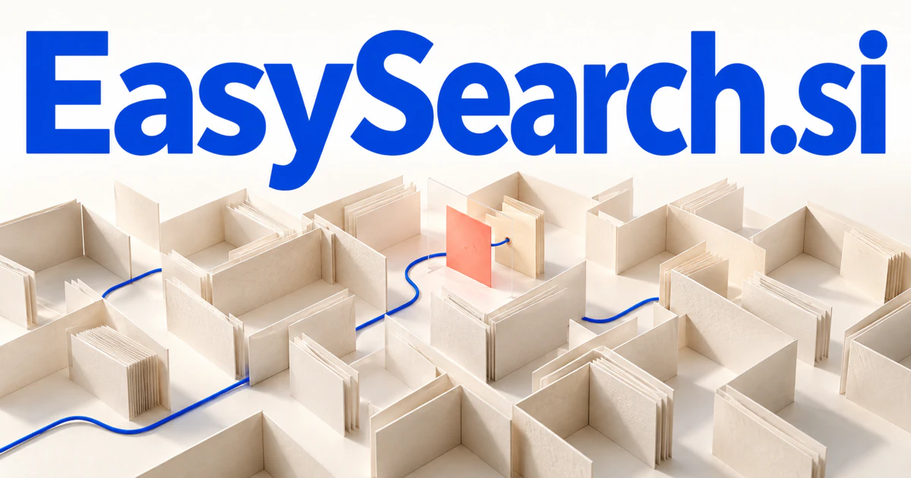

# EasySearch.si — Make the difficult part of discovery feel simple

EasySearch.si makes a direct promise about an experience rather than an indexing technology. It could serve people who know their problem but not the right query, connecting context, constraints and source evidence across a collection. Enterprise knowledge, shopping, technical support and personal retrieval provide distinct audiences whose searches become easier when the system understands the task.

[Enquire about EasySearch.si](mailto:hedge.pike02@icloud.com?subject=Domain%20enquiry%3A%20easysearch.si)

## Meaning and naming depth

Easy describes the desired experience, while search describes an active investigation rather than passive browsing. The compound is transparent: customers should not need to understand the internal indexing method before they can benefit from it.

The depth lies in the many ways search can be difficult. People may not know the exact word, may have several constraints, may be looking across languages, or may need to verify the result. A strong EasySearch product could simplify query formulation, filtering, comparison, and source inspection. Knowledge organization standards such as SKOS also show how labels and relationships can support discovery beyond exact text matching.

## Business opportunities

### 1. Enterprise document discovery

An enterprise assistant could connect a worker's question, project context and scattered documents, locating evidence and explaining how it supports an answer. Results could show the relevant passage, source, and current version. Sell organization workspaces, maintained connectors, and configuration services for firms whose knowledge is scattered across applications.

### 2. Conversational shopping search

Reconcile a customer's purpose, preferences and product constraints, asking useful questions and comparing options through reasons that matter to that person. Retailers could improve discovery without rebuilding their catalog around every possible phrase. Sell merchant subscriptions, catalog preparation, and a search API for ecommerce developers.

### 3. Research collection search

A researcher could distinguish a primary document from commentary. A research workspace could relate a new question to concepts, methodologies and evidence across a collection, helping investigators discover relevant work beyond literal keyword overlap. Sell individual plans, collaborative collections, and specialist research services to professional teams.

### 4. Search for technical support

A support assistant could connect a reported symptom, environment details and documented resolutions, guiding a customer toward a relevant diagnostic path instead of a generic search result. The interface could ask about the symptom and link to the relevant procedure. Sell software and content maintenance services to manufacturers, service providers, and developer platforms.

### 5. Local service discovery

Connect a person's practical problem, location constraints and provider capabilities, preparing a reasoned shortlist and the questions needed to compare it. A homeowner could describe a repair instead of guessing a trade label. Sell provider tools, customer planning services, or a focused marketplace for a clearly defined service area.

### 6. Personal file and photo retrieval

Users could search “the proposal from last spring” and inspect candidates. A contextual file finder could combine remembered context, content relationships and the user's current task, finding the file or image that matters even when its name is forgotten. Sell desktop applications, individual subscriptions, and optional shared household or team features.

### 7. Multilingual knowledge access

A multilingual assistant could connect equivalent concepts, cultural context and source passages, helping readers investigate a subject across language boundaries without losing the evidence. Results could preserve original passages with contextual explanations. Sell indexed collections, translation-review workspaces, and integrations for international research or publishing teams.

### 8. Parts and compatibility lookup

Relate a component's specifications, intended operating environment and installation requirements, explaining which alternatives fit and what remains uncertain. A maintenance buyer could describe an existing assembly and the job it performs, then inspect the compatibility evidence behind each suggested replacement. Customers could narrow a confusing catalog through a structured conversation. Sell catalog software, data normalization, and integrations with ordering systems.

### 9. Search evaluation and improvement

Reviewers could collect examples and compare proposed changes against a test collection. A search evaluation workspace could connect user intentions, retrieval failures and collection structure, helping teams design improvements that make actual tasks easier to complete. Sell evaluation workspaces, implementation projects, and recurring search quality consulting.

### 10. Accessible search design studio

An accessible discovery service could relate different interaction needs, information structures and user goals, designing search journeys that explain choices and support useful follow-up. Specialist agents could assist prototyping and content organization while user research shapes the experience. Project fees and maintenance retainers would support a service business under the same outcome-led name.

## A Super Intelligence brand

EasySearch.si can make Super Intelligence a discovery story: understand what a person means, connect relevant sources, and present a clear route forward. A possible platform could combine semantic retrieval, structured filtering, and a conversation that narrows uncertainty. The name keeps the product grounded in the customer’s experience rather than the complexity of the underlying models.

## Why the name works

Both words are familiar, and the promise is testable through the interface itself. The name can support EasySearch Docs, Shop, Parts, or Research as related vertical products. **“Less searching. More finding.”** provides a natural positioning line for a company focused on helping people reach useful material.

## Related names, different directions

- [AudioSearch.si](audiosearch-si.md) — Choose a focused retrieval identity for recordings, spoken evidence and acoustic material.
- [DataMonkey.si](datamonkey-si.md) — Work on the preparation and analysis that turn retrieved data into something usable.
- [ChatWeb.si](chatweb-si.md) — Make conversation and coordinated online tasks the primary interface for discovery.

## Acquire EasySearch.si

[Buy or make an offer on Dynadot](https://www.dynadot.com/market/user-listings/easysearch.si), or email [hedge.pike02@icloud.com](mailto:hedge.pike02@icloud.com?subject=Domain%20enquiry%3A%20easysearch.si) to discuss a direct purchase, a possible discount, or a portfolio bundle. The product directions above are ideas for a future owner.

[Purchase options](../guides/how-to-buy.md) · [Browse all domains](../README.md)

## Sources and further reading

- [Merriam-Webster: search](https://www.merriam-webster.com/dictionary/search) — The ordinary meaning underlying this outcome-led compound.
- [W3C: SKOS Reference](https://www.w3.org/TR/skos-reference/) — Labels, concepts, and relationships used in knowledge organization and discovery.
