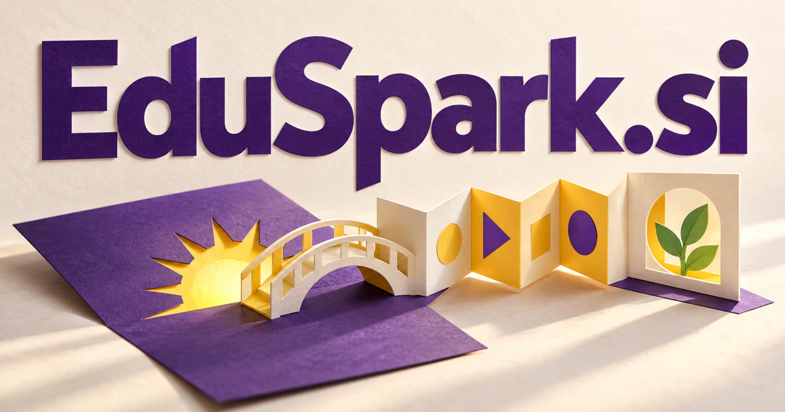

# EduSpark.si — Carry a moment of curiosity into real learning

EduSpark.si combines a familiar education cue with the image of an idea catching light. It could name a learning workspace that connects a student’s interests and understanding with useful questions, experiments and feedback. Teacher preparation, practical skills, coding clubs and family discovery offer different buyers, all with a credible reason to build beyond a single generated lesson.

[Enquire about EduSpark.si](mailto:hedge.pike02@icloud.com?subject=Domain%20enquiry%3A%20eduspark.si)

## What the name opens up

Edu is a familiar education cue; spark contributes the image of an initiating flash or an idea capable of growth. The figurative uses of [spark](https://www.merriam-webster.com/dictionary/spark) support a brand story about curiosity becoming activity. The most attractive interpretation is not that software magically teaches every subject. It is that a well-chosen question, example, or exercise can start a useful learning process. The compound can therefore support teachers, individual learners, practical training, creative projects, and educational resources while keeping a recognizable educational center.

## Business opportunities

### 1. Teacher preparation

A teacher assistant could connect curriculum intentions, classroom context and students' demonstrated understanding, preparing lessons and alternative explanations around real learning needs. Teachers could select what fits their learners and revise the material before sharing. Tutor subscriptions or school licenses would turn preparation assistance into usable classroom work.

### 2. Student projects

Relate a student's interests, available resources and conceptual goals, guiding an investigation through useful questions, experiments and a finished explanation. Instructors could review each stage. Program licenses and guided cohorts would connect curiosity with work a learner can actually explain.

### 3. Adult skills practice

Participants could see the difference between a first attempt and a revised one. A skills assistant could connect a learner's actual work, existing knowledge and desired capability, preparing focused practice with feedback that transfers to a practical task. Course fees or institution subscriptions would fund practical programs built around specific occupational skills.

### 4. Hands-on science kits

A science learning companion could combine household materials, observable phenomena and a child's questions, designing experiments that help them reason from what they see. Families and after-school programs could select themes and document what happened. Product sales and educator licenses would make the spark metaphor tangible through experiments that invite questions and investigation.

### 5. Coding project clubs

Connect a club member's project idea, code behavior and conceptual gaps, coaching development without replacing the learner's opportunity to understand decisions. Mentors could review decisions and explain debugging steps. Cohort fees, memberships, and school editions could fund a practical community that values building and understanding together.

### 6. Language curiosity tools

Activities could move from an engaging example to vocabulary practice and conversation. A language assistant could connect a person's curiosity, real conversational context and unfamiliar expressions, creating practice that makes vocabulary useful beyond an isolated exercise. Consumer subscriptions or tutor workspaces could support a focused educational product with a lively personality.

### 7. Museum learning companions

A museum assistant could connect collection objects, visitor questions and related ideas, turning a visit into a personalized inquiry that can continue afterward. Visitors could save discoveries and continue exploring afterward. Institutional licenses or sponsored programs could connect physical collections with an educational experience that extends beyond a single visit.

### 8. Parent-led activity libraries

Reconcile children's interests, available time and household resources, coordinating activities that make curiosity a shared experience. Parents could choose a goal, available time, and a child's interests. A family membership, printable shop, or subscription box could turn the brand into a trusted source of practical inspiration.

### 9. Professional teaching studios

The business could serve independent experts before expanding into institutions. A teaching studio companion could connect a client's learning goals with subject specialists, assessment evidence and lesson design, organizing a coherent program of human-led instruction. Subscription revenue or course commerce would connect software tools with the educator's actual work.

### 10. Learning-resource marketplaces

A resource marketplace service could connect educator needs, curriculum context and material quality, helping teachers select and adapt resources for a particular group of learners. Buyers could inspect samples and choose materials by objective, age range, and teaching context. Marketplace fees or contributor subscriptions could support an expanding library of practical educational sparks.

## A Super Intelligence product vision

An EduSpark SI learning studio could begin with a student's own question and build several routes into it: an explanation, a worked example, an experiment, and a way to test understanding. A teacher would select or edit the material, then inspect the learner's actual attempt. The first product could specialize in project-based science or adult software training. Its broader promise is adaptive curiosity: intelligence that helps people discover an entry point, work through the difficulty, and produce something they can explain.

## Related names, different directions

- [JobReady.si](jobready-si.md) — Focus the learning journey on evidence of capability and practical preparation for work.
- [Etudes.si](etudes-si.md) — Explore deliberate studies, repeated practice and the development of creative mastery.
- [Cues.si](cues-si.md) — Build around the timely question or prompt that helps a learner take the next step.

## Acquire the domain

Contact [hedge.pike02@icloud.com](mailto:hedge.pike02@icloud.com?subject=Domain%20enquiry%3A%20eduspark.si) to discuss a direct-purchase discount, an offer, or a portfolio package.

[View the sales listing](https://www.dynadot.com/market/user-listings/eduspark.si) · [Purchase options and escrow](../guides/how-to-buy.md) · [Browse all domains](../README.md)

## Sources and further reading

- [Spark — Merriam-Webster](https://www.merriam-webster.com/dictionary/spark) — Literal and figurative meanings underlying the curiosity-and-growth reading.
