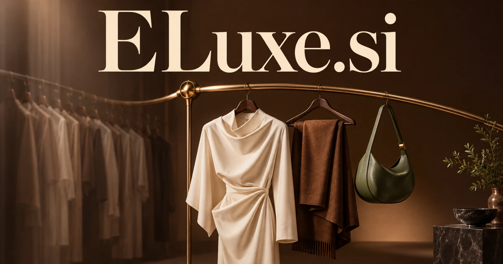

# ELuxe.si — Make personal attention feel considered

ELuxe.si is a proposed blend of a digital e and luxe, the latter carrying an established luxury association. It could suit a personal shopping or concierge service that connects taste, intended use and practical coordination instead of simply showing more products. Interiors, travel, resale collections and bespoke consultations give the brand several ways to express thoughtful attention.

[Enquire about ELuxe.si](mailto:hedge.pike02@icloud.com?subject=Domain%20enquiry%3A%20eluxe.si)

## What the name opens up

Eluxe is a proposed brand blend: e can suggest a digital channel or electronic service, while luxe has a real luxury association. [Larousse's luxe entry](https://www.larousse.fr/dictionnaires/francais/luxe/48146) provides the linguistic foundation for the latter. The combination can also be read as a seamless coined word, which gives a buyer more freedom in pronunciation and identity. Its strongest territories involve curation, personal attention, design, and premium presentation. A buyer could connect digital intelligence with physical products or carefully managed services, using the same master brand across several considered collections.

## Business opportunities

### 1. Personal shopping

A shopping service could connect personal taste, intended use and collection context, explaining a focused selection rather than overwhelming a customer with premium products. Customers could review a coherent proposal and arrange the next appointment. Professional subscriptions or paid styling packages would make personal attention the core commercial value.

### 2. Hospitality concierge

Reconcile guest preferences, service availability and local knowledge, coordinating a considered stay through relevant specialist handoffs. A guest’s request for a quiet local experience could become a considered shortlist, followed by the necessary coordination between the property and relevant local specialists. Staff could distinguish a proposed experience from a confirmed arrangement. Per-property subscriptions or concierge fees would support a carefully managed hospitality service.

### 3. Curated home collections

The customer could understand how each item fits the chosen room concept. An interior curation assistant could connect a home's existing objects, practical routines and design intentions, helping customers build a coherent collection over time. Project services or professional subscriptions would connect digital curation with real purchasing decisions.

### 4. Resale collection services

A resale service could relate item descriptions, condition evidence and collection goals, organizing research and specialist review for a buyer or seller's chosen category. A service could combine preparation with selected marketplace connections. Subscription tools or project fees would serve collectors and independent retailers who value an orderly presentation.

### 5. Personal styling memberships

Connect a person's wardrobe, upcoming occasions and comfort preferences, developing combinations that express their identity across different contexts. Stylists could propose combinations and track what the customer chose. Memberships and professional workspaces could support a business whose premium quality comes from useful personal attention.

### 6. Luxury travel preparation

Clients could review one coherent proposal. A travel planner could coordinate personal interests, service dependencies and local expertise, preparing a distinctive journey whose details work together in practice. Agency subscriptions or planning fees would connect a concise digital identity with a high-touch service business.

### 7. Bespoke product consultations

A bespoke assistant could interpret a customer's aesthetic intentions, functional needs and production constraints, turning a conversation into a clear brief for specialist makers. Customers could follow the progress of a custom piece. Maker subscriptions or directly operated consultation services would turn premium presentation into a practical production workflow.

### 8. Design-object discovery

Connect design history, material qualities and the customer's space, helping a buyer understand why a particular piece belongs in their collection. Editorial notes could explain why each item belongs. Direct sales, commissions, and paid collections could build a commerce identity with room for original products.

### 9. Premium membership portals

Operators could manage the administrative details while preserving a personal tone. A membership service could connect a member's preferences, past experiences and available services, creating an evolving relationship built around relevant personal attention. Per-organization subscriptions would attach the brand to an actual experience layer.

### 10. Gift concierge services

A gift concierge could relate an occasion, recipient interests and the giver's intentions, coordinating thoughtful objects, messages and delivery into one considered experience. A consultation could lead to a shortlist, personal message, and coordinated fulfillment. Planning fees, business subscriptions, or retail margins would make Eluxe a coherent identity for thoughtful premium gifting.

## A Super Intelligence product vision

An Eluxe SI concierge could begin with a customer's preferences, constraints, and the products or services genuinely available through connected providers. It could propose several coherent choices, explain the tradeoffs, and prepare requests for the customer to approve. A stylist might use it for a wardrobe consultation; a hotel might offer it for guest experiences. Revenue could begin with a professional subscription or paid concierge package. The intelligence opportunity is context-rich curation: remembering the details that make a choice feel considered and organizing the practical steps needed to deliver it.

## Related names, different directions

- [GiftGuide.si](giftguide-si.md) — Focus personal curation on understanding a recipient and choosing a meaningful gift.
- [Roseate.si](roseate-si.md) — Explore a warmer aesthetic identity for optimistic, beautiful experiences and lifestyle products.
- [DeckChair.si](deckchair-si.md) — Make leisure, a suitable pace and hospitality planning the core experience.

## Acquire the domain

Contact [hedge.pike02@icloud.com](mailto:hedge.pike02@icloud.com?subject=Domain%20enquiry%3A%20eluxe.si) to discuss a direct-purchase discount, an offer, or a portfolio package.

[View the sales listing](https://www.dynadot.com/market/user-listings/eluxe.si) · [Purchase options and escrow](../guides/how-to-buy.md) · [Browse all domains](../README.md)

## Sources and further reading

- [Luxe — Larousse](https://www.larousse.fr/dictionnaires/francais/luxe/48146) — French lexical background for the luxury component; Eluxe itself is a proposed blend.
