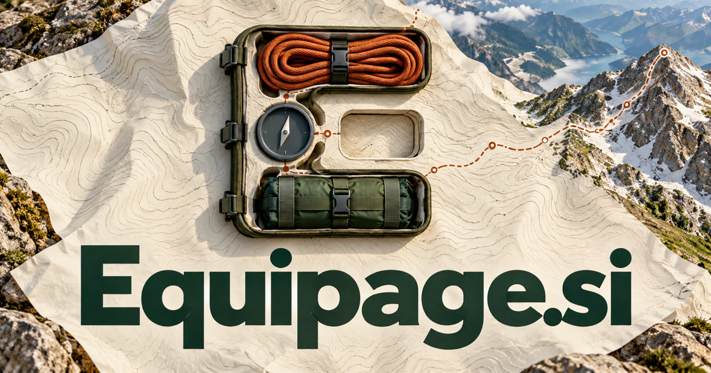

# Equipage.si — Bring the right capabilities together

Equipage.si has documented associations with equipment, an outfitted journey and historical carriage arrangements; the related French équipage means crew. It could become a preparation workspace connecting people, tools and task dependencies for expeditions or field teams. A digital counterpart could assemble specialist agents around a complex objective, giving the older idea of a capable crew a useful new expression.

[Enquire about Equipage.si](mailto:hedge.pike02@icloud.com?subject=Domain%20enquiry%3A%20equipage.si)

## Business opportunities

The strongest route depends on the buyer’s audience and the problem they want to solve. These directions develop different meanings of the name into practical product and service concepts.

### 1. Expedition preparation software

An expedition planner could connect route conditions, participants' capabilities and equipment dependencies, preparing a reasoned readiness plan with focused questions for local specialists. Organization subscriptions could keep assigned gear, inspection records, and participant acknowledgments connected to the actual departure plan.

### 2. Specialist travel equipment shop

Relate a customer's activity, existing kit and practical constraints, recommending a coherent set of tools rather than disconnected accessories. Retail margins and consultations could serve travelers who want a coherent equipment selection rather than a long list of unrelated products.

### 3. Crew and staffing coordination

A crew planner could connect role requirements, staff capabilities and scheduling dependencies, assembling a team whose complementary expertise matches the work to be done. Per-team software plans could combine staffing decisions with transport, equipment collection, and the documents needed for each job.

### 4. Outdoor rental operations

A rental service could reconcile customer plans, inventory condition and turnaround requirements, coordinating suitable kits and preparing clear collection and return workflows. A customer planning a weekend activity could see a complete compatible kit, while the operator reviews missing pieces, inspection needs and the next customer’s reservation. Rental businesses could pay per location while customers see clear collection instructions and a dependable inventory status.

### 5. Professional mobile work kits

Relate job requirements, technician experience and available equipment, assembling a mobile kit with the context needed to use it effectively. Before leaving for a site, a technician could review the required tools, relevant service notes and the components whose absence would prevent the job from being completed. Hardware bundles and company subscriptions could connect procurement, training materials, and useful replenishment reminders.

### 6. Equestrian and carriage experiences

An equestrian experience assistant could connect guest preferences, specialist operator knowledge and itinerary dependencies, shaping a coherent experience around travel, heritage and horsemanship. Operator subscriptions or booking commissions could support participant information, equipment requirements, weather changes, and practical arrival instructions.

### 7. Personal capability inventory

A capability assistant could connect a person's tools, skills and ambitions, helping them identify what to learn, acquire or borrow before starting a new undertaking. A subscription could include proposal preparation, missing-capability checklists, and reviewed recommendations for learning or purchasing.

### 8. Event production logistics

Coordinate equipment, crew roles and production dependencies, preparing a shared operational plan that adapts as the live event develops. A changed stage schedule could reveal which equipment movements and crew handoffs must change with it, preserving a shared understanding across the production. Production companies could pay for reusable project templates, equipment allocation, load schedules, and a clear record of approved changes.

### 9. Emergency preparedness collections

A preparedness planner could connect household needs, local guidance and existing supplies, organizing a practical readiness review with clearly assigned follow-up tasks. Retail bundles and organizational plans could focus on readiness without promising that a standardized kit covers every situation.

### 10. Agent team assembly

An agent team assistant could match a complex objective with specialist capabilities, information dependencies and review points, assembling a coordinated digital crew for the customer's task. Subscription plans could charge for maintained capabilities and execution records rather than an unexplained promise of autonomous work.

## A Super Intelligence product story

Equipage.si could express “Super Intelligence, properly equipped.” A project brief becomes a proposed combination of people, software agents, permissions, reference documents, and physical resources. The system identifies what is missing, proposes an arrangement, and keeps consequential purchasing or deployment choices subject to the project owner's approval.

## Why this name can carry a business

The name feels more considered than a literal inventory label. Its preparation and accompaniment associations support both functional software and a polished consumer experience. It leaves space to move from selling individual tools to coordinating the full collection of resources that makes an activity possible.

## Related names, different directions

- [RouteMapper.si](routemapper-si.md) — Focus on the route, sequence and practical plan that an equipped team follows.
- [BYO.si](byo-si.md) — Make the customer’s ownership and assembly choices explicit through a build-your-own identity.
- [OneNode.si](onenode-si.md) — Explore a compact infrastructure identity for a place where capabilities are deployed or connected.

## Acquire Equipage.si

The product directions above are ideas for a buyer to develop; software, customer accounts, content libraries, and an operating business are not included.

[Buy or make an offer on Dynadot](https://www.dynadot.com/market/user-listings/equipage.si), or email [hedge.pike02@icloud.com](mailto:hedge.pike02@icloud.com?subject=Domain%20enquiry%3A%20equipage.si) to discuss a direct purchase, a possible discount, or a portfolio package. Marketplace availability and checkout terms can vary. See [purchase options](../guides/how-to-buy.md) for the available marketplaces and an Escrow.com transaction route.

## Research references

- [Merriam-Webster: equipage](https://www.merriam-webster.com/dictionary/equipage)
- [Cambridge French-English: équipage](https://dictionary.cambridge.org/us/dictionary/french-english/equipage)

[Browse all domains](../README.md)
