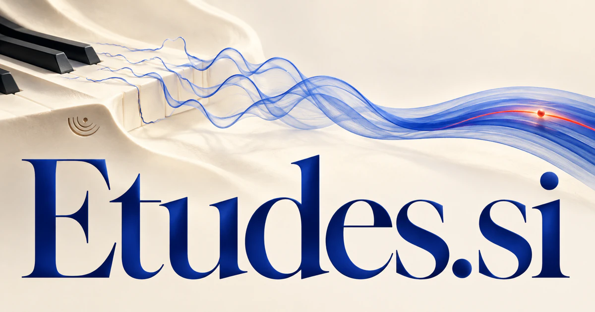

# Etudes.si — Develop mastery through deliberate studies

Etudes.si is the unaccented form of études, with established associations spanning study, investigation and artistic or musical exercises. It could serve musicians, designers or learners through a workspace connecting intentions, examples and feedback into focused practice. Research notebooks, coding studies and strategy explorations extend the same idea: understanding develops through considered work rather than isolated answers.

[Enquire about Etudes.si](mailto:hedge.pike02@icloud.com?subject=Domain%20enquiry%3A%20etudes.si)

## What the name opens up

Etudes is the unaccented domain form of études. In French, [étude and études](https://www.larousse.fr/dictionnaires/francais/%C3%A9tude/31591) encompass study, investigation, preparatory work, artistic studies, and educational work; the musical sense concerns a piece intended for learning. This depth offers more than an instrumental exercise brand. A buyer can connect art, research, design, analysis, and deliberate practice through the idea of concentrated study. The plural is especially valuable for collections: many exercises, many investigations, or several creative series can sit beneath one coherent identity.

## Business opportunities

### 1. Music practice

A music practice companion could connect performance observations, a musician's expressive goals and technical gaps, shaping studies that develop the next useful capability. Learners could see how the next exercise follows from the previous attempt. Studio subscriptions or institutional licenses would support deliberate practice between lessons.

### 2. Practice publishing

Relate learners' needs, teaching sequences and expressive repertoire, helping educators create coherent collections of exercises with a clear progression. Customers could inspect sample pages and the skill each piece develops. Collection sales and memberships would support a publishing business with a clear musical identity.

### 3. Creative study programs

Learners could build a sequence of related experiments. A creative learning studio could connect a participant's visual intentions, references and working process, preparing studies that reveal the effects of deliberate artistic choices. Course fees or school subscriptions would serve art education with a coherent deliberate-practice framework.

### 4. Research study notebooks

A research workspace could connect hypotheses, observations and methodological notes, helping investigators structure an inquiry and decide which experiment or reading should come next. Study templates could preserve the difference between a planned approach and what actually happened. Institutional licenses or individual subscriptions could support careful inquiry in a chosen field.

### 5. Design experiment libraries

Reconcile project constraints, prior experiments and user questions, organizing studies that make competing approaches easier for a team to compare. Teams could explain what each experiment tested. Studio subscriptions or paid collections would make the preparatory-work meaning commercially concrete for professional designers.

### 6. Language practice collections

Tutors could assign a sequence and review actual attempts. A language practice companion could relate a learner's current expression, intended situations and recurring difficulties, preparing focused studies that connect language form with useful communication. Course sales and school licenses could build a learning business whose identity emphasizes purposeful study and useful practice sequences.

### 7. Coding practice studios

A coding study companion could connect program behavior, a learner's reasoning and alternative designs, guiding practice that develops understanding rather than only a correct submission. Mentors could inspect reasoning as well as a working result. Individual memberships or employer licenses would connect deliberate practice to professional development.

### 8. Art book publishing

Connect an artist's studies, process notes and visual themes, shaping a publication that reveals how the work developed. Artists could sell limited editions alongside digital companions. The name supports a publishing identity where the process and study can be as interesting as a final masterpiece.

### 9. Movement and performance practice

Studio subscriptions or guided programs could serve performance education. A performance assistant could relate movement sequences, a practitioner's intentions and feedback, preparing deliberate studies that connect technique with expressive purpose. The musical origin offers a familiar analogy without confining the business to sound.

### 10. Strategy exploration services

A strategy assistant could connect market evidence, organizational capabilities and alternative futures, helping a team develop and compare reasoned studies before selecting a course of action. Project fees could fund focused studies before major commitments. Etudes provides an elegant identity for the disciplined preparation behind a decision.

## A Super Intelligence product vision

An Etudes SI coach could observe a learner's chosen exercise, identify the specific skill being practiced, and propose a short sequence of related challenges. A teacher could revise the sequence and attach examples from the learner's own work. The same study-centered approach could support artists testing light, developers practicing a concept, or researchers comparing methods. A subscription business might begin in one discipline and add expert-designed collections over time. The intelligence ambition is purposeful practice: small tasks arranged so that each one reveals a useful distinction and informs the next attempt.

## Related names, different directions

- [Solfa.si](solfa-si.md) — Concentrate on singing, pitch and the relationships that support musical understanding.
- [EduSpark.si](eduspark-si.md) — Choose a broader educational identity centered on curiosity and project-based learning.
- [TextArt.si](textart-si.md) — Develop expressive studies where words and visual composition are the primary medium.

## Acquire the domain

Contact [hedge.pike02@icloud.com](mailto:hedge.pike02@icloud.com?subject=Domain%20enquiry%3A%20etudes.si) to discuss a direct-purchase discount, an offer, or a portfolio package.

[View the sales listing](https://www.dynadot.com/market/user-listings/etudes.si) · [Purchase options and escrow](../guides/how-to-buy.md) · [Browse all domains](../README.md)

## Sources and further reading

- [Étude, études — Larousse](https://www.larousse.fr/dictionnaires/francais/%C3%A9tude/31591) — French study, investigation, art, educational, and music meanings.
