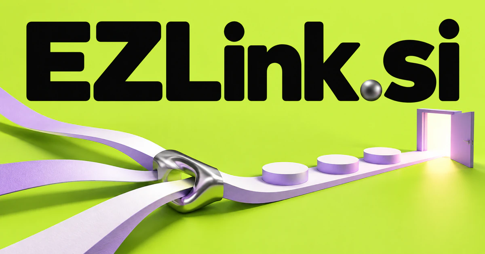

# EZLink.si — Carry useful context across the connection

EZLink.si combines the sound-based easy cue with a word that can mean a URL, a relationship or a connection between systems. It could become an onboarding and handoff product that carries the right context into the next step. Smart destinations, controlled sharing, tool connectors and useful introductions offer distinct starting points beyond a basic link shortener.

[Enquire about EZLink.si](mailto:hedge.pike02@icloud.com?subject=Domain%20enquiry%3A%20ezlink.si)

## Meaning and naming depth

EZ is commonly used as a sound-based shorthand for “easy”; link can mean a web address, a connection, or a relationship between things. EZLink is therefore best understood as a composed brand with an ease-of-connection promise, not a technical acronym that needs a single expansion.

The second half contains more possibility than a URL shortener. A link may carry permissions, context, campaign information, a destination that changes over time, or the next step in a service journey. The URI standard supplies the technical foundation for web addresses; a founder’s opportunity lies in the experience and business process built around them.

## Business opportunities

### 1. Branded short links for campaigns

A campaign assistant could connect a visitor's context, destination options and campaign intent, helping teams maintain meaningful journeys behind short, recognizable links. A client could update an offer without reprinting the physical material containing its link. Sell workspace subscriptions, custom domains, and reporting tools suited to agencies managing several brands.

### 2. One-link client onboarding

Relate a customer's goal, outstanding requirements and service dependencies, presenting the next useful step through one evolving entry point. The customer follows a single address instead of searching an email chain. Charge by active client, with industry templates for bookkeeping, design, property, and consulting services.

### 3. QR destinations for physical businesses

A code might open product instructions, an equipment record, a booking form, or a current menu. A contextual QR destination service could connect the scanned location, customer intent and live service information, making a QR destination useful in the actual moment of interaction. Recurring subscriptions could cover destination updates and multi-location administration.

### 4. Creator’s service and content hub

A creator assistant could connect a visitor's interests, a creator's services and relevant content, guiding people toward a suitable next interaction rather than a static link list. Specialist agents could help assemble a clear page from existing material. Sell premium page tools, storefront features, and design services to independent professionals and audience businesses.

### 5. Controlled sharing for important files

Relate a document's purpose, recipient role and workflow context, helping teams prepare appropriate access and useful accompanying explanations. An adviser sending a client a document could attach the relevant explanation, define the next requested action and retain a clear record of the exchange. The service could show which version was shared with which customer. Paid plans could follow storage, workspaces, or professional reporting needs.

### 6. Connectors for AI assistants

EZLink could maintain connection setup, capability descriptions, and execution history. An integration planner could connect task intent, tool capabilities and permission boundaries, providing the right context when an agent moves between applications. The commercial product could include a connector catalog, a hosted gateway, or integration packages for agencies building specialist agents.

### 7. Software and data synchronization

A synchronization assistant could reconcile differing data meanings, workflow states and ownership rules, coordinating updates that keep related applications aligned without losing business context. A setup wizard could map fields and show exceptions. Sell managed synchronization by connection, with paid assistance for more complicated customer systems.

### 8. Event networking and digital introductions

Connect participants' goals, complementary expertise and conversation history, preparing useful introductions and relevant follow-up after an event. Organizers could provide a connected attendee directory through one event link. Revenue could come from event licenses, exhibitor tools, and reusable professional contact pages.

### 9. Referral and partner relationships

Accountants could refer clients to trusted specialists; local businesses could bundle services. A partner assistant could relate referral intent, customer needs and partner capabilities, coordinating introductions whose context survives each handoff in the relationship. Software fees and managed program services would support a relationship-focused interpretation of link.

### 10. Repair desk for broken web journeys

A journey repair assistant could connect broken destinations, content history and visitor intentions, helping site teams restore useful paths rather than merely replacing missing URLs. An agency could sell ongoing link maintenance with suggested fixes and owner assignments. The value is keeping the connections customers already rely on useful over time.

## A Super Intelligence brand

EZLink.si could describe a connective layer for Super Intelligence: the user states a goal and the system connects the right knowledge, tool, person, or destination. A practical first product might turn a customer invitation into an organized workflow, then expand into reusable agent connectors. The name gives complex orchestration a simple user-facing promise: getting from here to the next useful step.

## Why the name works

The spelling is short enough for a button, a QR caption, or a software badge, and the meaning is easy to demonstrate. “Link” supports both consumer and infrastructure audiences. **“One easy connection. More possibilities.”** would work for a broad platform, while product extensions such as EZLink Share, EZLink Connect, and EZLink Events remain intuitive.

## Related names, different directions

- [FluxAPI.si](fluxapi-si.md) — Focus on the programmatic interfaces and transformations behind a connection.
- [CloudGateway.si](cloudgateway-si.md) — Manage shared routing and policy when many services and agent tools connect.
- [KeyID.si](keyid-si.md) — Explore how identity and credentials determine what a connection should permit.

## Acquire EZLink.si

[Buy or make an offer on Dynadot](https://www.dynadot.com/market/user-listings/ezlink.si), or email [hedge.pike02@icloud.com](mailto:hedge.pike02@icloud.com?subject=Domain%20enquiry%3A%20ezlink.si) to discuss a direct purchase, a possible discount, or a portfolio bundle. The product directions above are ideas for a future owner.

[Purchase options](../guides/how-to-buy.md) · [Browse all domains](../README.md)

## Sources and further reading

- [IETF: URI Generic Syntax](https://www.rfc-editor.org/rfc/rfc3986) — The standard foundation for resource identifiers and web addresses.
- [W3C: Webmention](https://www.w3.org/TR/webmention/) — An example of links carrying interactions between independent websites.
