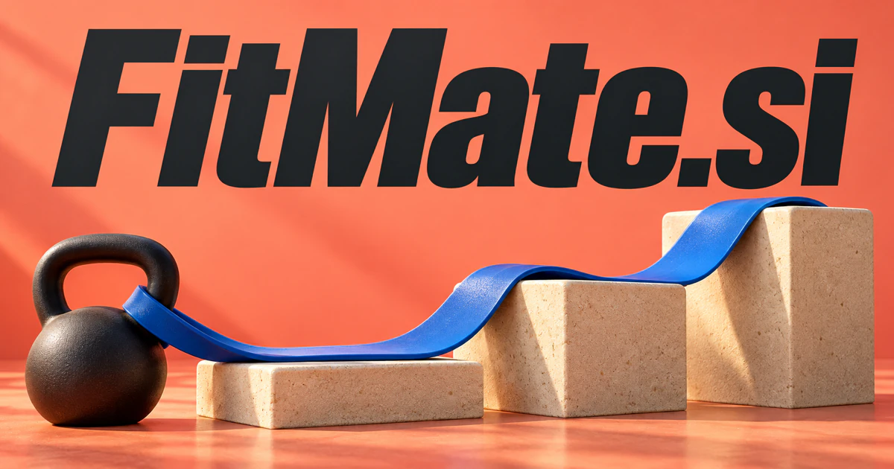

# FitMate.si — Find what works for this person, in this situation

FitMate.si combines fit—in condition, size, shape or suitability—with the warmth of a companion. It could become an adaptive fitness product, but the same clear promise also suits apparel sizing, equipment selection and practical compatibility. Its deeper software opportunity is personal context: reconcile needs, preferences and real constraints, then explain why one option fits better than another.

[Enquire about FitMate.si](mailto:hedge.pike02@icloud.com?subject=Domain%20enquiry%3A%20fitmate.si)

## Meaning and naming depth

**Fit** can describe physical condition, correct size or shape, and suitability for a requirement. Those are established meanings in [Cambridge's entry](https://dictionary.cambridge.org/us/dictionary/english/fit). **Mate** supplies the companion or friend idea, adding a warmer relationship to a functional promise. Together, the words can mean a fitness companion, a partner for choosing what suits you, or an assistant that helps components work together.

The compound also supports two levels of product design. A simple product might recommend an appropriate workout or garment. A deeper platform could remember preferences, reconcile constraints, explain alternatives, and adjust as circumstances change. The name's unifying principle is **personal suitability**: more relevant choices for a particular person or task, rather than one generic answer for everybody.

## Business opportunities

### 1. Adaptive fitness companion

A fitness companion could connect a person's goals, activity history and available equipment, coordinating adaptable sessions that fit their real routine and chosen priorities. A conversational interface could organize workout logs, explain an exercise, and suggest a revised schedule when the week changes. Consumer subscriptions and coach-reviewed plans would suit people who want a consistent companion between training sessions.

### 2. Software for personal trainers

Connect client notes, progress observations and programming choices, helping coaches prepare individualized sessions and focused conversations between appointments. An assistant could draft session summaries and identify questions to discuss with each client. Per-coach subscriptions or studio licenses would sell administrative usefulness alongside a recognizable coaching brand.

### 3. Apparel sizing and wardrobe assistance

A retailer tool could explain why an item may suit a customer's stated preferences and suggest alternatives. An apparel assistant could reconcile garment construction, chosen measurements and style preferences, explaining sizing alternatives and identifying the information needed for a useful fit decision. Merchant subscriptions, shopping services, or a personal wardrobe application could use FitMate as a clear fit-related identity.

### 4. Footwear and sports-equipment selection

An equipment assistant could connect an activity, personal preferences and product characteristics, helping customers compare footwear or sports gear for their actual intended use. Product data and user measurements could become a shortlist with practical questions for a fitting appointment. Retail software, specialist consultations, and curated commerce could support the business.

### 5. Training partners and activity communities

Relate interests, location constraints and participation preferences, introducing suitable partners and coordinating a practical plan for exercising together. Clubs could organize recurring groups while members coordinate attendance and discover suitable partners. Paid club tools, local memberships, and event bookings would make the “mate” half of the name central to the experience.

### 6. Meal planning around everyday routines

It could connect an editable weekly plan to recipes and a consolidated grocery list. A meal planning planner could reconcile household routines, food preferences and cooking capacity, assembling meals and preparation steps that fit everyday life. Household subscriptions and partnerships with food retailers offer a practical consumer direction.

### 7. Employee wellbeing programs

A wellbeing-program planner could connect employee-selected interests, available programs and participation barriers, helping organizers create relevant experiences without assuming every person has the same needs. Program coordinators could organize participation without turning individual health details into public comparisons. Employer licenses and managed program services would serve distributed teams and office communities.

### 8. Career and learning compatibility

Relate evidence of capability, personal interests and role requirements, identifying learning experiments that help someone assess a meaningful professional fit. A tool could map project evidence to role requirements and recommend learning activities. Career-service subscriptions and education-provider licenses could support decisions with explanations rather than an unexplained compatibility score.

### 9. Furniture and room planning

Measurements, photographs, and product dimensions could produce layout alternatives and a delivery-preparation checklist. A room planning planner could reconcile dimensions, activities and furniture behavior, explaining arrangements that make a living space work for the people using it. Retail integrations, paid planning projects, and a consumer design subscription provide multiple commercial models.

### 10. Parts and accessory compatibility

A compatibility assistant could connect component specifications, existing equipment and installation context, helping customers understand which accessories fit and which details require confirmation. Structured specifications and model identifiers could support comparison and explain uncertain matches. Supplier subscriptions and catalog APIs could address a concrete purchasing problem across several equipment categories.

### 11. Developer's integration companion

Relate interface contracts, environment constraints and a desired integration, coordinating documentation and tests that establish how software components can work together. An assistant could inspect a proposed configuration, explain version constraints, and prepare a reproducible test. Team subscriptions and private workspaces would translate the fit metaphor into technical compatibility.

### 12. Personal scheduling and habit support

Users could describe a goal, review suggested time blocks, and adjust around family or work commitments. A routine planner could connect commitments, personal energy preferences and recurring intentions, proposing a manageable schedule that evolves when the person's real circumstances change. Individual subscriptions and household plans would make “fit it into my life” a distinct product promise.

## A Super Intelligence product story

FitMate.si can position Super Intelligence around **understanding the person and reconciling the whole situation**. Consider a proposed activity companion: a user has forty minutes, limited equipment, a changing work calendar, and a preferred training routine. Agents could assemble relevant records, propose a plan, explain changes, and organize reminders after approval.

There is a practical data foundation for the fitness direction. Android's [Health Connect documentation](https://developer.android.com/health-and-fitness/health-connect/data-types) describes structured exercise, activity, sleep, and other records with permission requirements. A future product could integrate authorized data while retaining user control over what it uses. The same brand logic extends to garments, spaces, and software: understand the constraints before recommending the fit.

## Why the name works

Seven letters combine two familiar words with a friendly rhythm. The name communicates both assistance and a result, which helps a product demonstration feel concrete. FitMate Coach, FitMate Wardrobe, and FitMate Match are natural possible extensions. **“Find your fit. Bring your mate.”** could suit the social direction, while **“A better fit for your life.”** supports a broader personal intelligence brand.

## Related names, different directions

- [WellFit.si](wellfit-si.md) — Explore a broader wellbeing and personal-suitability identity with less emphasis on a companion relationship.
- [JobReady.si](jobready-si.md) — Concentrate on capabilities, learning evidence and preparation for a suitable role.
- [HomeGuide.si](homeguide-si.md) — Place room suitability and household choices within a wider practical home-planning service.

## Acquire FitMate.si

[Buy or make an offer on Dynadot](https://www.dynadot.com/market/user-listings/fitmate.si), or email [hedge.pike02@icloud.com](mailto:hedge.pike02@icloud.com?subject=Domain%20enquiry%3A%20fitmate.si) to discuss a direct purchase, a possible discount, or a portfolio bundle. These product directions are proposals for a future owner to develop.

[Purchase options and Escrow.com](../guides/how-to-buy.md) · [Browse all domains](../README.md)

## Research references

- [Cambridge Dictionary: fit](https://dictionary.cambridge.org/us/dictionary/english/fit) — Physical fitness, size, shape, and suitability.
- [Cambridge Dictionary: mate](https://dictionary.cambridge.org/us/dictionary/english/mate) — The companion reading used in the brand analysis.
- [Android Developers: Health Connect data types](https://developer.android.com/health-and-fitness/health-connect/data-types) — Structured records and permissions relevant to a fitness application.
