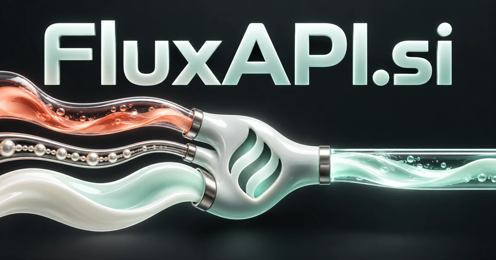

# FluxAPI.si — Keep capability flowing between systems

FluxAPI.si connects the image of continuous change with the established application programming interface abbreviation. It could name a developer service that coordinates models, tools and moving information around a task, rather than exposing disconnected endpoints. Streaming inference, event delivery, document processing and contextual data transformation offer distinct technical products under the same adaptable infrastructure identity.

[Enquire about FluxAPI.si](mailto:hedge.pike02@icloud.com?subject=Domain%20enquiry%3A%20fluxapi.si)

## Meaning and naming depth

Flux evokes flow, movement, and continuous change; API means application programming interface. The name can therefore support both a metaphorical story about adaptable software and a literal product story about interfaces handling moving information.

An API is not itself a business model: it is a way of exposing capability. That distinction opens several directions, from model routing and document processing to telemetry and industrial calculations. OpenAPI provides a standard way to describe HTTP interfaces. A strong FluxAPI business could pair that clarity with excellent examples, predictable behavior, and carefully chosen tools that developers repeatedly need.

## Business opportunities

### 1. Unified model interface

A model orchestration interface could connect a developer's intended outcome, model capabilities and evaluation requirements, coordinating suitable specialists behind a consistent application interface. Customers could compare supported capabilities and route requests according to project rules. Usage billing, customer workspaces, and private deployment packages would give the business several practical ways to sell.

### 2. Streaming inference infrastructure

Interpret an evolving task, partial results and application state, coordinating incremental responses that remain useful as new context arrives. FluxAPI could provide connection handling, request tracing, and useful client libraries. A subscription based on workloads or data transfer could serve teams that want reliable interaction rather than custom streaming plumbing.

### 3. Event and webhook delivery

Developers could test a customer integration against saved examples. An event delivery planner could connect an event's meaning, dependent services and workflow status, helping teams coordinate reliable follow-up rather than merely transmit a notification. Sell by delivery volume, retained history, and operational features for teams running several environments.

### 4. Data transformation endpoints

A transformation assistant could reason across source semantics, target requirements and business rules, preparing explainable mappings between incompatible data representations. Agencies could chain those operations into business automations. A catalog of focused endpoints could become a paid toolkit for developers who prefer one maintained service over many small scripts.

### 5. Document understanding as a service

Connect layout, written meaning and a customer's extraction objective, returning contextualized information with evidence for downstream specialist workflows. Accounting software vendors and service portals could integrate the capability. Pricing could follow processed pages, with specialized extraction configurations sold to particular industries.

### 6. Financial data integration layer

Customers could request consistent fields and documented update times. A financial data workspace could reconcile identifiers, time context and analytical intent, helping developers connect information sources without obscuring important differences in their meaning. Revenue could combine API access, data licensing, and integration services, with the brand emphasizing information flow rather than investment promises.

### 7. Scientific and engineering calculations

An engineering assistant could connect a technical question, applicable assumptions and calculation tools, orchestrating a reviewable computation workflow around the user's specific problem. Engineering software teams could integrate rather than rebuild them. Sell metered calls, specialist libraries, or enterprise access backed by clear calculation documentation.

### 8. Integration testing workbench

Relate API contracts, real workflow dependencies and observed failures, generating scenarios that expose meaningful integration problems before production use. Customers could test a new version before changing production integrations. Developer subscriptions and team workspaces would make this a product about maintaining flow when interfaces evolve.

### 9. Internet-of-things telemetry

Integrators could normalize data from supported devices before feeding dashboards or alerts. A telemetry assistant could connect device observations, asset context and operational questions, coordinating a useful response across application and equipment systems. Sell by connected fleet, retained data, and managed deployment options for customers with distributed equipment.

### 10. API-first automation studio

An automation studio assistant could combine client requirements, interface capabilities and specialist agents, building a coordinated workflow whose transitions remain understandable to its operators. Paid projects could develop into maintained subscriptions. FluxAPI becomes an agency identity that can later turn its most useful components into standalone software products.

## A Super Intelligence brand

FluxAPI.si makes Super Intelligence concrete through programmable access. A founder could expose perception, reasoning, search, and action as separate documented capabilities that developers compose. One request might gather context, call a specialist model, and return structured output plus execution details. The long-term brand territory is adaptable intelligence delivered as infrastructure, while the first commercial product can remain sharply focused.

## Why the name works

Flux has energy without prescribing a single task; API tells a developer how to engage. The pairing works especially well for documentation, SDK package names, and a developer console. **“Capability in motion.”** is concise enough for a homepage, while FluxAPI Models, Events, and Transform can organize a growing product family.

## Related names, different directions

- [CloudGateway.si](cloudgateway-si.md) — Focus on the shared entry point, routing and operating policy around connected services.
- [DataFeeds.si](datafeeds-si.md) — Make the actual streams of updated information the primary product rather than the interface.
- [BotID.si](botid-si.md) — Connect developer workflows with the identity and authority of participating software agents.

## Acquire FluxAPI.si

[Buy or make an offer on Dynadot](https://www.dynadot.com/market/user-listings/fluxapi.si), or email [hedge.pike02@icloud.com](mailto:hedge.pike02@icloud.com?subject=Domain%20enquiry%3A%20fluxapi.si) to discuss a direct purchase, a possible discount, or a portfolio bundle. The product directions above are ideas for a future owner.

[Purchase options](../guides/how-to-buy.md) · [Browse all domains](../README.md)

## Sources and further reading

- [OpenAPI Specification](https://spec.openapis.org/oas/latest.html) — Standard interface descriptions for HTTP APIs.
- [CloudEvents specification](https://github.com/cloudevents/spec) — An open specification for describing event data across services.
