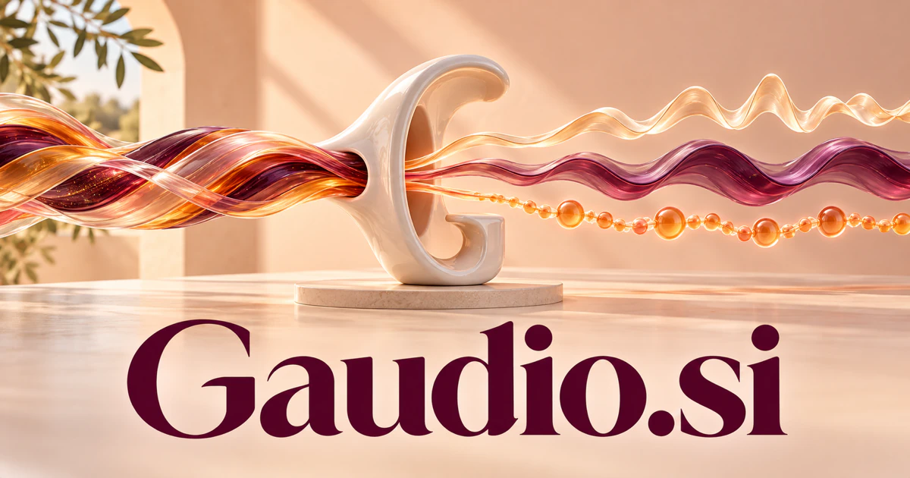

# Gaudio.si — Turn a listening goal into a considered audio workflow

Gaudio.si connects the Italian word for joy with a visible sound-related sequence. Its strongest software direction is an intelligent audio-processing workspace or developer API: understand the intended listening result, organize specialist tools and make each processing step reviewable. Producers, creators, developers and archive teams could each build a distinct service around the name.

[Enquire about Gaudio.si](mailto:hedge.pike02@icloud.com?subject=Domain%20enquiry%3A%20gaudio.si)

## Meaning and naming depth

**Gaudio** is an Italian literary word for joy. [Treccani's dictionary entry](https://www.treccani.it/vocabolario/gaudio/) traces it to Latin *gaudium* and describes both intense joy and a more general sense of pleasure. That gives the six-letter name an emotional foundation for creative tools, listening experiences or a consumer service.

The visible **audio** sequence also invites a creative **G + audio** reading. Generative audio or guided audio are possible interpretations of that initial letter; they are proposed branding choices, separate from the word's historical derivation. A founder could build an audio identity around the recognizable sequence while using the joy association to make the product feel more human and expressive.

## Business opportunities

### 1. Audio-processing APIs

Developers could submit authorized material with a description of the intended output and receive an inspectable processing plan. A coordination layer would connect task requirements, specialist tools, versions and reviewable results. Usage-based plans, developer subscriptions and private deployments could make Gaudio a useful interface for applications that need several audio capabilities without separate workflows for each one.

### 2. Music source-separation workspaces

Producers could prepare candidate stems from authorized recordings and compare what remains in each result. The workspace would retain settings and versions so a person can inspect artifacts before using an output. Producer subscriptions and processing credits could support a focused tool grounded in the practical evaluation of separated sources.

### 3. Dialogue cleanup and repair

Editors could organize noise reduction, level adjustments and repair tasks around the speech, recording environment and intended delivery. An assistant would prepare alternatives and explain which part of the brief each version addresses. Per-project plans and studio subscriptions could serve teams that need an orderly review process for spoken material across multiple recordings.

### 4. Archive-restoration projects

Archive teams could connect original recordings, provenance, earlier transfers and editing decisions in a preservation workspace. Agents would organize candidate treatments and document the review history rather than replace the original source. Project fees, institutional licenses and specialist services could make Gaudio useful wherever an audio collection needs a careful and repeatable restoration process.

### 5. Podcast post-production

Production teams could relate transcripts, edit notes, segments and delivery requirements to a coherent episode plan. An assistant would organize review comments and prepare versions for the assigned editor to approve. Creator subscriptions and studio plans could support a recognizable service around moving an episode from raw recording to an agreed release.

### 6. Sound workflows for video

Video teams could coordinate dialogue, music, effects and timing against an approved picture edit. A planning agent would connect notes to relevant moments and track which version of the sound belongs with each cut. Project subscriptions and production integrations could make Gaudio a shared workspace for editors, sound designers and clients reviewing the same scene.

### 7. Sound-library discovery

Designers could connect a creative brief with authorized recordings, recorded permissions and the reason each candidate fits. A retrieval assistant would preserve those relationships as the project evolves. Team libraries, catalog subscriptions and private search deployments could turn Gaudio into a practical place to find a sound and understand its production context.

### 8. Interactive game audio

Game teams could prepare sound behaviors and variations from application events and creative intent. Agents would organize the relationship between a game state, a proposed sound response and the designer's review notes. Studio licenses and development integrations could support a specialized product for managing audio that responds to player actions and changing scenes.

### 9. Spatial-audio authoring

Designers could organize source placement, scene relationships and listening previews in a visual workspace. An assistant would turn a brief into reviewable arrangements and maintain the reasoning behind a scene revision. Creator plans and professional licenses could connect the name's audio identity with interactive installations, immersive storytelling and application sound design.

### 10. Creator collaboration and approvals

Distributed teams could keep comments, stems, versions and approvals connected to the same production. An assistant would turn feedback into a structured work queue and identify which changes still need agreement. Team subscriptions and client portals could make Gaudio useful even when the actual editing happens in several different specialist tools.

### 11. Learning and instructional audio

Education teams could connect approved lesson material with narration plans, pacing and listening exercises. The workspace would prepare draft segments for an instructor to review and organize feedback from a teaching team. Institutional licenses and course-production services could create a distinct route focused on making approved educational content understandable through sound.

### 12. Joyful listening experiences

Consumer teams could explore personal sound collections, celebratory audio and ambient experiences around a user's chosen tastes and activities. A planning assistant would help organize the experience and make its selections understandable. Memberships, creator collections and event packages could develop the joy association into a product whose identity extends beyond professional editing tools.

## A Super Intelligence product story

Gaudio.si can position Super Intelligence around **understanding a listening goal and coordinating the work needed to realize it**. A user supplies authorized audio, describes the intended result and reviews a plan. Specialist agents could organize separation, cleanup, timing and delivery, with intermediate outputs available for inspection.

[Hybrid Transformers for Music Source Separation](https://arxiv.org/abs/2211.08553) provides primary research context for separating music sources. The [Web Audio specification](https://www.w3.org/TR/webaudio/) provides a browser-based processing and synthesis context, including connected audio nodes. Those are useful technical foundations for particular directions. A broader Gaudio product could connect such capabilities with project memory, creative reasoning and human approval rather than treating every upload as an isolated transformation.

## Why the name works

Six letters contain the complete visible sequence *audio* while retaining a positive word meaning. Gaudio Studio, Gaudio API and Gaudio Archive could identify different offerings under the same main name. **“Understand the sound you want.”** connects a creative brief to a practical workflow, while the joy association leaves room for a more expressive consumer identity.

## Related names, different directions

- [AudioX.si](audiox-si.md) — Give a broad audio toolkit an experimental, technical identity.
- [AudioSearch.si](audiosearch-si.md) — Focus on finding and understanding material within audio collections.
- [DrumLoop.si](drumloop-si.md) — Build around rhythm creation, pattern libraries and music practice.
- [Soona.si](soona-si.md) — Extend a creative workflow into product imagery and visual production.

## Acquire Gaudio.si

[Buy or make an offer on Dynadot](https://www.dynadot.com/market/user-listings/gaudio.si), or email [hedge.pike02@icloud.com](mailto:hedge.pike02@icloud.com?subject=Domain%20enquiry%3A%20gaudio.si) to discuss a direct purchase, a possible discount, or a portfolio bundle. These product directions are proposals for a future owner to develop.

[Purchase options and Escrow.com](../guides/how-to-buy.md) · [Browse all domains](../README.md)

## Research references

- [Treccani: gaudio](https://www.treccani.it/vocabolario/gaudio/) — The word's literary joy meaning and Latin derivation.
- [Hybrid Transformers for Music Source Separation](https://arxiv.org/abs/2211.08553) — Primary research on a source-separation architecture.
- [W3C: Web Audio](https://www.w3.org/TR/webaudio/) — A primary specification for audio processing and synthesis in web applications.
