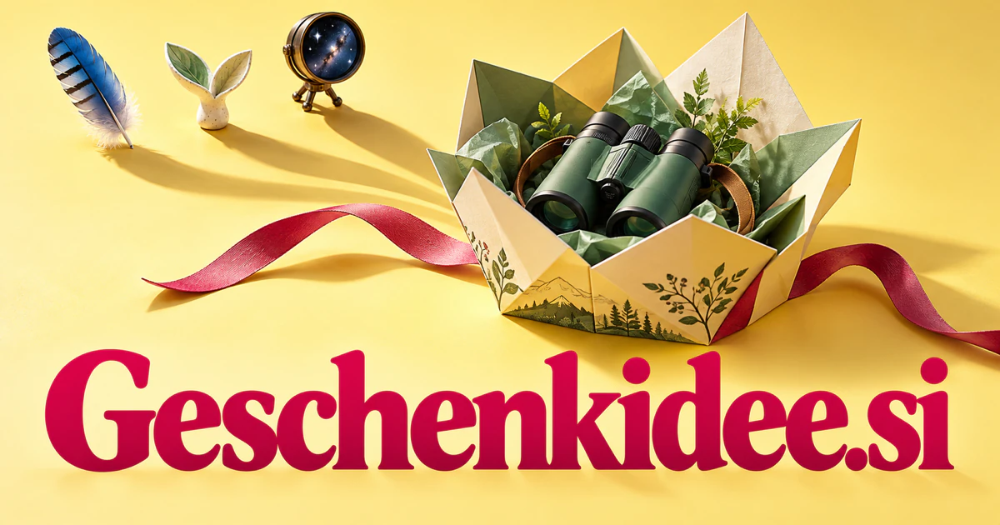

# Geschenkidee.si — Make the gift idea personally meaningful

Geschenkidee.si is the German word for gift idea, placing the shopper’s immediate question at the center of the brand. It could become a recommendation service connecting recipient interests, relationship context and practical availability with thoughtful options. Maker commissions, experiences, group gifts and personal messages provide separate businesses that extend from inspiration into a completed act of giving.

[Enquire about Geschenkidee.si](mailto:hedge.pike02@icloud.com?subject=Domain%20enquiry%3A%20geschenkidee.si)

## What the name opens up

[Geschenkidee](https://en.langenscheidt.com/german-english/geschenkidee) means gift idea in German. It combines Geschenk, gift, with Idee, idea, making the shopper's immediate need the center of the name. The word is longer than a compact coined brand, but its descriptive precision is useful for a German-language audience. It can connect recommendation, editorial inspiration, personalization, and the practical steps from thought to delivery. A buyer could operate a focused guide, a maker marketplace, a corporate service, or a planning application. The intelligence theme naturally concerns understanding the recipient and the situation behind a purchase.

## Business opportunities

### 1. Gift discovery

A gift discovery service could connect a recipient's interests, the relationship and the occasion, explaining ideas that feel relevant instead of merely popular. Editorial notes could explain the fit. Retail sales or disclosed affiliate publishing would connect a familiar gift question with practical, considered answers.

### 2. Corporate gift planning

Reconcile recipient groups, company values and practical constraints, coordinating suitable selections, messages and delivery work across a campaign. Organizers could inspect the actual contents of each proposed package. Business subscriptions or managed gifting fees would serve repeated workplace occasions with clear operational needs.

### 3. Personalized maker marketplace

A structured brief could collect the message, visual references, and approval before production. A maker marketplace service could translate a giver's story, recipient preferences and customization choices into a clear brief that an independent maker can fulfill. Marketplace commissions or maker subscriptions would turn a gift idea into a clearly specified personal creation.

### 4. Experience gift planning

An experience assistant could connect the recipient's interests, accessibility needs and practical availability, helping someone choose a gift the recipient can genuinely use. Details could include dates, accessibility information, and the recipient's interests. Booking commissions or planning packages would extend the name from physical objects to memorable experiences.

### 5. Occasion reminder notebooks

Relate relationships, upcoming occasions and previous gifts, giving the user useful preparation time and increasingly thoughtful ideas. A consumer subscription could offer thoughtful planning and printable reminders. The product would help preserve useful personal context before a shopping deadline arrives.

### 6. Handmade gift education

Creators could sell classes or project packs. A handmade learning companion could connect a giver's skills, available materials and recipient interests, guiding the creation of something personal through achievable steps. A resource membership or materials shop would serve a distinct audience motivated by effort and personal expression.

### 7. Group gift coordination

A group gifting service could reconcile contributors' ideas, shared intentions and coordination needs, helping a group agree on a meaningful present and divide the practical work. The platform could connect to existing payment providers. Event fees, organizer subscriptions, or commerce revenue could fund a practical social-planning product.

### 8. Children's gift discovery

Connect stated interests, developmental context and household preferences, helping adults choose items that invite an appropriate kind of play or discovery. Editorial explanations and real product details could support informed selection. Retail sales or disclosed affiliate publishing would fit a focused German-language content and commerce business.

### 9. Personal message studios

Templates could be personalized through guided questions. A message assistant could connect personal memories, the occasion and the giver's voice, shaping words that explain the meaning behind a chosen gift. Individual purchases, print fulfillment, or retailer integrations could make the emotional part of gifting a distinct product.

### 10. Local maker gift routes

A local gift planner could connect maker stories, recipient interests and practical routes, turning discovery and collection into a coherent neighborhood gifting experience. Each listing could explain the product and lead time clearly. Merchant memberships or marketplace commissions could support a specialist destination built around discovering an appropriate gift close to hand.

## A Super Intelligence product vision

A Geschenkidee SI assistant could ask about the recipient, occasion, relationship, budget, and delivery constraints, then build a short list with clear reasons for each suggestion. It could remember preferences with the user's permission and distinguish a creative idea from an item that is actually available. A first business could serve German-speaking shoppers in one specialist category, earning through retail margins, disclosed affiliate links, or planning fees. The larger opportunity is considerate matching: intelligence that understands the human reason for a gift and helps carry the idea through to a well-prepared presentation.

## Related names, different directions

- [GiftGuide.si](giftguide-si.md) — Explore an English-language identity for guiding the selection of suitable gifts.
- [GiftWrap.si](giftwrap-si.md) — Focus on presentation, packaging and the physical experience surrounding a chosen present.
- [DreamCard.si](dreamcard-si.md) — Connect giving with personal messages, aspirations and card-based creative experiences.

## Acquire the domain

Contact [hedge.pike02@icloud.com](mailto:hedge.pike02@icloud.com?subject=Domain%20enquiry%3A%20geschenkidee.si) to discuss a direct-purchase discount, an offer, or a portfolio package.

[View the sales listing](https://www.dynadot.com/market/user-listings/geschenkidee.si) · [Purchase options and escrow](../guides/how-to-buy.md) · [Browse all domains](../README.md)

## Sources and further reading

- [Geschenkidee — Langenscheidt](https://en.langenscheidt.com/german-english/geschenkidee) — Established German-English meaning: gift idea or idea for a present.
