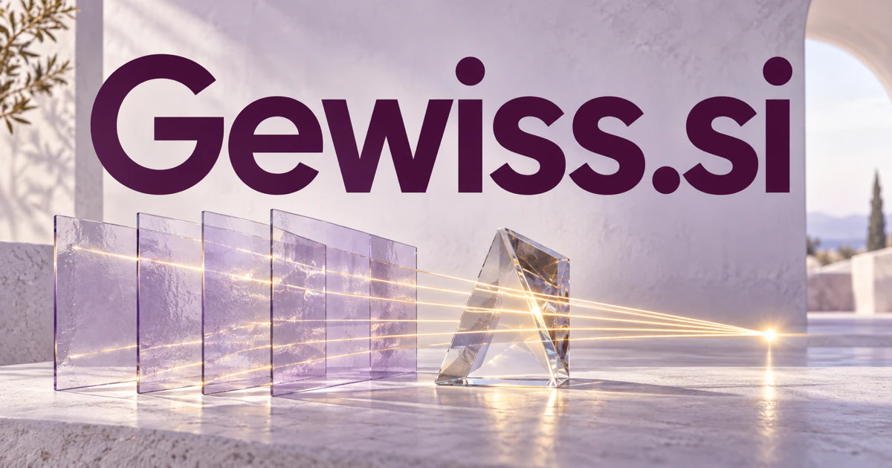

# Gewiss.si — Make the basis of an answer visible

Gewiss.si draws on a German word associated with certainty or being sure. It could name an evidence-oriented research companion for editors, organizations or professional learners: connect claims with sources, compare explanations and show which questions remain open. The brand promise is a better-grounded understanding, with document review, decision records and knowledge work offering distinct practical products.

[Enquire about Gewiss.si](mailto:hedge.pike02@icloud.com?subject=Domain%20enquiry%3A%20gewiss.si)

## Business opportunities

The strongest route depends on the buyer’s audience and the problem they want to solve. These directions develop different meanings of the name into practical product and service concepts.

### 1. Evidence-linked organizational knowledge

An organizational assistant could connect a question, relevant records and internal expertise, forming an evidence-linked answer that shows how the organization knows what it knows. Business subscriptions could make recurring answers maintainable as the organization changes and help new colleagues understand why a particular conclusion was adopted.

### 2. Editorial fact review

Relate claims to source material, context and competing accounts, preparing a focused review queue that helps editors resolve factual uncertainty. Professional plans could preserve the reasoning behind a published statement and make corrections easier when new evidence changes the picture.

### 3. Research brief preparation

A research workspace could connect an inquiry, methodological context and contrasting evidence, assembling a brief that distinguishes supported conclusions from unanswered questions. Team subscriptions could support cited drafts and expert review, helping analysts deliver a clearer account of what the available material actually supports.

### 4. AI answer evaluation

An evaluation workspace could compare an answer's reasoning, source support and task requirements, helping teams understand which failure modes matter for their intended use. Paid plans could connect an answer-quality judgment with the specific prompt, sources, model configuration, and human assessment involved in producing it.

### 5. Business decision records

Connect assumptions, alternatives and the evidence available at the time, preserving a useful account of why a team chose a particular path. Enterprise subscriptions could help teams revisit the decision later and distinguish a change in evidence from a change in preference.

### 6. Customer support knowledge

A contextual support workspace could reconcile product versions, customer context and verified resolutions, helping agents explain what applies to a specific situation and why. Business plans could identify outdated source material and route unresolved questions to the right owner, improving the quality of future answers as the team learns.

### 7. Procurement evidence workspaces

A procurement assistant could connect supplier claims, buyer requirements and supporting documents, preparing structured questions that make an important comparison more trustworthy. A buyer comparing two proposals could inspect which requirement each document actually supports, then send a precise clarification request where the evidence remains incomplete. Procurement subscriptions could retain the evidence behind a shortlist and prepare focused questions before a purchasing commitment.

### 8. Scientific literature collections

Relate study designs, findings and research context, helping specialists compare evidence while preserving distinctions between methods and conclusions. A comparison view could align the population, method and limitations of related studies, making apparently similar results easier to interpret on their own terms. Institutional plans could make collaboration more coherent while preserving uncertainty and the distinction between an author’s result and a reader’s interpretation.

### 9. Professional learning portfolios

A learning portfolio companion could connect practical work, feedback and professional goals, helping someone demonstrate capability through evidence rather than a list of completed activities. Memberships or employer subscriptions could organize evidence of learning and make mentoring discussions more specific than a list of self-reported skills.

### 10. Intelligent document companion

A document assistant could reason across clauses, tables and explanatory context, answering a reader's practical question while showing the passages that support its interpretation. Team plans could make the document collection useful in daily work, with users able to inspect the source behind each proposed answer.

## A Super Intelligence product story

Gewiss.si could express Super Intelligence as confidence earned through evidence. A research agent retrieves permitted material, a reasoning agent proposes an answer, and a reviewer sees supporting passages plus unresolved questions. The product’s distinctive experience would be clarity about why a conclusion deserves attention and what could change it.

## Why this name can carry a business

The real-language association gives the name intellectual weight, while six letters remain manageable for a wordmark and spoken introduction. Gewiss can serve a specialist knowledge tool or a broader business intelligence platform, keeping a consistent identity around dependable understanding and reviewable work.

## Related names, different directions

- [TruthCheck.si](truthcheck-si.md) — Focus on checking a particular claim and tracing the evidence that supports or challenges it.
- [AnnualReports.si](annualreports-si.md) — Choose a specific document category for organizational research and comparison across time.
- [DQM.si](dqm-si.md) — Address the quality of the inputs and decision process that contribute to a supported answer.

## Acquire Gewiss.si

The product directions above are ideas for a buyer to develop; software, customer accounts, content libraries, and an operating business are not included.

[Buy or make an offer on Dynadot](https://www.dynadot.com/market/user-listings/gewiss.si), or email [hedge.pike02@icloud.com](mailto:hedge.pike02@icloud.com?subject=Domain%20enquiry%3A%20gewiss.si) to discuss a direct purchase, a possible discount, or a portfolio package. Marketplace availability and checkout terms can vary. See [purchase options](../guides/how-to-buy.md) for the available marketplaces and an Escrow.com transaction route.

## Research references

- [Wissen.de: gewiss](https://www.wissen.de/rechtschreibung/gewiss)
- [NIST: AI Risk Management Framework](https://www.nist.gov/itl/ai-risk-management-framework)

[Browse all domains](../README.md)
