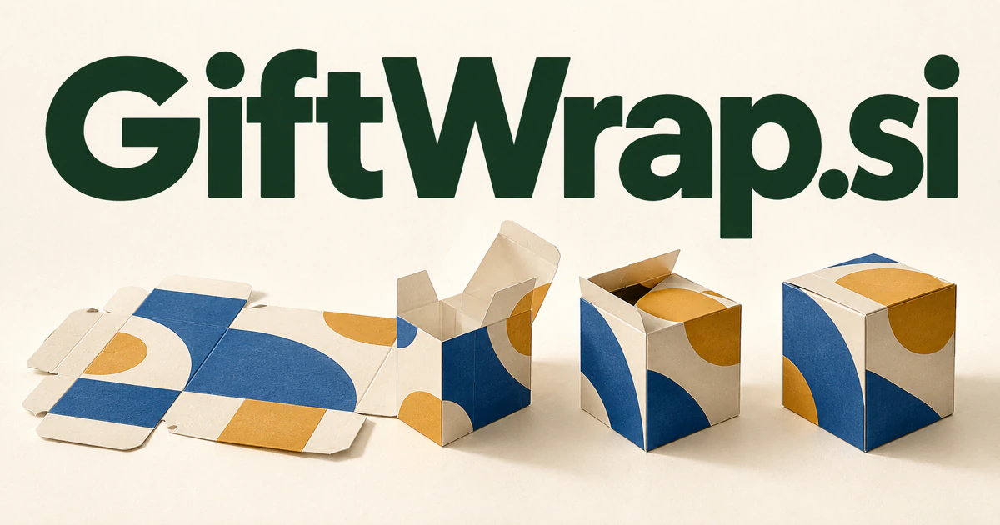

# GiftWrap.si — Connect a personal gesture with packaging that works

GiftWrap.si names the presentation around a gift, with an immediate connection to paper, fabric, ribbons and personal messages. A packaging design and fulfillment workspace could turn a recipient's story into coordinated, producible materials. The same name also leaves room for reusable products, wrapping instruction and digital gift reveals, each serving a different part of the giving experience.

## What the name opens up

[Gift wrap](https://www.merriam-webster.com/dictionary/gift%20wrap) concerns decorating the presentation of merchandise intended as a gift. It is a physical action with a wider emotional role: turning an object into something prepared for a particular person. A buyer could work with paper, boxes, fabric, print design, retail workflows, or digital gift presentation. Wrap can also inspire a software metaphor—packaging several pieces into a coherent experience—but that would be an intentional brand extension. The compound's clearest strength is that it names a recognizable task with room for both products and services.

## Business opportunities

### 1. Packaging design studio

A packaging design assistant could reason across object dimensions, brand identity, printing limits and the recipient's occasion, generating coordinated paper, card and label concepts. Designers would receive editable production specifications alongside the visual proposal. Merchant subscriptions, design fees, or custom print sales would connect personalization with production-ready packaging.

### 2. Checkout gift options

A checkout gifting coordinator could interpret a customer's presentation request, check item compatibility and translate choices into packing instructions. Merchants would connect an attractive checkout preview with a precise fulfillment record, including exceptions requiring staff review. Store subscriptions or service fees would make GiftWrap a practical commerce extension.

### 3. Gifting fulfillment service

Specialist agents could coordinate packaging choices, stock, recipient personalization and assembly order, comparing alternative plans when a component is unavailable. Event teams gain a visible route from approved concept to correctly packed delivery. Project fees or recurring corporate services would support thoughtful presentation at a useful operational scale.

### 4. Custom print commerce

A print-personalization studio could convert a short personal story into pattern options while checking repeat spacing, bleed, text legibility and the chosen printer's specifications. Customers would approve both the emotional design and the physical production preview. Commercial options include selling wrapping paper and labels personalized with names, illustrations, colors, or event details. Retail margins and designer collections would support a physical business with software making customization easier to understand.

### 5. Reusable wrapping collections

A reusable-wrap selector could match reusable fabric, bags and fastenings to the shape of a gift, then demonstrate several wrapping sequences. Retailers could connect material choices with reusable product systems and practical customer education. Product sales, workshops, and curated sets would create a distinctive material proposition within the same familiar task.

### 6. Professional wrapping workshops

A visual tutor could compare a learner's attempt with the demonstrated technique, identify where a fold changed the result and propose a targeted practice step. Retail staff receive guidance suited to actual objects and materials. Training fees and kit sales would turn GiftWrap into a service and education identity.

### 7. Digital gift presentation

A digital reveal director could plan the timing, narrative, visuals and spoken message of a digital gift reveal around the relationship and occasion. A creator would edit the sequence before connecting it to the actual voucher or delivery. Individual purchases or retailer integrations could extend wrapping into digital experiences.

### 8. Packaging supply management

A packaging supply planner could reconcile forecast orders, approved designs, material inventory and supplier lead times, testing how shortages alter a seasonal plan. Shop managers would see purchasing priorities and acceptable substitutions before the busy period. Retail subscriptions or supplier services would support the practical operational side behind an attractive final package.

### 9. Event welcome kits

A welcome-kit coordinator could connect an event's theme, attendee groups, accessibility preferences and packing requirements into several kit configurations. Planners would approve a complete composition and receive a sequenced assembly checklist for each variation. Project fees or recurring fulfillment services would connect design with a clearly defined event deliverable.

### 10. Independent designer marketplaces

An artwork-matching service could match a buyer's visual brief and production method to compatible artwork families, comparing license terms and adaptation needs. Designers retain creative control while customers find collections that work together across paper, cards and inserts. Let illustrators sell coordinated wrapping patterns, cards, and label artwork with clear production and license information. Marketplace commissions or professional memberships would create a catalog business built around a specific, recurring use.

## A Super Intelligence product vision

A GiftWrap SI studio could take an occasion, recipient, product dimensions, and a chosen visual style, then propose coordinated paper, a message card, labels, and packing instructions. Designers could edit the artwork and review the actual print specifications before production. Retailers could send the approved choices directly into their fulfillment workflow. A business could begin with printable designs or merchant subscriptions, then add production partners. The intelligence opportunity is coordinated personalization: carrying a customer's intent through visual design and practical packing details so the final presentation feels considered.

## Related names to compare

- [GiftGuide.si](giftguide-si.md) for recipient research and gift selection before presentation.
- [Papered.si](papered-si.md) for paper products alongside document-oriented workflows.
- [Joia.si](joia-si.md) for meaningful objects and custom jewelry commissions.

## Explore GiftWrap.si

For acquisition enquiries about **GiftWrap.si**, contact [hedge.pike02@icloud.com](mailto:hedge.pike02@icloud.com?subject=Domain%20enquiry%3A%20giftwrap.si). Direct enquiries can discuss a preferential offer or a portfolio arrangement.

[View the marketplace listing](https://www.dynadot.com/market/user-listings/giftwrap.si) · [Marketplace and Escrow.com transaction options](../guides/how-to-buy.md) · [Browse all domains](../README.md)

## Sources and further reading

- [Gift wrap — Merriam-Webster](https://www.merriam-webster.com/dictionary/gift%20wrap) — Established decorative wrapping meaning grounding the physical and digital extensions.
