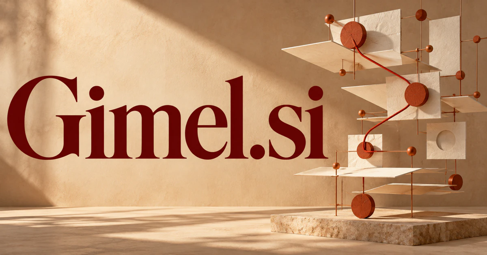

# Gimel.si — A meeting place for symbols, language and connected ideas

Gimel.si draws on a real letter name and a separate mathematical symbol, giving it a scholarly identity without prescribing a single product. A source-linked knowledge workspace could be the strongest first expression: connect concepts, expose assumptions and help researchers follow an argument. Language learning, mathematical tools and script-aware design offer related but distinct interpretations, rather than additional definitions invented for the spelling.

## Meaning and naming depth

Gimel is the name of a Hebrew letter, represented by ג. Unicode separately includes a gimel mathematical symbol, ℷ, among the Hebrew letterlike symbols used in transfinite cardinal notation. Those connections give the name an authentic relationship with writing systems, symbols, and abstract thought.

The brand can build on an evocative association: a small symbol participates in a much larger system of meaning. The five-letter form also works independently as a pronounceable identity. Proposed expansions such as **Graph Intelligence and Meaning Exploration Lab** could be used as creative stories, clearly distinct from the word’s established origin.

## Business opportunities

### 1. A knowledge graph workspace

A research graph assistant could compare claims across a researcher's collection, propose explicit relationships and surface contradictions with their source passages. A team would inspect how an argument connects, identify missing evidence and decide which links deserve further investigation. Commercial options include selling research workspaces, institutional deployments, and consulting services for organizing specialized collections.

### 2. Hebrew language and script learning

A language companion could connect letter recognition, writing attempts, pronunciation and reading context, adjusting the next exercise to a learner's actual confusion. Teachers would receive an explanation of the learning path rather than a generic completion score. Commercial options include selling individual subscriptions, classroom licenses, illustrated books, and specialist learning materials under a name with a direct script connection.

### 3. Symbolic reasoning tools

A symbolic reasoning agent could plan a derivation, call symbolic tools, check intermediate assumptions and present alternative solution paths. Students and researchers would inspect each transformation and distinguish a machine-suggested conjecture from a tool-verified step. Commercial options include selling technical software, educational licenses, and workflow extensions for specific mathematical or engineering disciplines.

### 4. Mathematical concept education

A mathematical learning tool could translate an abstract mathematical question into diagrams, worked examples and contrasting cases, then adapt to the learner's explanation. Educators gain a way to teach why a construction matters, beyond formula recall. Course subscriptions, institutional access, and carefully edited publications would support an intellectually distinctive learning brand.

### 5. A research writing environment

Specialist agents could organize a scholar's claims, retrieve supporting passages, challenge unsupported transitions and compare outline structures. The author would retain a traceable connection between a developing argument and the material that actually supports it. Commercial options include selling individual and team subscriptions, with discipline-specific templates and integration services.

### 6. Typography and writing-system design

A multilingual design collaborator could compare a multilingual layout's glyph coverage, spacing, hierarchy and intended reading context, proposing coordinated revisions. Type designers would work from explicit visual and linguistic constraints instead of treating each script as an unrelated decoration. Commercial options include selling type licenses, design commissions, workshops, and software tools centered on the visual expression of language.

### 7. Semantic data integration

Institutional research agents could propose mappings between collection vocabularies, explain ambiguous terms and flag relationships that require a curator's judgment. Museums and publishers gain a more navigable shared knowledge structure without erasing the source collection's distinctions. Commercial options include selling integration projects, maintained mapping tools, and institutional workspaces for ongoing curation.

### 8. A multilingual cultural archive

An archive research assistant could connect translated passages, recordings, images and historical commentary while preserving provenance and language-specific ambiguity. Researchers would explore a topic across formats and inspect where interpretations diverge rather than receiving a flattened universal summary. Memberships, institutional subscriptions, educational editions, and commissioned curation offer several ways to build the business.

### 9. An interdisciplinary ideas publication

An editorial research team could trace connections between language, mathematics and design, assemble competing interpretations and prepare source-grounded interview questions. Writers would develop a distinctive intellectual publication around relationships that reward more than a quick explanation. Commercial options include selling subscriptions, printed editions, lectures, and workshops for readers who want more depth than a rapid stream of technology commentary.

### 10. A thoughtful creative studio

A concept-led design studio could explore the relationship between a client's concepts, information structure and visual identity, generating several coherent creative systems. Designers would compare how each system behaves across a book, digital interface and data-rich communication. Commissioned projects and original design products would support a non-software interpretation of the name.

## A Super Intelligence brand

Gimel.si could position Super Intelligence around meaning that can be connected and examined. A possible product would combine language understanding, structured knowledge, and symbolic tools to help a researcher move between an informal question and a formal model. The linguistic and mathematical associations give a future intelligence company an unusually rich naming story.

## Why the name works

Five letters give the name a compact, distinctive silhouette. Its real cultural and mathematical references support a richer story than a random string, while its openness accommodates software, publishing, and design. **“Small symbols. Expanding understanding.”** captures the connection between a concise identity and a broad field of ideas.

## Related names to compare

- [Topoi.si](topoi-si.md) for logical structures and the organization of ideas.
- [Prefactor.si](prefactor-si.md) for calculation assumptions and scientific models.
- [InWords.si](inwords-si.md) for expressing complex material in understandable language.

## Explore Gimel.si

For acquisition enquiries about **Gimel.si**, contact [hedge.pike02@icloud.com](mailto:hedge.pike02@icloud.com?subject=Domain%20enquiry%3A%20gimel.si). Direct enquiries can discuss a preferential offer or a portfolio arrangement.

[View the marketplace listing](https://www.dynadot.com/market/user-listings/gimel.si) · [Marketplace and Escrow.com transaction options](../guides/how-to-buy.md) · [Browse all domains](../README.md)

## Sources and further reading

- [Unicode: Hebrew code chart](https://www.unicode.org/Public/18.0.0/charts/nameslist/0590/) — The encoded Hebrew letter gimel and related characters.
- [Unicode: Letterlike Symbols](https://www.unicode.org/charts/PDF/U2100.pdf) — The separate mathematical gimel symbol and its notation context.
- [W3C: SKOS Reference](https://www.w3.org/TR/skos-reference/) — A primary reference for structured concepts and semantic relationships.
