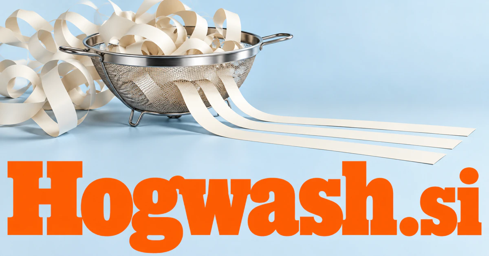

# Hogwash.si — A memorable invitation to ask what a claim rests on

Hogwash.si starts with the informal English word for nonsense, giving a future brand a candid, skeptical voice. An evidence-review workspace is a credible first product: separate a claim into testable parts, compare sources and show what remains unresolved. Consumer research, supplier scrutiny, media literacy and playful educational publishing provide different commercial expressions of that same questioning character.

## Name roots and associations

Hogwash is an informal English word for nonsense, as recorded by [Cambridge Dictionary](https://dictionary.cambridge.org/us/dictionary/english/hogwash). It is candid, colorful, and easy to remember. For a buyer, that creates a brand voice built around curiosity and practical skepticism: show the claim, inspect the basis, and explain the result. The strongest commercial territory is giving people better tools to question, compare, and understand what they are being told. The personality can also work in playful education, media, and creative products.

## Ten directions a buyer could build

### 1. A claim-review newsroom

A claim-investigation workspace could break a public assertion into testable propositions, retrieve primary evidence and compare alternative explanations. Editors would publish an inspectable reasoning trail showing what is established, disputed or still missing rather than an unsupported verdict. Publisher subscriptions could support transparent evidence handling and clear correction records, making a bold editorial voice compatible with careful underlying work.

### 2. Consumer promise explainers

A consumer promise explainer could compare a product's advertising language with its specifications, demonstrations and stated conditions. Shoppers would understand which promises fit their intended use and which depend on assumptions the marketing leaves unexplained. Editorial memberships and disclosed commerce models could support useful buying guides focused on the needs and circumstances of a particular reader.

### 3. AI response checking

A checking agent could trace an answer's factual assertions, test cited passages and generate counterexamples to its reasoning. Developers would receive a repair plan distinguishing unsupported facts, tool failures and conclusions that outrun the available evidence. Team subscriptions could preserve examples and corrections, connecting a concrete issue with the evaluation task and configuration that produced it.

### 4. Marketing evidence libraries

A marketing evidence assistant could map each proposed campaign claim to approved evidence, detect qualifications lost during rewriting and flag statements requiring stronger support. Marketing teams would maintain an evidence-backed message library rather than repeatedly reconstruct the same justification. Business plans could keep review responsibilities and expiry dates visible, making accurate reuse easier across presentations, advertisements, and sales materials.

### 5. Research literacy courses

A critical-thinking tutor could adapt an investigation exercise to a learner's reasoning, introduce an overlooked source and ask which evidence would change their mind. Educators would teach inquiry through decisions and comparisons rather than a checklist of supposedly trustworthy outlets. Course sales and classroom licenses could combine a memorable voice with practical exercises rather than asking learners to accept another authority uncritically.

### 6. A humorous current-claims publication

An editorial investigation tool could assemble the evidence behind a fashionable claim, distinguish contradiction from harmless exaggeration and propose narrative angles for a writer. The publication's humor would emerge from demonstrable gaps between the promise and the record. Memberships and event tickets could support a distinctive editorial personality while separating reporting, analysis, and satire for readers.

### 7. Internal business assumption reviews

An assumption-review assistant could reconstruct the assumptions behind a proposal, search for disconfirming evidence and compare failure scenarios. Leadership teams would see which premise deserves testing before a persuasive slide deck becomes an expensive commitment. Consulting services and software plans could make skeptical review constructive, connecting each concern with a test or a question to investigate.

### 8. Supplier claim comparisons

A supplier comparison tool could compare vendor claims against requested documents, trial results and contractual definitions, highlighting non-equivalent metrics. Procurement teams would ask sharper follow-up questions and distinguish a genuinely comparable offer from a superficially impressive one. Procurement subscriptions could help buyers identify exactly which promise needs further evidence before they make a commercial decision.

### 9. Educational card and party games

An argument-testing game could generate debate cards with hidden assumptions, respond to players' objections and explain several defensible interpretations. Facilitators would turn critical reading into an interactive experience where the quality of reasoning matters more than guessing the host's answer. Physical packs and digital memberships could make evidence literacy entertaining, with clear answers and explanations appropriate to the chosen audience.

### 10. Data cleanup with personality

A data-cleanup assistant could inspect conflicting records, infer likely causes of inconsistency and propose reversible cleanup rules with representative examples. Analysts would examine the reasoning behind a merge or correction instead of receiving a mysteriously cleaned dataset. Developer plans could present an understandable review queue and correction history, giving a technical maintenance task a memorable consumer-friendly face.

## A Super Intelligence product story

Hogwash.si could make Super Intelligence a practical ally against unsupported output. Agents collect the relevant source material, compare it with a statement, and explain where support is strong, incomplete, or absent. Human reviewers decide the final characterization. The value is a readable evidence trail with a confident editorial personality.

## Why this name can carry a business

The word has a distinctive sound and immediate emotional color. It can stand out in a category often expressed through abstract trust terminology. A buyer could build a publication, software product, learning brand, or review service around the same recognizable invitation to ask better questions.

## Related names to compare

- [MyReviews.si](myreviews-si.md) for experience-based reviews and customer feedback.
- [Prefactor.si](prefactor-si.md) for assumptions behind calculations and scenarios.
- [Gimel.si](gimel-si.md) for source-linked arguments and connected research knowledge.

## Explore Hogwash.si

For acquisition enquiries about **Hogwash.si**, contact [hedge.pike02@icloud.com](mailto:hedge.pike02@icloud.com?subject=Domain%20enquiry%3A%20hogwash.si). Direct enquiries can discuss a preferential offer or a portfolio arrangement.

[View the marketplace listing](https://www.dynadot.com/market/user-listings/hogwash.si) · [Marketplace and Escrow.com transaction options](../guides/how-to-buy.md) · [Browse all domains](../README.md)

## Research references

- [Cambridge Dictionary: hogwash](https://dictionary.cambridge.org/us/dictionary/english/hogwash)
- [NIST: AI Risk Management Framework](https://www.nist.gov/itl/ai-risk-management-framework)

[Browse all domains](../README.md)
