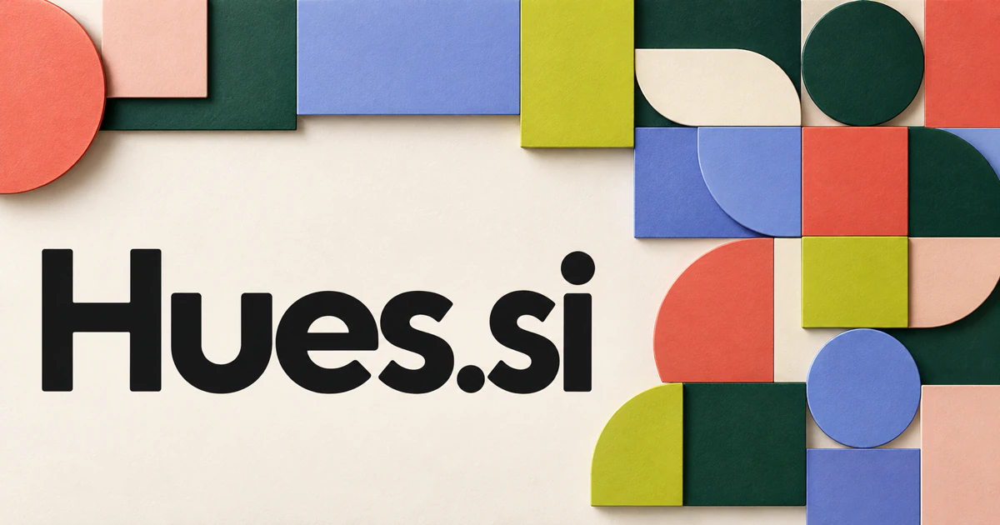

# Hues.si — Make color decisions in the context where they will be seen

Hues.si uses the plural of hue, putting color at the center of the brand. A design workspace could compare palettes against interface states, materials, lighting and the audience's task rather than offer attractive swatches alone. Product teams, interior designers and visual storytellers would benefit in different ways. Beauty discovery, education and curated objects provide further routes beyond professional design software.

## What the name opens up

Hues is the plural of [hue](https://www.merriam-webster.com/dictionary/hue), whose meanings include color, color gradation, and broader character or appearance. Technically, hue is one attribute of color, alongside properties such as lightness and saturation. That distinction can give a product depth: work with lightness, saturation, contrast, material, and context as well as a color wheel. Four letters create a concise master brand. The plural makes sense for palettes, variations, perspectives, and collections, while the familiar word keeps the product's visual territory immediately understandable.

## Business opportunities

### 1. Palette workspace

A palette reasoning assistant could reason across a brand brief, interface states, contrast needs and real application examples to propose coherent palettes. Designers would compare how a color decision behaves throughout a system instead of evaluating attractive swatches in isolation. Team subscriptions or agency editions would turn color selection into a reusable visual system for actual production work.

### 2. Product color planning

A product-range planning tool could connect customer segments, manufacturing constraints, existing inventory and collection identity, testing how new colors affect the assortment. Product teams would see complementary choices and avoid expanding a range without a clear customer story. Organization subscriptions would support the practical bridge between a moodboard and a physical collection.

### 3. Color tools API

A color-system service could expose explainable palette generation, semantic color roles and transformation suggestions through developer tools. Application teams would receive recommendations grounded in their content and constraints rather than a context-free list of hexadecimal values. Usage pricing or commercial licenses would make Hues useful infrastructure beneath a larger design experience.

### 4. Interior visualization

An interior visualization assistant could compare room photographs, selected finishes, lighting observations and a resident's preferences, proposing several coordinated schemes. Designers would show how walls, fabrics and furniture interact under the intended use of the space. Project fees, retail partnerships, or professional subscriptions could bridge digital previews with physical selection.

### 5. Beauty shade discovery

A shade-discovery guide could compare a shopper's preferences, authorized reference images and product characteristics, asking clarifying questions before suggesting shade families. Beauty retailers would explain the uncertainty and trade-offs of a recommendation rather than pretend one photograph establishes a perfect match. Commerce revenue or a professional makeup-artist edition could use Hues for a consumer business where nuanced color choice is central.

### 6. Photography color grading

A grading collaborator could translate a photographer's intended mood into editable grading strategies, compare shots for continuity and explain local adjustments. Creators would retain artistic control while managing consistent visual storytelling across a larger collection. Creator subscriptions, preset sales, or studio licenses would connect the short word with a practical production workflow.

### 7. Material sample libraries

A material-library research tool could connect physical sample attributes, supplier specifications, project photographs and designer notes into a searchable material map. A design team would compare feasible combinations and understand how a visual preference relates to a producible finish. Organization subscriptions or supplier services could make color information more useful in real procurement decisions.

### 8. Educational color play

An exploratory color tutor could adapt experiments in mixing, contrast and visual perception to a learner's observations, generating examples that challenge an initial explanation. Teachers would turn a playful activity into evidence-based exploration of how color relationships work. Course packs and school licenses would support a playful learning product with an immediately fitting identity.

### 9. Data visualization styling

A chart-styling assistant could interpret a chart's analytical task, data structure and audience needs, proposing color encodings with clear explanations. Analysts would compare what each scheme makes easier or harder to understand before publishing the visualization. Team subscriptions or embedded components could connect visual communication with the practical need to make data easier to read.

### 10. Curated art and objects

An art-curation service could connect a customer's spatial context, visual interests and existing collection with original works and objects, explaining each proposed relationship. Curators would build a considered ensemble rather than merely search for items of the same dominant color. Direct sales, artist collaborations, or limited-edition subscriptions would give the name a strong physical-brand opportunity.

## A Super Intelligence product vision

A Hues SI design assistant could take a brand brief and selected references, propose several palette systems, and explain how each choice relates to the intended mood and real interface uses. Designers would review actual foreground/background pairs against the relevant [WCAG contrast requirements](https://www.w3.org/TR/WCAG22/), then export approved values and usage roles. The result would be a working visual system. Agency subscriptions, design-tool integrations, and enterprise libraries could fund a product that connects creative exploration with explicit, reviewable production choices.

## Related names to compare

- [TextArt.si](textart-si.md) for expressive lettering and generated visual compositions.
- [Drap.si](drap-si.md) for textiles, surfaces and fabric-centered design.
- [BlueCap.si](bluecap-si.md) for a visual brand with oversight and protection associations.

## Explore Hues.si

For acquisition enquiries about **Hues.si**, contact [hedge.pike02@icloud.com](mailto:hedge.pike02@icloud.com?subject=Domain%20enquiry%3A%20hues.si). Direct enquiries can discuss a preferential offer or a portfolio arrangement.

[View the marketplace listing](https://www.dynadot.com/market/user-listings/hues.si) · [Marketplace and Escrow.com transaction options](../guides/how-to-buy.md) · [Browse all domains](../README.md)

## Sources and further reading

- [Hue — Merriam-Webster](https://www.merriam-webster.com/dictionary/hue) — Literal color and broader appearance meanings.

- [WCAG 2.2](https://www.w3.org/TR/WCAG22/) — Primary contrast requirements for specific interface combinations.
