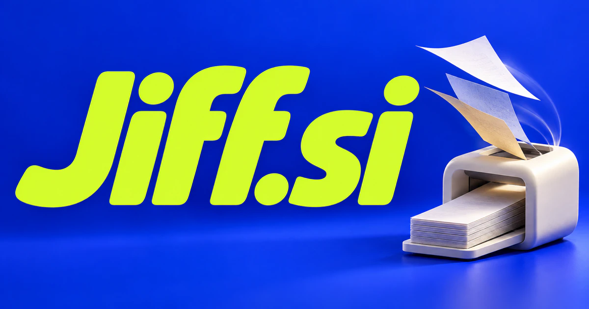

# Jiff.si — Small tasks finished with less friction and clearer intent

Jiff.si draws on the informal word for a very short time, giving it a natural association with speed and ease. A focused task assistant is a credible first product: understand the outcome, choose a short workflow and show the result. File tools, merchant operations and developer utilities suit that promise; quick learning and local services provide broader interpretations.

## Meaning and naming depth

Jiff is a real informal word connected with jiffy, meaning a very short period of time. The familiar expression “in a jiff” supplies an immediate emotional association: this should be simple and soon. It is not necessary to turn the word into an acronym to make it useful.

The most attractive interpretation is quick usefulness in familiar everyday tasks. A customer may want a file converted, a draft cleaned up, a small order prepared, or one idea explained. The name supports tools and services that remove small recurring obstacles, and it leaves room for a larger suite built from those focused moments.

## Business opportunities

### 1. Everyday file utilities

A file-task assistant could infer the intended outcome of a file operation, compare formats and constraints, then propose a reversible sequence with a preview. Users would finish a practical job without navigating a dozen separate utilities or losing the original material. Commercial options include selling a lightweight application, individual subscriptions, and team plans for recurring administrative work.

### 2. A quick-task AI assistant

A quick-action companion could turn a short request into a small plan, resolve missing details and coordinate approved tools. The product's promise would be low-friction completion of meaningful tasks, with visible checkpoints where the request could be misunderstood. Commercial options include selling individual plans and team workspaces, beginning with a carefully chosen set of reliable capabilities.

### 3. Fast creative production

A creative production tool could translate a brief into several coherent creative directions, compare them against audience and format requirements and prepare editable assets. Small businesses would accelerate production without replacing a specific brand message with generic generated decoration. Commercial options include selling task packages, retainers, and priority production plans supported by a human creative team.

### 4. Microlearning and practical explanations

A just-in-time tutor could diagnose the practical obstacle behind a learner's question, supply a compact example and test the next step. The valuable output is enough understanding to continue the current task, with an optional path into the deeper concept. Commercial options include selling educational subscriptions, employer learning programs, and curated subject packs with a friendly, approachable identity.

### 5. Merchant catalog shortcuts

A catalog operations assistant could reconcile supplier records, product images and a merchant's catalog rules, flagging mismatches before preparing updates. Store owners would receive a reviewable batch of consistent listings rather than another manual round of copying and formatting. Commercial options include selling merchant subscriptions, agency workspaces, and managed catalog services for stores without dedicated operations engineers.

### 6. Scheduling and booking tools

A scheduling coordinator could compare calendars, service durations, travel requirements and stated priorities, suggesting workable appointments and alternatives. Service providers would coordinate a complete commitment, including preparation and follow-up, rather than simply find an empty calendar slot. Commercial options include selling business subscriptions, setup services, and focused vertical versions for particular professions.

### 7. A local convenience service

A local-service organizer could interpret a customer's immediate need, compare provider availability and gather the details needed to scope the service. A neighborhood business would offer practical, informed coordination with a clear handoff to the person doing the work. Memberships, service fees, and partnerships with local businesses would support a non-software commercial direction.

### 8. Developer productivity utilities

A developer workflow assistant could connect a reproducible error, repository documentation and local task context, propose focused checks and explain the likely cause. Developers would save repeated context gathering while retaining control over code changes and test interpretation. Commercial options include selling desktop licenses, team workspaces, and a premium library of maintained utilities.

### 9. Lightweight notes and capture

A capture notebook could connect a captured fragment with related notes, infer useful questions and suggest a small next action. Users would recover why something mattered when it was saved rather than accumulate an ever-larger inbox of disconnected snippets. Commercial options include selling individual subscriptions, shared collections, and optional desktop or mobile applications under the same short name.

### 10. A practical consumer product range

A consumer product studio could compare customer feedback, use scenarios and product constraints to develop a coherent range of simple consumer tools. A compact brand could grow around repeated practical wins instead of adding features without a clear household purpose. Commerce, subscriptions, and instructional content could reinforce a recognizable Jiff identity.

## A Super Intelligence brand

Jiff.si can make Super Intelligence feel useful in small moments. A possible product could understand a brief request, choose a suitable tool, and return a clear result without a long configuration process. The company could begin with focused utilities and gradually connect them into a broader assistant, keeping the experience light even as the underlying capability grows.

## Why the name works

A real one-syllable word and four-letter spelling provide a compact logo, app icon, and spoken name. Its informal tone suits consumer software and friendly business tools. **“Small tasks. Simply done.”** expresses the practical promise, while Jiff Tools, Jiff Notes, and Jiff Studio can organize different offerings.

## Related names to compare

- [Neep.si](neep-si.md) for an approachable character and lightweight personal tools.
- [OneNode.si](onenode-si.md) for connected infrastructure and a persistent knowledge hub.
- [ServiceCall.si](servicecall-si.md) for coordination between a service request and completed work.

## Explore Jiff.si

For acquisition enquiries about **Jiff.si**, contact [hedge.pike02@icloud.com](mailto:hedge.pike02@icloud.com?subject=Domain%20enquiry%3A%20jiff.si). Direct enquiries can discuss a preferential offer or a portfolio arrangement.

[View the marketplace listing](https://www.dynadot.com/market/user-listings/jiff.si) · [Marketplace and Escrow.com transaction options](../guides/how-to-buy.md) · [Browse all domains](../README.md)

## Sources and further reading

- [Merriam-Webster: jiff](https://www.merriam-webster.com/dictionary/jiff) — The established informal word and its connection to jiffy.
- [Merriam-Webster: jiffy](https://www.merriam-webster.com/dictionary/jiffy) — The meaning of a very short period of time behind the naming story.
