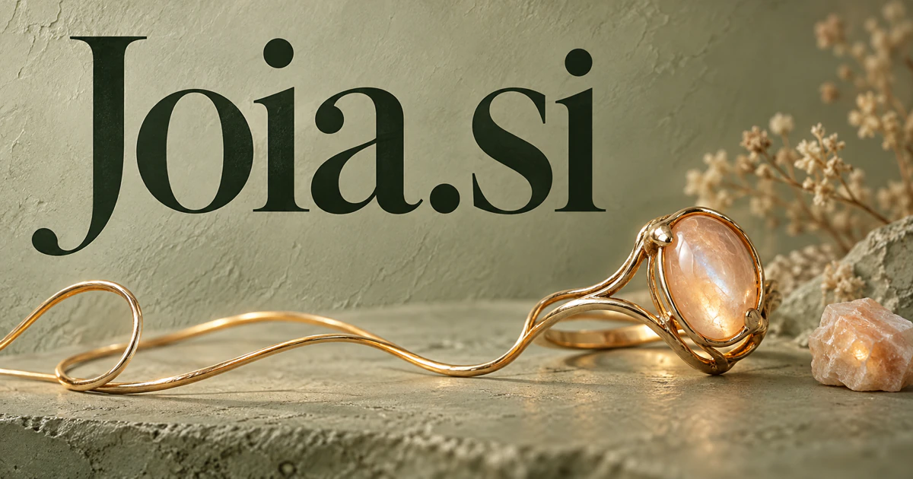

# Joia.si — A jewel-like name for meaningful objects and personal choices

Joia.si draws on the Portuguese word for a jewel, with positive figurative associations of value and delight. Jewelry discovery or custom-design consultations provide a clear commercial starting point. A service could connect personal meaning with a maker's practical choices, while collection care, styling and celebration experiences offer related directions. The wider business ideas are interpretations of the name, not additional literal translations.

## What the name opens up

[Joia](https://www.infopedia.pt/dicionarios/lingua-portuguesa/joia) is a Portuguese word for a jewel or precious ornament. The dictionary also records figurative value and a Brazilian colloquial adjective for something excellent or pleasing. That gives the name a meaningful bridge between jewelry, carefully selected objects, and delightful experiences. The four-letter form is compact and vowel-rich. A buyer could emphasize tangible craftsmanship, personal significance, or curation. The broader possibilities grow from value and pleasure, while the literal jewel meaning provides an especially strong foundation for a jewelry or gift business.

## Business opportunities

### 1. Jewelry discovery

A jewelry discovery guide could compare a shopper's style references, intended occasion, material preferences and practical constraints, explaining several different directions. Retailers would help customers articulate what matters to them rather than reduce a meaningful purchase to a similarity score. Retail subscriptions or a curated shop would make the literal jewel meaning commercially direct and easy to understand.

### 2. Custom design consultations

A custom-design collaborator could translate a client's story into design briefs, compare shapes and materials with a maker's capabilities and organize revisions. Jewelers would receive a clearer conversation about meaning and feasibility before moving into detailed design. Maker subscriptions or commissioned design fees would connect intelligent preparation with the craftsperson who produces the finished piece.

### 3. Collection care records

A collection-care assistant could connect purchase records, material information, previous repairs and the owner's wearing habits, proposing care questions and service reminders. Collectors would maintain a useful history for each object instead of a folder of unrelated receipts. Consumer subscriptions or professional editions would support care and continuity around pieces someone values.

### 4. Independent maker collections

A maker-matching service could connect a buyer's desired style and commissioning needs with makers' portfolios, available techniques and lead times. A curated marketplace would explain the fit between a creative practice and a specific customer's brief. Retail margins or marketplace commissions would use the figurative treasure reading beyond jewelry alone.

### 5. Meaningful gift consultations

A gift consultation service could reason about the relationship, shared memories, occasion and recipient preferences, comparing a new piece, a commission or a restored heirloom. Gift consultations would connect emotional intent with a feasible, personal outcome. Planning fees, retailer subscriptions, or a directly operated gifting service would fit the warm, value-centered name.

### 6. Jewelry repair coordination

A repair coordination tool could organize photographs, service history and a customer's description into a structured repair inquiry, identifying questions for a craftsperson. Shops would compare proposed work and maintain the owner's understanding of options, timing and expected changes. Per-workshop subscriptions or a repair service would create a practical business around caring for treasured objects.

### 7. Personal collection journals

A personal collection journal could connect an object's provenance, family stories, photographs and occasions on which it was worn. Owners would explore a collection as a meaningful personal archive and prepare source-linked notes for future family custodians. Consumer subscriptions or professional collector editions could turn the notion of a treasure into lasting useful documentation.

### 8. Accessory styling tools

A styling assistant could compare an outfit, occasion, comfort needs and existing accessories, explaining several coherent combinations. Stylists would support thoughtful reuse and personal expression rather than continually recommend an additional purchase. Consumer subscriptions, retailer tools, or styling services would connect the name to practical visual decisions.

### 9. Celebration experiences

A celebration planner could coordinate a couple's or host's visual ideas, guest experience, meaningful objects and supplier dependencies into an event concept. Planners would compare alternatives as complete experiences rather than assemble decorations one item at a time. Event fees, venue packages, or planning software would extend Joia toward enjoyment while preserving a considered identity.

### 10. Craft education studios

A craft-learning companion could connect a learner's sketch, chosen technique and workshop instructions, propose exercises and identify where expert demonstration is needed. Studios would offer a guided progression from understanding a material to making an original piece. Course sales, tool kits, and studio memberships would let the compact brand support both creation and appreciation.

## A Super Intelligence product vision

A Joia SI design companion could begin with a customer's references, meaningful details, material preferences, and budget. It would organize several proposed directions, explain the differences, and prepare a structured brief for a maker. The craftsperson would refine the design and confirm what can be produced. A retail edition might instead guide discovery within an actual collection. Commission fees, maker subscriptions, or a curated shop could fund an initial business. The intelligent opportunity is personal meaning translated into practical selection and design, with the finished object remaining the focus.

## Related names to compare

- [GiftGuide.si](giftguide-si.md) for selection across many gift types and occasions.
- [GiftWrap.si](giftwrap-si.md) for presentation, packaging and the experience of giving.
- [Hues.si](hues-si.md) for color relationships and coordinated visual choices.

## Explore Joia.si

For acquisition enquiries about **Joia.si**, contact [hedge.pike02@icloud.com](mailto:hedge.pike02@icloud.com?subject=Domain%20enquiry%3A%20joia.si). Direct enquiries can discuss a preferential offer or a portfolio arrangement.

[View the marketplace listing](https://www.dynadot.com/market/user-listings/joia.si) · [Marketplace and Escrow.com transaction options](../guides/how-to-buy.md) · [Browse all domains](../README.md)

## Sources and further reading

- [Joia — Infopédia](https://www.infopedia.pt/dicionarios/lingua-portuguesa/joia) — Literal jewel, figurative value, and colloquial positive adjective meanings.
