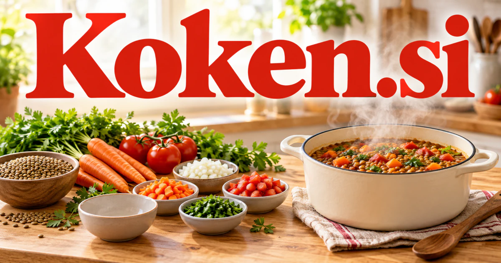

# Koken.si — Turn available ingredients into something worth making

Koken.si has a genuine culinary foundation in the Dutch verb covering cooking and boiling. A pantry-to-meal assistant could turn available ingredients, preferences and time into a workable plan. Professional kitchens, recipe publishers and cooking educators have related but distinct needs. The process of combining and refining inputs also supplies a creative metaphor for an idea-development studio.

## Name roots and associations

Koken is a Dutch verb covering cooking and boiling, documented in Dutch-language reference material including [Woorden.org](https://www.woorden.org/woord/koken). That gives the five-letter name a real culinary foundation. Cooking also offers a productive brand metaphor: combining inputs, applying a process, responding to feedback, and producing a result people can enjoy. Koken can therefore carry a food business, a household assistant, a professional kitchen platform, or a creative workspace that turns raw ideas into finished work.

## Ten directions a buyer could build

### 1. A pantry-to-meal assistant

A pantry-to-meal assistant could reconcile available ingredients, dietary preferences, cooking time and a household's equipment, proposing meals with workable substitutions. Families would see a complete preparation plan and shopping gaps rather than a recipe that assumes an entirely different kitchen. Consumer subscriptions could produce editable plans and shopping lists, with users checking ingredient details and deciding which suggestions suit them.

### 2. Recipe creator publishing

A recipe publishing tool could compare a creator's draft instructions, ingredient quantities and expected serving context, identifying missing steps and adaptation opportunities. Publishers would produce clearer recipes and related explanations while preserving the cook's original voice and technique. Creator plans could include structured ingredient lists, reader questions, recipe updates, and a convenient path from a free sample to a complete course.

### 3. Small kitchen operations

A kitchen operations planner could coordinate menu choices, preparation dependencies, stock observations and service timing, comparing alternative prep plans. Small kitchen teams would identify the bottleneck behind a difficult shift and adjust work before orders create avoidable pressure. Per-kitchen subscriptions could connect a recipe change with its operational consequences instead of maintaining several disconnected spreadsheets.

### 4. Cooking education for beginners

A culinary tutor could diagnose a beginner's difficulty from their description, connect it to the cooking principle and propose a focused exercise. Teachers would help learners understand why a method works and when it can be adapted. Course sales and classroom licenses could support progress through practical projects, with photographs and instructor feedback on the learner’s own attempts.

### 5. Food photography and recipe assets

A food-content production assistant could connect a recipe's story, target audience and visual brief, planning photographs, demonstrations and explanatory assets together. Creators would produce a coherent learning experience instead of treating the image, written instructions and video as unrelated jobs. Team subscriptions and asset collections could serve food studios, publishers, restaurant groups, and independent creators.

### 6. Meal kits and produce boxes

A meal-kit planning service could compare household portions, ingredient overlap, delivery schedules and preparation complexity to design flexible kit combinations. Operators would coordinate customer choice with packing and sourcing requirements while explaining practical substitutions before dispatch. Retail margins and supplier software plans could make the box easier to use and give customers a reason to return.

### 7. Shared household cooking

A household meal coordinator could reconcile family preferences, leftovers, cooking skills and available evenings, proposing a shared meal plan and division of tasks. The result would make home cooking easier to coordinate rather than place every planning decision on one person. A family subscription could help people decide who cooks what, adapt quantities to attendance, and keep useful meal notes for the following week.

### 8. Culinary travel and workshops

A culinary travel guide could connect a traveler's food interests with producer visits, classes and regional context, comparing practical routes and learning goals. Workshop operators would offer a coherent experience whose story extends beyond restaurant recommendations. Commercial options include selling local market visits, cooking classes, ingredient tours, and private kitchen experiences through clear availability and preparation information. Booking fees or operator subscriptions could connect an enjoyable occasion with a complete learning and travel itinerary.

### 9. Food product development notebooks

A food-development notebook could organize prototype recipes, tasting notes, ingredient changes and process observations, generating hypotheses for the next trial. Product teams would compare why a formulation changed instead of losing experimental knowledge in scattered spreadsheets. Team subscriptions could preserve experimental records and connect approved formulations with manufacturing instructions for qualified professional review.

### 10. An idea kitchen for creators

Using cooking as a creative metaphor, an idea-development workspace could combine a founder's ingredients of customer evidence, technical capabilities and constraints into testable concepts. Teams would compare prototypes and learn which combination deserves further development. Subscription software could organize ingredients, drafts, editorial review, and final exports while keeping the creator in charge of the result.

## A Super Intelligence product story

Koken.si could frame Super Intelligence as practical kitchen coordination. A user shares a pantry photograph and a dinner goal; agents prepare ingredient questions, an editable recipe, a shopping list, and a timed preparation plan. In a professional setting, the same system could connect approved recipes with purchasing and preparation records.

## Why this name can carry a business

The repeated consonant and two clear syllables create a compact identity with an authentic language anchor. Koken can be warm and domestic or precise and professional. Its process-oriented metaphor supports a family of products around planning, learning, making, and sharing rather than only a recipe archive.

## Related names to compare

- [Neep.si](neep-si.md) for produce, home gardening and a friendly consumer identity.
- [GiftGuide.si](giftguide-si.md) for culinary gifts, experiences and recipient preferences.
- [HomeGuide.si](homeguide-si.md) for the wider household routines around a kitchen.

## Explore Koken.si

For acquisition enquiries about **Koken.si**, contact [hedge.pike02@icloud.com](mailto:hedge.pike02@icloud.com?subject=Domain%20enquiry%3A%20koken.si). Direct enquiries can discuss a preferential offer or a portfolio arrangement.

[View the marketplace listing](https://www.dynadot.com/market/user-listings/koken.si) · [Marketplace and Escrow.com transaction options](../guides/how-to-buy.md) · [Browse all domains](../README.md)

## Research references

- [Woorden.org: koken](https://www.woorden.org/woord/koken)
- [Voedingscentrum: basic cooking skills](https://www.voedingscentrum.nl/professionals/gezond-op-school/koken-op-school/de-basis-van-het-koken-in-de-klas.aspx)

[Browse all domains](../README.md)
