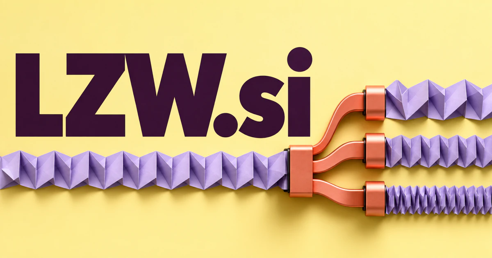

# LZW.si — Understand the trade-off behind a smaller representation

LZW.si takes its technical identity from Lempel–Ziv–Welch compression. A file and compression workbench could compare actual workloads, explain compatibility and help developers choose a practical representation. Storage planning, preservation and algorithm teaching provide other credible businesses around the same foundation. A broader performance studio could use the name's efficiency association while making its wider services clear.

## Meaning and naming depth

LZW is the established abbreviation for **Lempel–Ziv–Welch**, a dictionary-based compression algorithm. Rather than repeatedly writing whole strings, the method builds a dictionary and uses codes representing strings encountered in the input. That provides a real foundation for teaching, file engineering, and format tools.

The naming possibilities extend beyond implementing one algorithm. Compression raises questions about representation, redundancy, bandwidth, storage, and efficient computation. A new owner could use LZW as the umbrella identity for a suite that compares many methods. Alternative expansions such as **Lean Zero-Waste** or **Learning Zone Workshop** would be creative brand readings, distinct from the established algorithm name.

## Business opportunities

### 1. A compression comparison workbench

A compression comparison tool could compare representative files, output requirements, decompression environments and measured results, proposing suitable trade-offs. Engineers would choose a compression approach from evidence about their actual workload rather than assume one algorithm wins every comparison. Commercial options include selling desktop licenses, team experiment workspaces, and specialist benchmarking services rather than claiming one method always wins.

### 2. Image and archive format diagnostics

A file diagnostic assistant could connect file metadata, parser errors and format documentation, plan reversible checks and explain likely causes of incompatibility. Archivists and developers would receive an understandable path toward recovering access or identifying the tool that should handle the file. Revenue could come from batch-processing software, file analysis services, and maintained integrations with document systems.

### 3. Interactive algorithm education

An algorithm tutor could step through dictionary construction and encoded sequences with examples tailored to a learner's prediction. Educators would reveal why repeated patterns change the representation and help students locate the precise point where their mental model diverges. Commercial options include selling curriculum licenses, instructor dashboards, and programming workshops to universities, schools, and technical training providers.

### 4. Bandwidth-aware device software

A device communication planner could compare device constraints, transmission schedules and data importance, testing which information should be compressed, delayed or summarized. Embedded teams would reason about a complete communication strategy rather than tune a codec without its operating context. Commercial options include selling SDKs, optimization consulting, and fleet-facing reporting for industrial or remote-device applications.

### 5. Data retention and storage planning

A storage lifecycle assistant could map data types, access patterns, retention requirements and storage options, proposing reviewable lifecycle policies. Organizations would understand the practical consequence of compression, tiering or deletion before applying a cost-reduction plan. Subscription reporting and paid assessments could serve research institutes, media archives, and software companies.

### 6. Developer file utilities

A developer file utility could infer the intended transformation, identify format constraints and sequence validation steps around an operation. Developers would receive reusable, explainable workflows for inspecting and converting files rather than collect unrelated command snippets. A lightweight paid application could become the first product under a larger data engineering identity.

### 7. Digital preservation services

A digital preservation service could connect an archive's original formats, provenance records and available readers, proposing migration tests and preservation priorities. Institutions would maintain evidence of what a conversion changes and where original material must remain available. Commercial options include selling project-based services alongside a maintained catalog and monitoring workspace.

### 8. AI data preparation and deduplication

A dataset redundancy reviewer could distinguish duplicate content, meaningful variations and corrupted examples by combining similarity evidence with the intended training task. Data teams would inspect proposed exclusions and understand how a cleanup rule could affect coverage. Commercial options include selling data workspaces and engineering services, with compression as one component of a broader preparation toolkit.

### 9. A performance engineering studio

A performance investigation team could connect profiling results, storage behavior and application requirements, generate competing bottleneck hypotheses and plan focused benchmarks. Engineering consultancies would deliver evidence about which change improves the user's actual workload rather than another synthetic headline result. The short technical name suits a consultancy that later productizes reusable tools from recurring client problems.

### 10. A modular learning and maker brand

A maker-learning companion could guide learners from a compression experiment into files, images and small device projects, adapting to their interests. A modular education brand would connect practical builds with an understanding of representation, efficiency and technical trade-offs. Under the proposed Learning Zone Workshop interpretation, sell hands-on courses, visual computing lessons, and project kits.

## A Super Intelligence brand

LZW.si can frame Super Intelligence through efficient representation: useful systems must organize, retain, and retrieve growing quantities of information. A future-facing product could connect compression benchmarks, dataset understanding, and storage planning, allowing an agent to recommend a configuration based on measured constraints. The story is making information usable at scale, not treating a compression ratio as a measure of intelligence.

## Why the name works

Three letters are highly compact, and the established computing reference gives technical audiences a recognizable starting point. LZW Lab, LZW Tools, and LZW Learn sound like related products rather than unrelated businesses. **“More information. Less friction.”** gives the engineering concept a broader commercial expression.

## Related names to compare

- [NCQ.si](ncq-si.md) for storage workloads, queues and infrastructure diagnosis.
- [OneNode.si](onenode-si.md) for the compute environment where resources are managed.
- [DataFeeds.si](datafeeds-si.md) for streaming inputs and data-delivery requirements.

## Explore LZW.si

For acquisition enquiries about **LZW.si**, contact [hedge.pike02@icloud.com](mailto:hedge.pike02@icloud.com?subject=Domain%20enquiry%3A%20lzw.si). Direct enquiries can discuss a preferential offer or a portfolio arrangement.

[View the marketplace listing](https://www.dynadot.com/market/user-listings/lzw.si) · [Marketplace and Escrow.com transaction options](../guides/how-to-buy.md) · [Browse all domains](../README.md)

## Sources and further reading

- [NIST: Lempel–Ziv–Welch](https://xlinux.nist.gov/dads/HTML/lempelZivWelch.html) — Algorithm definition and references to its original technical literature.
- [Library of Congress: Sustainability of Digital Formats](https://www.loc.gov/preservation/digital/formats/) — A primary preservation resource for understanding digital format considerations.
