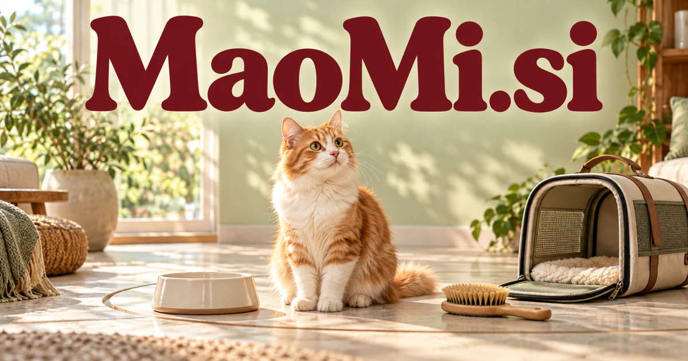

# MaoMi.si — A curious, companionable identity with cats at its heart

MaoMi.si is the unmarked pinyin of a familiar Mandarin expression for a cat. A cat-care organizer could be its most direct product, connecting routines, sitter instructions and useful observations. The character also supports playful education, creator tools or a personal assistant. Those wider opportunities draw on a chosen brand personality; they are not extra dictionary meanings or claims about a deployed product.

## Name roots and associations

Maomi is the unmarked pinyin of [猫咪 / 貓咪](https://zdic.net/hans/%E8%B2%93%E5%92%AA), a familiar Mandarin expression for a cat. It gives the five-letter spelling a warm, concrete character without needing an invented acronym. The association can support a pet-care brand, an expressive mascot, a creator community, or a small consumer device. A cat also supplies useful product personality: curious, observant, independent, and comfortable at home. Those are creative brand associations, not assertions that a software assistant possesses animal understanding.

## Ten directions a buyer could build

### 1. A cat-care organizer

A cat-care organizer could connect an owner's observations, established care instructions, appointment records and household schedule, organizing useful reminders and questions. Families would maintain consistent routines and prepare clearer information for veterinary professionals when something changes. A subscription could turn scattered messages into an organized handover that all approved carers can understand and update.

### 2. Pet-sitter coordination

A sitter coordination assistant could translate an owner's routines, home instructions and emergency contacts into a sitter-specific handover, then organize visit updates. Owners and sitters would share a consistent understanding of the individual cat rather than rely on scattered messages. Per-business software plans could connect service bookings with the specific routines of each cat rather than generic visit notes.

### 3. Adoption preparation

An adoption preparation guide could compare a prospective household's routines, space and questions with a shelter's documented information about a cat, identifying preparation needs. Adoption teams would support informed conversations and a practical transition plan rather than promise a perfect automated match. Organization subscriptions could keep volunteers coordinated and help prospective adopters understand practical responsibilities before making a commitment.

### 4. A specialist cat retail brand

A cat-product discovery service could connect a cat's habits, the home environment and an owner's practical preferences with product attributes, explaining alternatives. Retailers would help customers choose purposeful combinations instead of market every popular accessory to every household. Commercial options include selling enrichment toys, furniture, feeding accessories, and travel products through guidance about dimensions, materials, and household needs. Retail revenue and replenishment services could support coherent collections instead of an undifferentiated catalog of unrelated pet supplies.

### 5. Home observation summaries

A home observation journal could organize authorized camera observations and owner notes into changes worth checking, with examples and uncertainty visible. The product would help an owner notice patterns and prepare better questions, while leaving diagnosis to veterinary professionals. Device subscriptions could help people find relevant moments without presenting automated behavior labels as veterinary conclusions or replacing a qualified assessment of a concern.

### 6. A cat-themed learning companion

A playful learning companion could use an expressive cat character to adapt stories, language practice and problem-solving exercises to a child's responses. Educators would connect affection for the character with a clear learning objective and adult-controlled interaction settings. Family subscriptions and classroom licenses could support short, achievable activities, parent controls, and printable materials connecting the digital character with offline play.

### 7. Creator tools for pet content

A pet-creator production tool could connect a creator's authorized footage, recurring character traits and publishing goals into coherent storyboards, captions and series ideas. Creators would build an identifiable voice and preserve the animal's ordinary behavior rather than manufacture misleading narratives. Creator subscriptions or print fulfillment could make a recognizable publishing brand around everyday cat experiences.

### 8. Foster network operations

A foster-network coordinator could reconcile placement needs, supplies, volunteer availability and documented care requirements, preparing handovers and follow-up questions. Coordinators would see unresolved practical needs before moving an animal between homes. Organization plans could maintain a clear history of handovers and keep permissions appropriate for volunteers involved in each placement.

### 9. Pet-friendly home design

A pet-aware design assistant could compare room layouts, household routines and a cat's observed preferences, proposing alternative arrangements for play, rest and resources. Designers would explain how each change fits both the animal and the people sharing the space. Paid consultations, product collections, and designer software could connect an attractive room with the practical requirements of its animal residents.

### 10. An expressive personal assistant

A character-led personal assistant could give a cat-inspired assistant a consistent interaction style while connecting notes, reminders and ongoing user goals. A character-centered product would make practical assistance approachable, with user-directed memory and clear control over connected actions. Consumer subscriptions could build a distinctive relationship through consistent personality and useful actions, with optional themes, accessories, and physical companion devices.

## A Super Intelligence product story

MaoMi.si could position Super Intelligence as attentive assistance for people sharing a home with animals. An owner-approved agent gathers routine records, prepares a sitter briefing, reminds a person about an agreed task, and organizes questions before a veterinary appointment. The strongest story is helpful coordination expressed through a friendly character.

## Why this name can carry a business

Five letters, alternating consonants and vowels, and an immediately drawable animal identity make Maomi suitable for icons, packaging, animation, and spoken interaction. Its literal pet foundation is strong, while the mascot can extend into education, consumer software, home products, and a recognizable creative universe.

## Related names to compare

- [PawCare.si](pawcare-si.md) for a broader service identity for multiple companion animals.
- [Neep.si](neep-si.md) for friendly household tools and educational characters.
- [Picaro.si](picaro-si.md) for inventive characters and curiosity-led interactive experiences.

## Explore MaoMi.si

For acquisition enquiries about **MaoMi.si**, contact [hedge.pike02@icloud.com](mailto:hedge.pike02@icloud.com?subject=Domain%20enquiry%3A%20maomi.si). Direct enquiries can discuss a preferential offer or a portfolio arrangement.

[View the marketplace listing](https://www.dynadot.com/market/user-listings/maomi.si) · [Marketplace and Escrow.com transaction options](../guides/how-to-buy.md) · [Browse all domains](../README.md)

## Research references

- [Han Dian dictionary: 貓咪](https://zdic.net/hans/%E8%B2%93%E5%92%AA)

[Browse all domains](../README.md)
